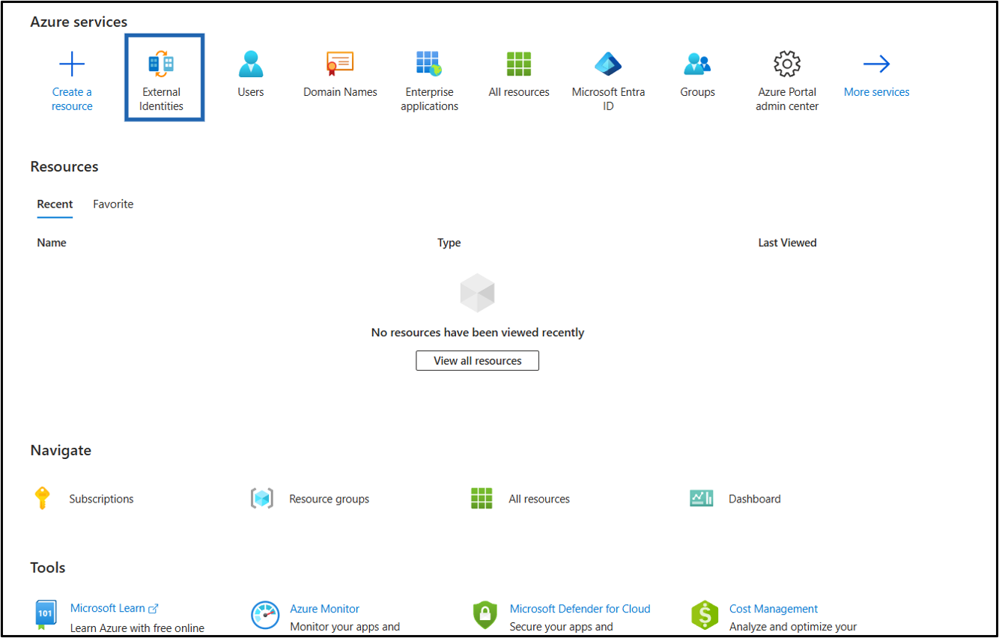
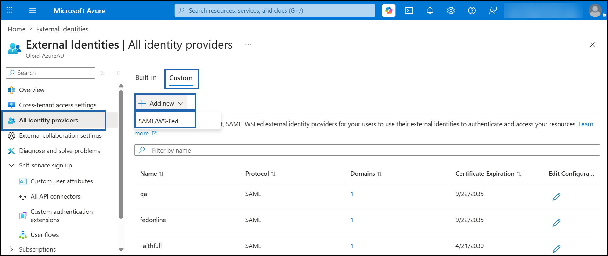
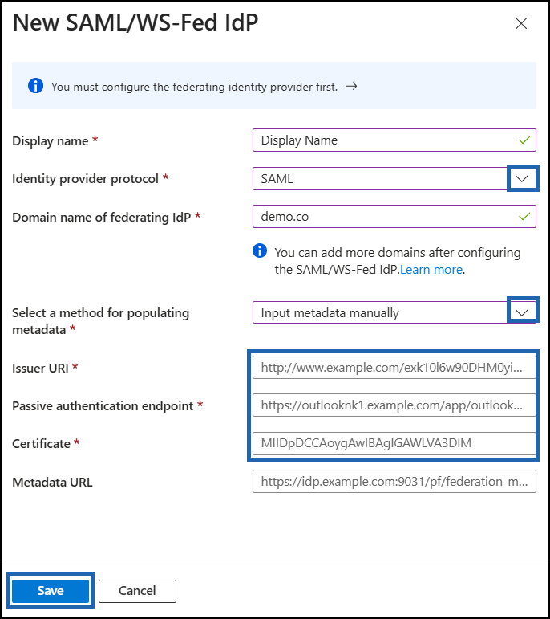
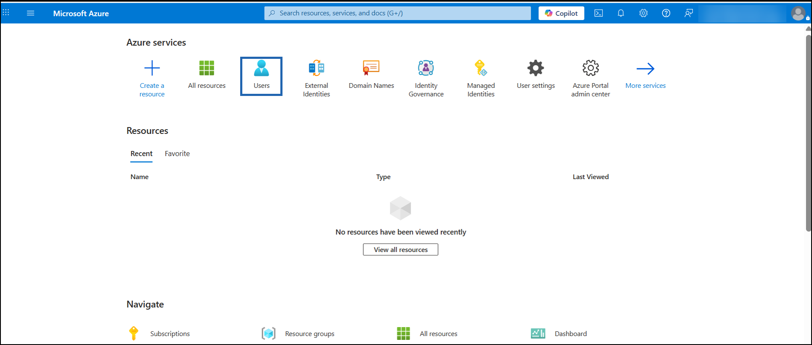
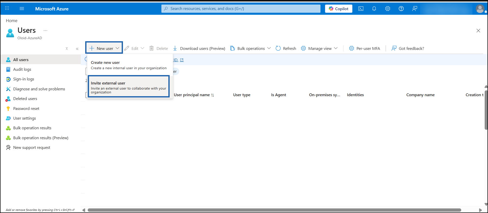
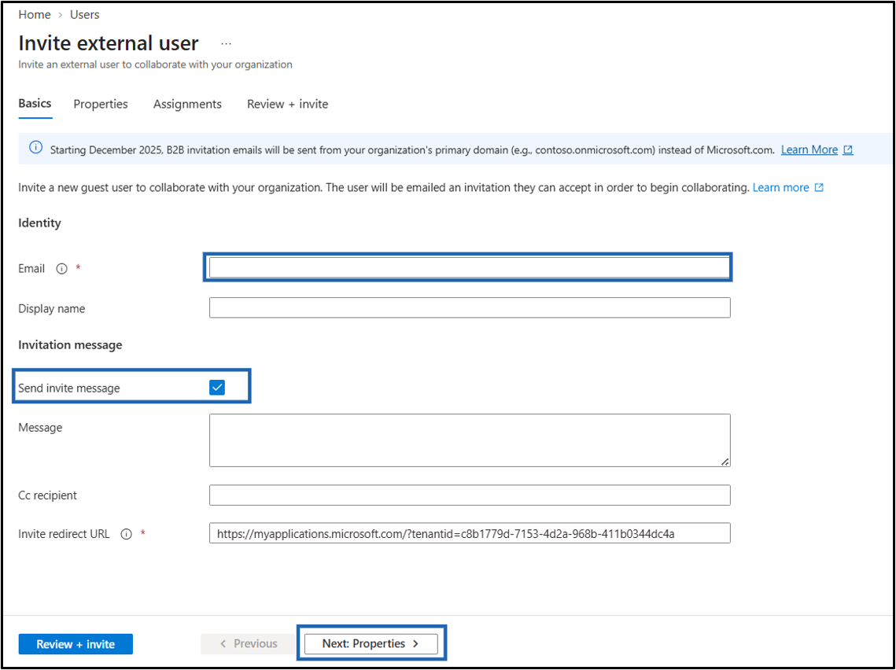
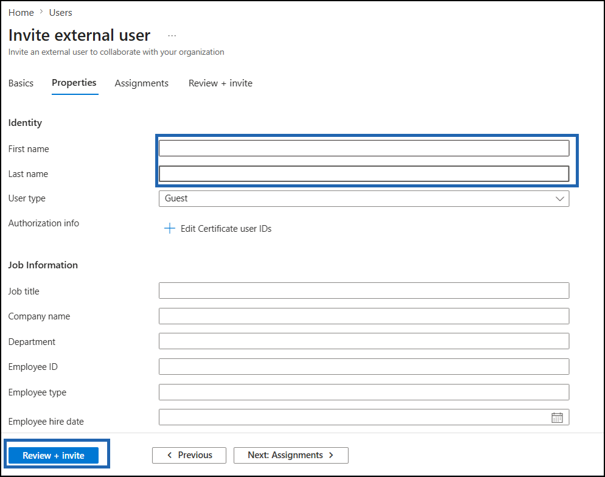

{/* Source: Intercom article 15051772 -  */}
{/* Generated by intercom_to_mintlify.py - re-running overwrites this file. */}

## Introduction

This document provides step-by-step instructions to configure Oloid as an External Identity Provider (IdP) in Microsoft Azure using the SAML/WS-Fed protocol. It also explains how to invite external users in Azure AD to enable authentication through Oloid.

## Prerequisites

- You must have administrator access to the Microsoft Azure portal.
- Ensure that the SAML Identity Provider details are configured in the Tenant Admin Portal.

## Steps to Configure Oloid as an External Identity Provider

[Create SAML Identity Provider](#create-saml-identity-provider)

[Invite External Users in Azure AD](#invite-external-users-in-azure-ad)

### Create SAML Identity Provider

1. Log in to the Microsoft Azure.
   The Azure homepage is displayed.
2. Click **External Identities**.

   

   The External Identities screen is displayed.
3. Go to **All identity providers > Custom > Add new > SAML/WS Fed**.

   

   The **New SAML/WS-Fed IdP** page is displayed.
4. Do the following:
   1. Enter **Display** name.
   2. Select **SAML** as Identity provider Protocol.
   3. In the **Domain name of federating IdP** field, enter the domain name.
   4. Select a method for populating metadata.

      <Note>
        **Note:** You can select either Parse metadata file or Input metadata manually.
      </Note>

   5. Enter the **Issuer URI** value.

      <Note>
        **Note:** The **Entity ID** value is the **Issuer URI**.
      </Note>

   6. Enter the **Passive Authentication Endpoint URL**.

      <Note>
        **Note:** The **Sign-on URL** value is the **Passive Authentication Endpoint URL**.
      </Note>

   7. Enter the **Certificate** value.
      Note:
      1. Click **Download Certificate** and paste it in the Certificate field.
      2. You can find the **Issuer URI**, **Passive Authentication Endpoint URL**, and **Certificate** from your Oloid Portal. To find, navigate to **Identity Provider > SAML > Oloid Metadata**.
   8. (Optional) Enter the **Metadata URL**.
   9. Click **Save**.

      

      The New SAML/WS-Fed IdP is created successfully.

### Invite External Users in Azure AD

1. Go back to the Home page of the Azure AD and select **Users**.

   

   The user screen is displayed.
2. Navigate to **New user > Invite External User**.

   

   The **Invite External User** page is displayed.
3. Do the following:
   1. On Basic tab
      1. Enter Email ID.
      2. Enter Display Name (Optional)
      3. Ensure Send invite message checkbox is selected.
      4. Click **Next: Properties**.

         

         The Properties tab is displayed.
   2. Do the following.
      1. Enter **First name**.
      2. Enter **Last Name**.
      3. Click **Review+invite**.

         

         The user is added successfully.
