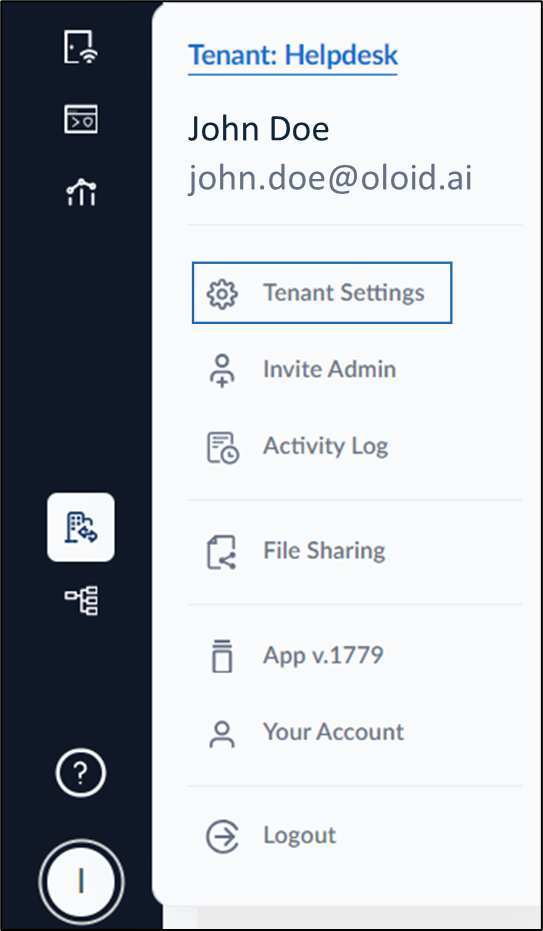
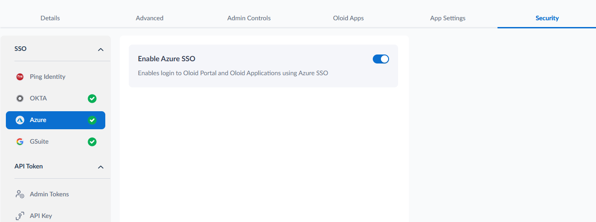

{/* Source: Intercom article 10356885 -  */}
{/* Generated by intercom_to_mintlify.py - re-running overwrites this file. */}

To enable Azure SSO:

1. Log in to the **Oloid Portal**.
2. On the homepage of the portal, click **user profile icon** on the bottom left corner of the menu panel.

   

   The user profile menu is displayed.
3. Click **Tenant Settings**.

   

   The **Tenant Settings** page is displayed.
4. Go to **Security** tab > **Okta**.
5. Turn on **Enable Azure SSO** button.

   

6. Click **Save**.
   The Azure SSO is configured.
