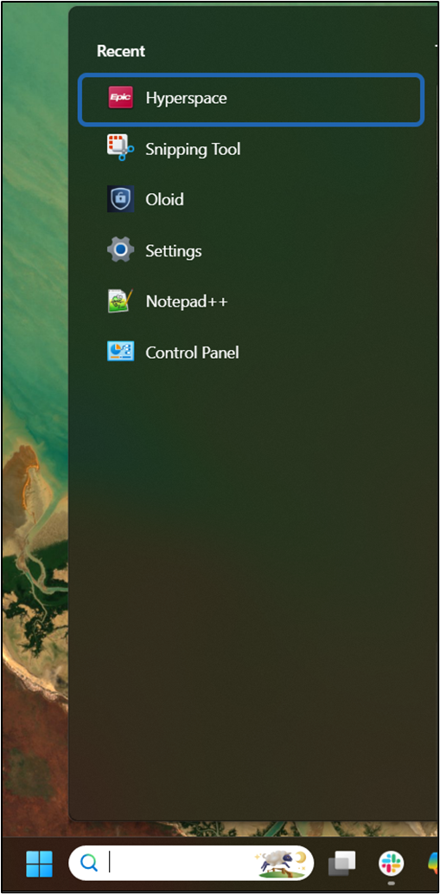
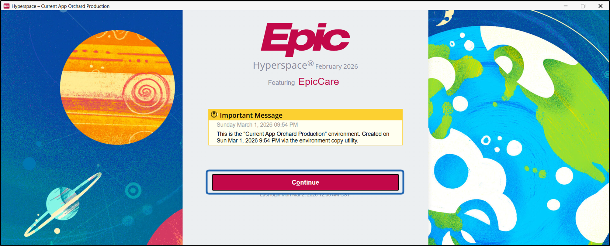

{/* Source: Intercom article 14778830 -  */}
{/* Generated by intercom_to_mintlify.py - re-running overwrites this file. */}

## Introduction

Logging into **Epic Hyperspace using SAML**

## Prerequisites

- You must have a badge assigned.
- You must have Vault Shared password assigned.
- Ensure that SAML IDP is configured.

## Steps to Log in to Epic Hyperspace

1. Launch the Epic Hyperspace application on your Windows machine.

   

   The Windows login app opens and the Welcome page is displayed.
2. Enter **Email ID / Employee ID.**
3. Click **Continue**.
4. The camera turns on. Place your face in front of the camera for facial authentication.
   The camera auto-captures the user's face.
   If manual capture is enabled, press **Enter or Spacebar,** or click on the camera icon.
   The **Login confirmation** screen is displayed.
5. Click **Continue.**

   

   You are successfully logged into Epic Hyperspace.
