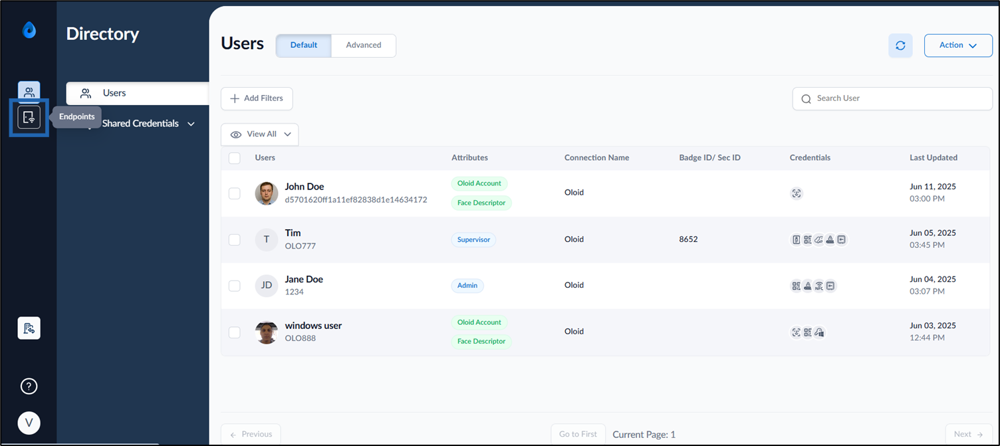
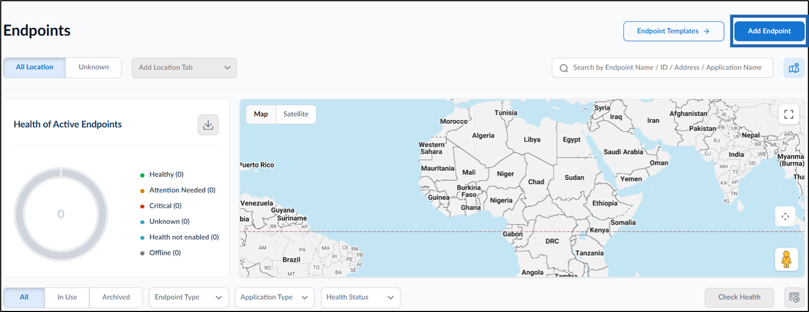
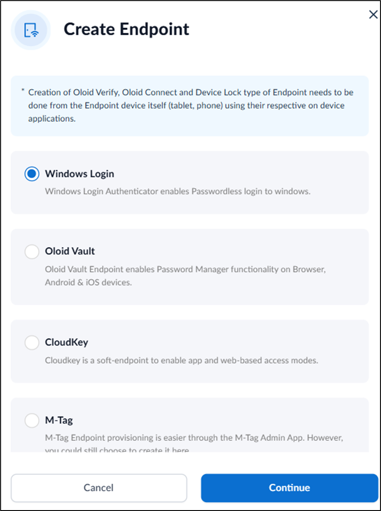
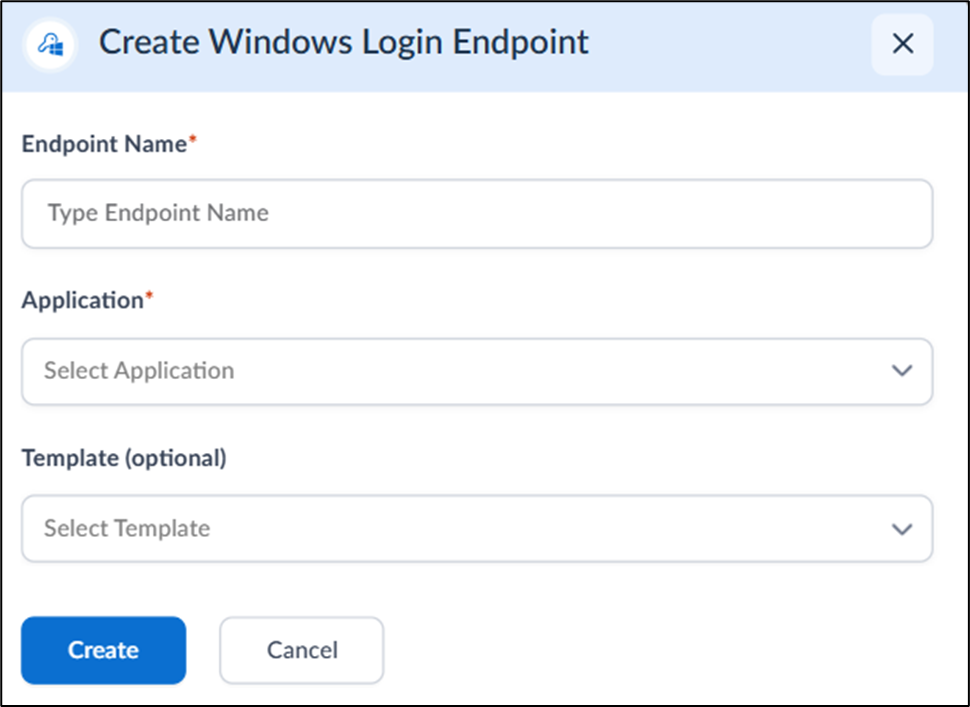
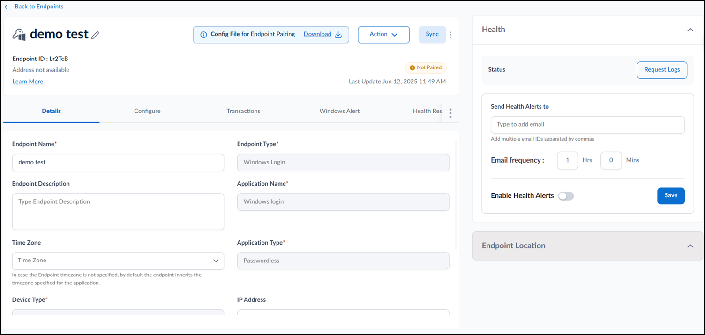

{/* Source: Intercom article 11494143 -  */}
{/* Generated by intercom_to_mintlify.py - re-running overwrites this file. */}

Steps to add a Windows Login endpoint:

1. Log in to the **Supervisor Portal**.
2. On the homepage of the portal, click **Endpoints** on the left panel menu.

   

   The **Endpoints** page is displayed.
3. Click **Add Endpoint** on the top right corner of the page.

   

   The **Create Endpoint** pop-up box is displayed.

   

4. Select **Windows Login** and select **Continue**.
   The **Create Windows Login Endpoint** pop-up box is displayed.

   

5. On the pop-up box, do the following:
   1. Enter **Endpoint Name**.
   2. Select **Application** from the application list**.**
   3. Select **Template** (optional).
   4. Click **Create**.
      The endpoint is created and listed on the **Endpoints** page.

      
