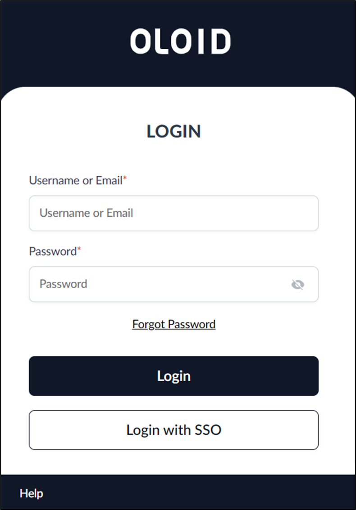
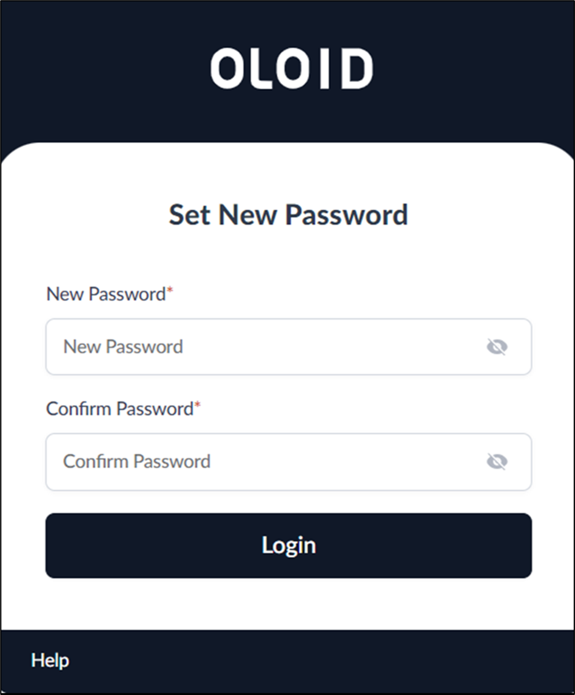

{/* Source: Intercom article 9710547 -  */}
{/* Generated by intercom_to_mintlify.py - re-running overwrites this file. */}

To access the Supervisor Portal, you should be a supervisor. Once the supervisor account is created, you will receive the URL and credentials (username and temporary password) for the portal on your registered email id.

Once you first login, the system prompts you to set your password.

Steps to set new password on first time login:

1. Launch your browser.
2. Enter the URL provided for you in the browser’s address bar. Then, press **Enter** on your keyboard.

   

   The **Login** page is displayed.
3. Enter your login information in the appropriate fields as provided in the email.
4. Click **LOGIN**.
   The **Set New Password** screen is displayed.

   

5. Enter **New Password.**

   <Note>
     **Note:** Password must contain at least one uppercase, one lowercase letter, one number, no consecutive or sequence characters The password should not contain any part of username.
   </Note>

6. Enter **Confirm Password.**
7. Click **LOGIN**.
   The Supervisor Portal is displayed.
