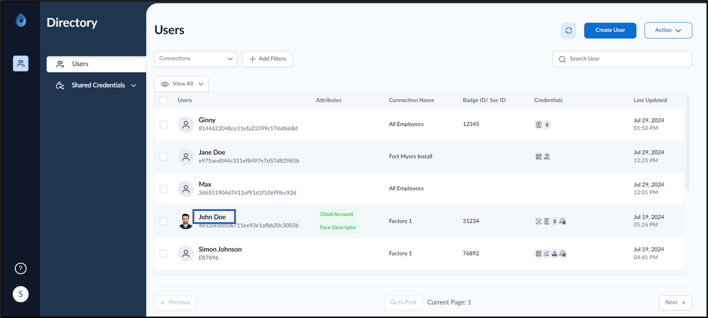
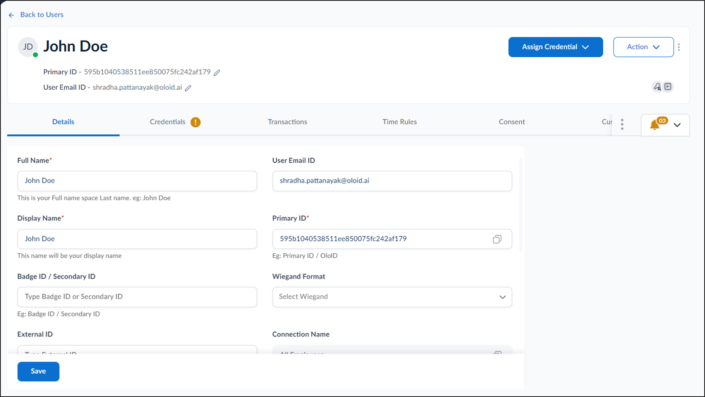
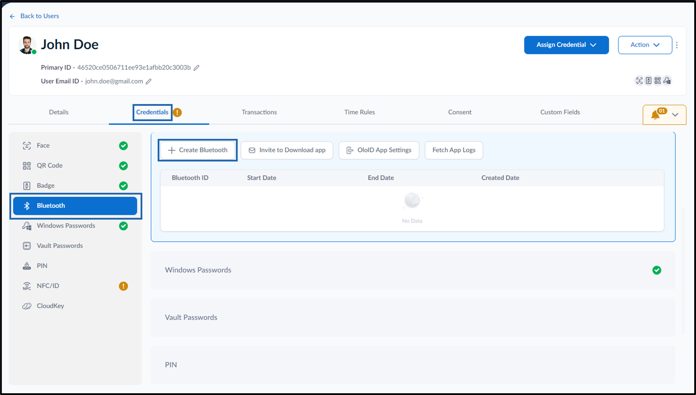
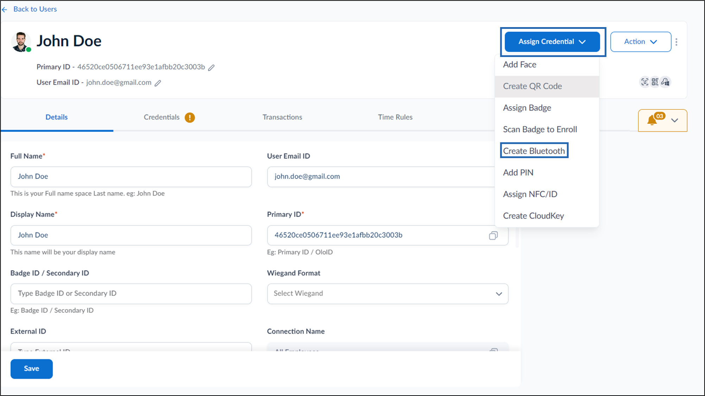
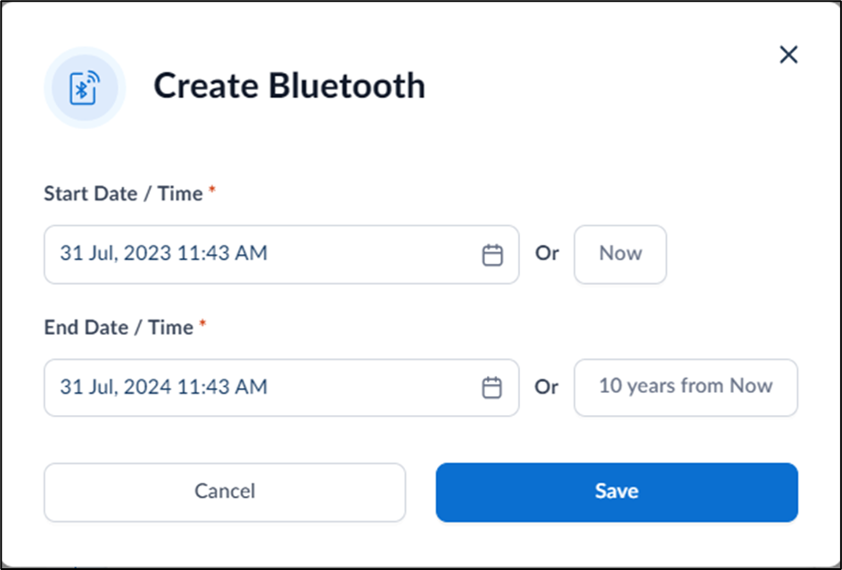
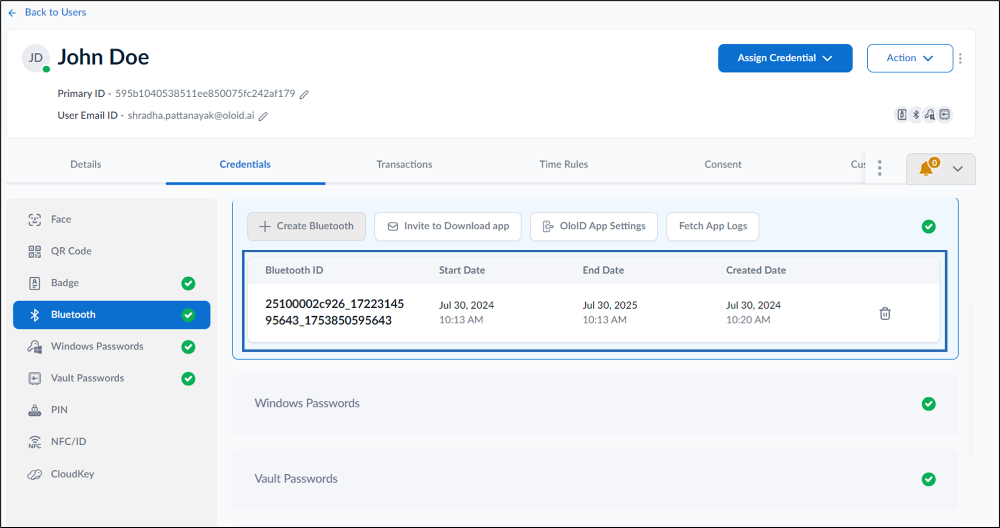

{/* Source: Intercom article 9669712 -  */}
{/* Generated by intercom_to_mintlify.py - re-running overwrites this file. */}

## Introduction

Bluetooth ID is generated for the M-Tag application to function.

**Pre-requisite**

Badge ID should be assigned to the User. If a Badge ID is not assigned to the User, see **[How to assign Badge ID and create Bluetooth credentials](/drafts/platform/supervisor-portal/supervisor-portal-how-to-assign-badge-id-and-create-bluetooth)**[.](/drafts/platform/supervisor-portal/supervisor-portal-how-to-assign-badge-id-and-create-bluetooth)

Steps to add Bluetooth as credential:

1. Log in to the **Supervisor Portal.**
   The **Users** page is displayed.
2. Click the **username** to edit.

   

   The user details page is displayed.

   

3. Do one of the following:
   1. Go to **Credentials** > **Bluetooth** tab> + **Create Bluetooth**.

      

   2. Go to **Assign Credential** > **Create Bluetooth**.

      

      The **Create Bluetooth** pop-up box is displayed.

      

4. Do the following:
   1. Select **Start Date / Time** and **End Date/Time** from the calendar.

      <Note>
        **Note:** You can click **Now** to set the current date and time. The end date is automatically set to 1 year from the current date.
      </Note>

      You can click **10 years from Now** to set the **End Date/Time** to 10 years from the current date/time.
   2. Click **Save**.
      The Bluetooth ID is created and listed on the **Bluetooth** tab.

      
