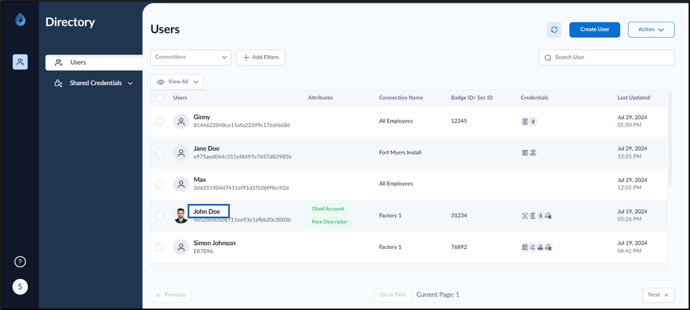
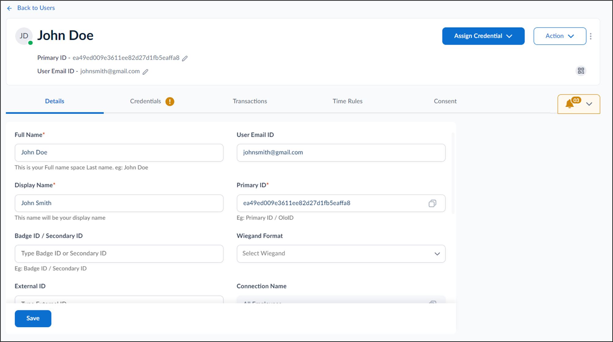
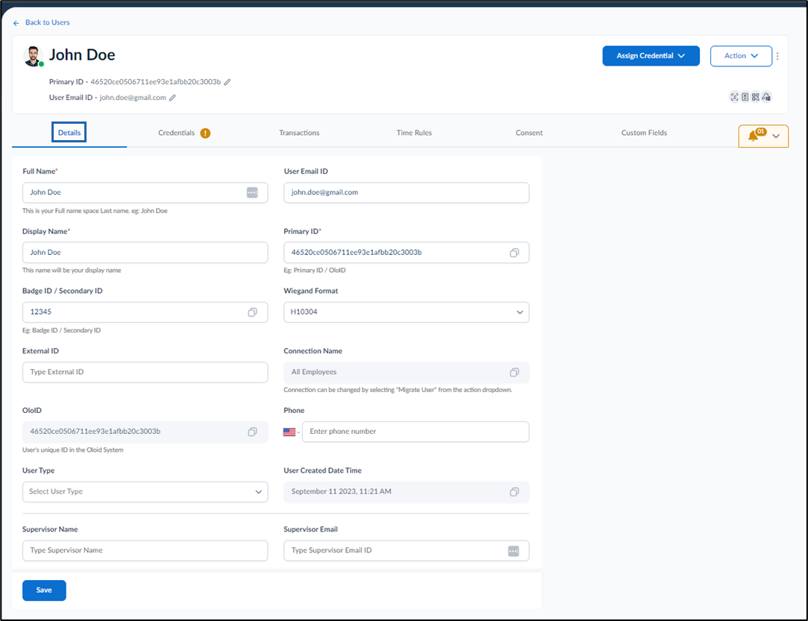
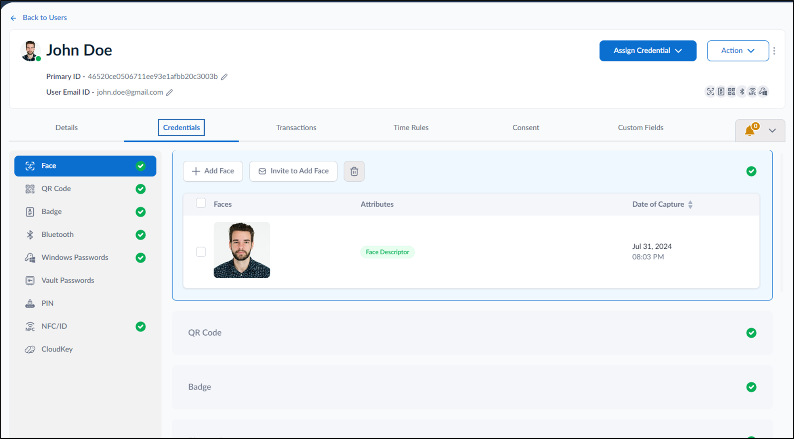
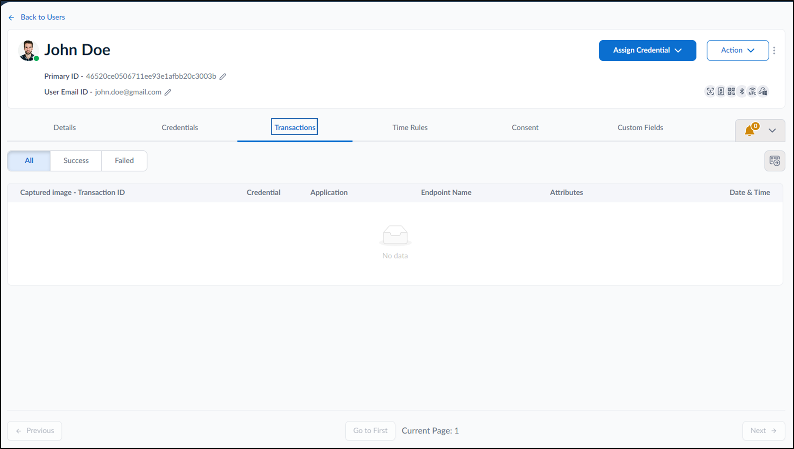
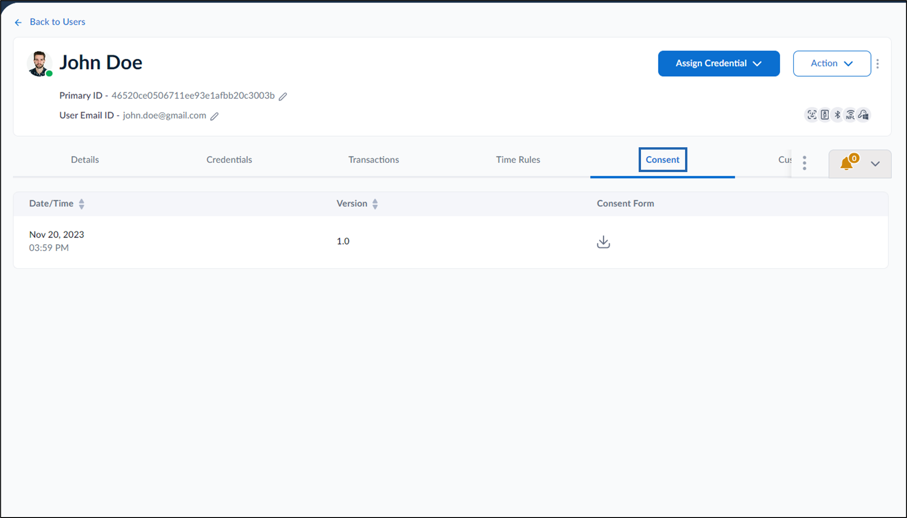

{/* Source: Intercom article 9673790 -  */}
{/* Generated by intercom_to_mintlify.py - re-running overwrites this file. */}

Steps to configure user details:

1. Log in to the **Supervisor Portal.**
   The Users page is displayed.
2. Click username to edit.

   

   The User details page is displayed.

   

3. Do the following:
   1. **Details** tab: Enter user details and click **Save**.

      

   2. **Credentials** tab: Add Face, Set QR code, Assign Badge, Configure Bluetooth settings, Add Windows Password, Vault Passwords, Add PIN, Assign NFC/ID, and Add CloudKey in the respective tabs.

      

   3. **Transactions** tab: View transactions.

      

   4. **Time Rules** tab: View time rules.
   5. **Consent** tab: View user consent.

      

   6. **Custom fields** tab: Edit badge binary (Optional).
      The User details are configured.
