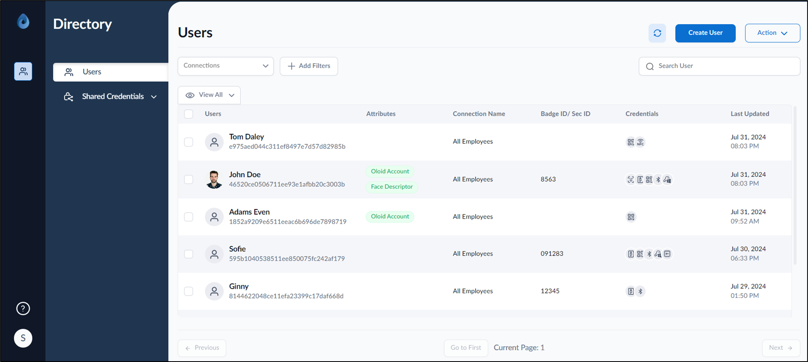
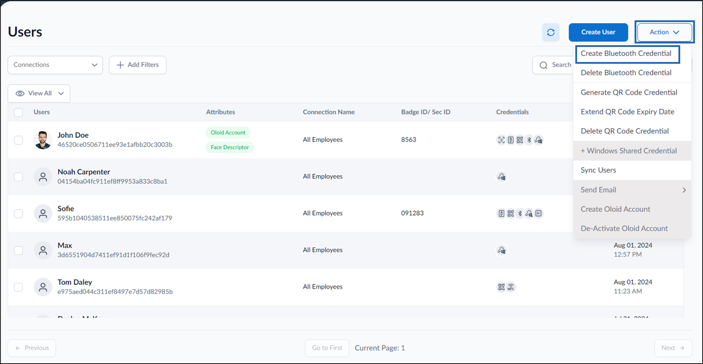
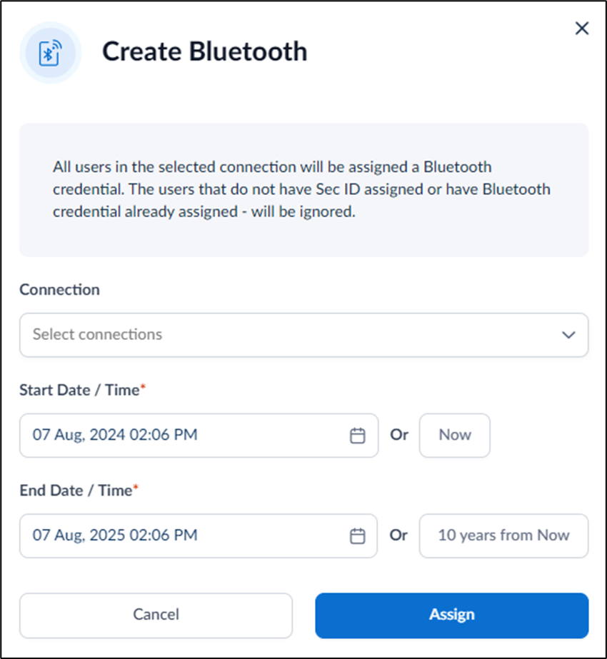

{/* Source: Intercom article 9711204 -  */}
{/* Generated by intercom_to_mintlify.py - re-running overwrites this file. */}

Steps to create Bluetooth credential for a Connection:

1. Log in to the **Supervisor Portal**.
   The **Users** page is displayed.

   

2. Go to **Action > Create Bluetooth Credential**.

   

   The **Create Bluetooth** pop-up box is displayed.

   

3. On the pop-up box, do the following:
   1. Select the preferred connection(s) from the **Connection** drop-down list.
   2. Select **Start Date / Time** and **End Date/Time** from the calendar.

      <Note>
        **Note:** You can click **Now** to set the current date and time. The end date is automatically set to 1 year from the current date.
      </Note>

      You can click **10 years from Now** to set the **End Date/Time** to 10 years from the current date/time.
   3. Click **Assign**.
      The Bluetooth credential is successfully created for all the users in the selected connection.
