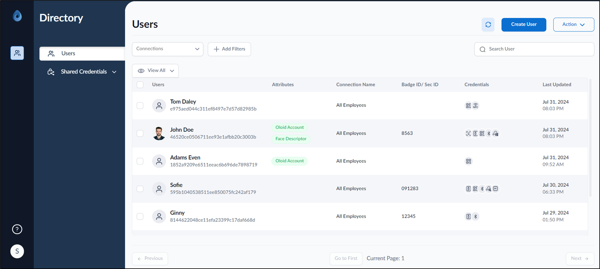
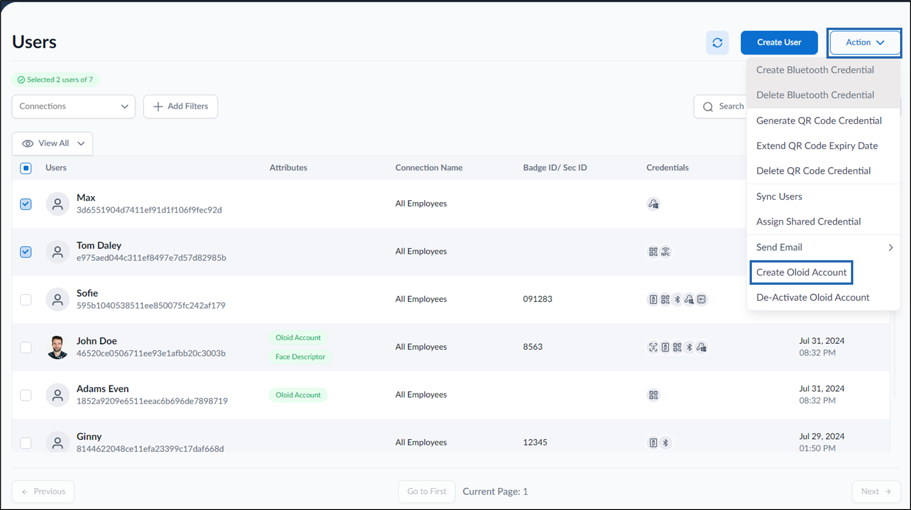
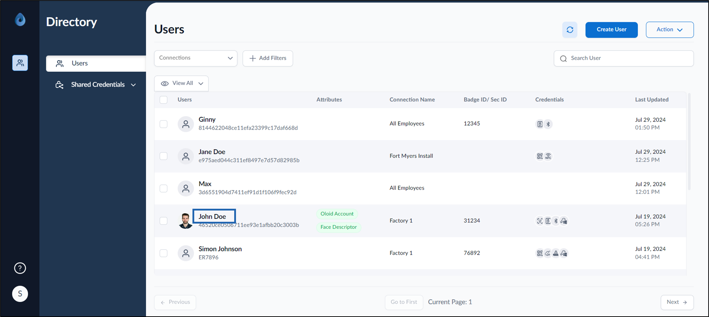
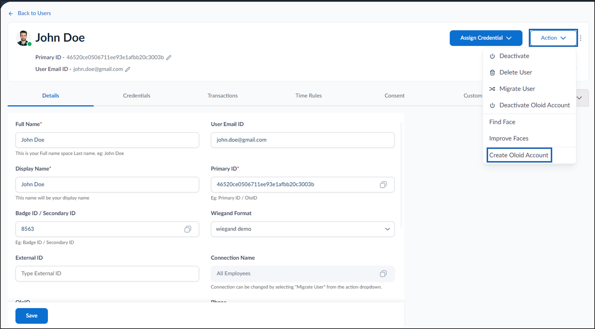

{/* Source: Intercom article 9670509 -  */}
{/* Generated by intercom_to_mintlify.py - re-running overwrites this file. */}

**Pre-requisite**

- You must provide your email or phone to create OloID Account.
- You must turn on **Enable OloID Account** toggle button on the Connection detail page. For more information, see **How to Enable OloID account in user Connection**.

Steps to Create Oloid Account:

1. Log in to the **Supervisor Portal**.
   The **Users** page is displayed.

   

2. Do one of the following:
   1. Select **User name(s**)> **Action** > **Create Oloid Account**.

      

   2. Click username to edit.

      

      The User details page is displayed.
3. Go to **Action** > **Create Oloid Account**.

   

   An OloID account is created. The user can now log in to Oloid app using their email ID.
