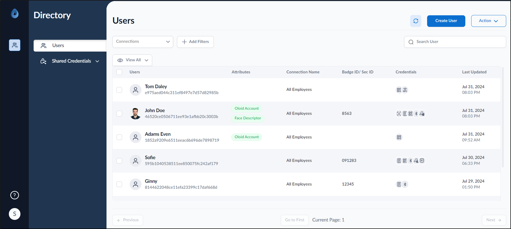
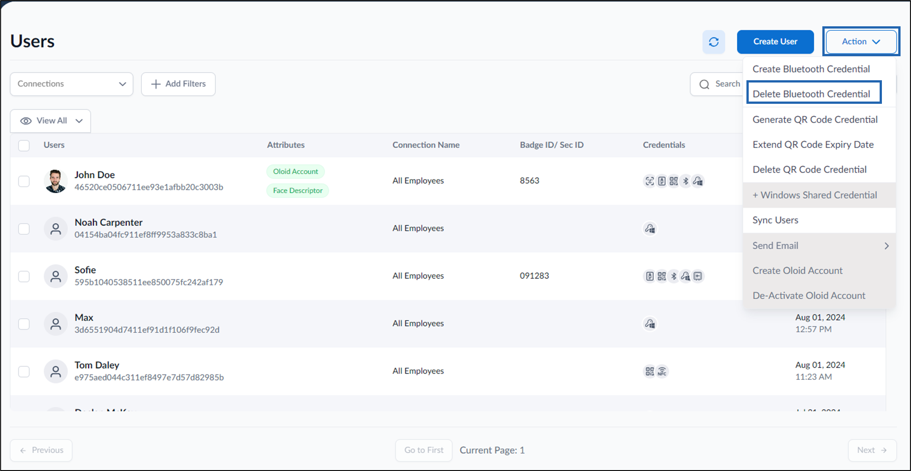
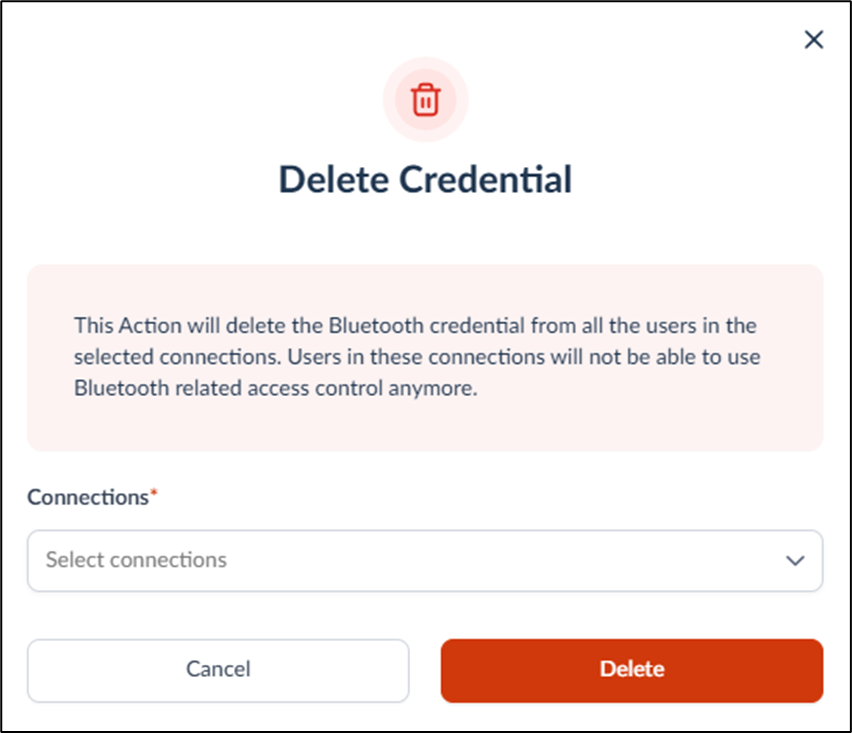

{/* Source: Intercom article 9711471 -  */}
{/* Generated by intercom_to_mintlify.py - re-running overwrites this file. */}

Steps to delete Bluetooth Credential of Users in a Connection:

1. Log in to the **Supervisor Portal**.
   The **Users** page is displayed.

   

2. Go to **Action** > **Delete Bluetooth Credential**.

   

   The **Delete Bluetooth Credential** pop-up box is displayed.

   

3. On the pop-up box, do the following:
   1. Select a preferred connection from the **Connections** dropdown list.
   2. Click **Delete**.
      The Bluetooth credential is successfully deleted for users in the selected connection.
