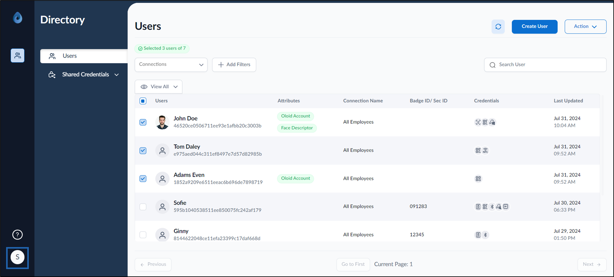
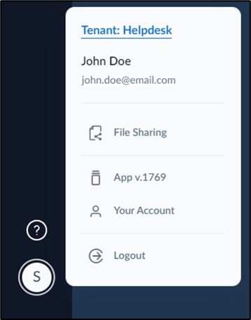
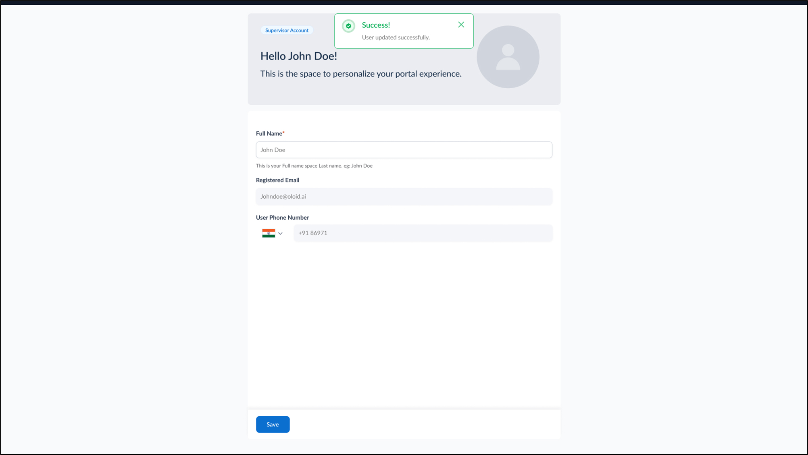

{/* Source: Intercom article 9699294 -  */}
{/* Generated by intercom_to_mintlify.py - re-running overwrites this file. */}

Steps to edit supervisor profile:

1. Log in to the **Supervisor Portal**.
2. On the homepage of the portal, click **User profile icon** on the bottom left corner of the menu panel.

   

   The user profile menu is displayed.

   

3. Select **Your Account**.
   The **Supervisor Account** page is displayed.
4. Do the following:
   1. Edit **Full Name** (Optional).
   2. Enter **Phone number** (Optional).

      <Note>
        **Note:** You must enter a valid phone number. Once saved you cannot edit your phone number. Please reach out[Oloid Support](mailto:support@oloid.ai) to update your phone number.
      </Note>

   3. Click **Save**.

      

      Your profile is updated successfully.
