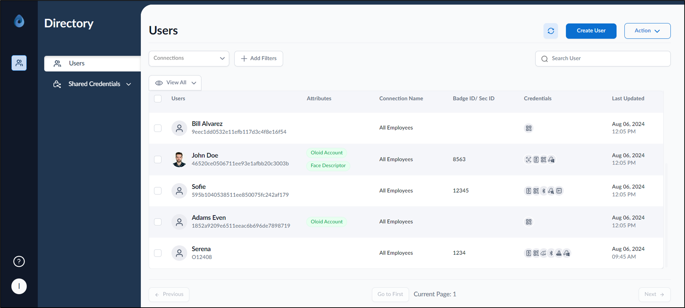
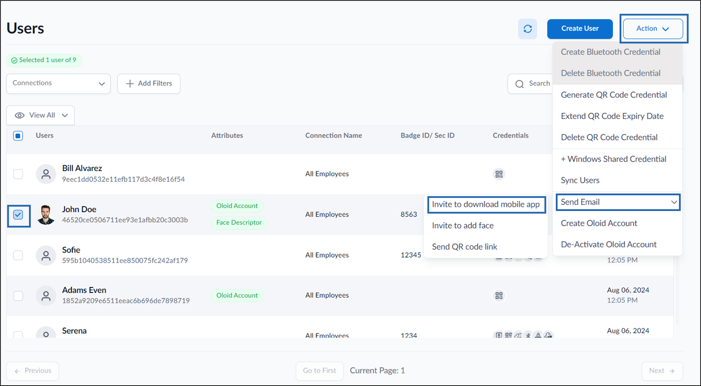
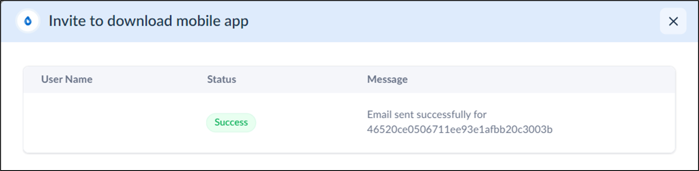
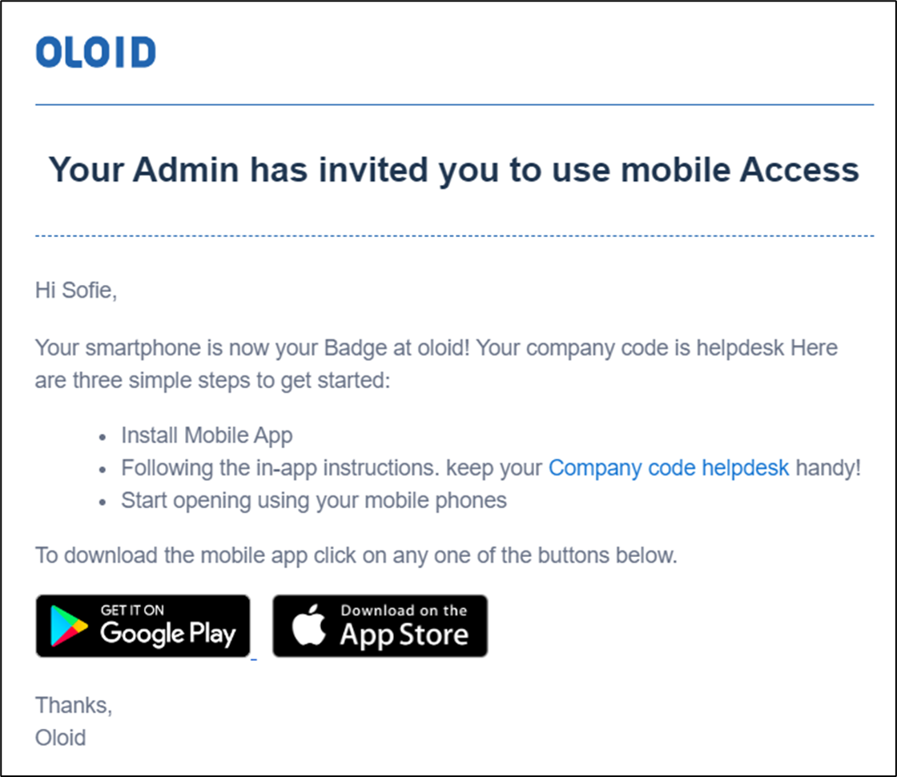

{/* Source: Intercom article 9706459 -  */}
{/* Generated by intercom_to_mintlify.py - re-running overwrites this file. */}

Steps to invite users to download mobile app:

1. Log in to **Supervisor Portal**.

   

   The Users page is displayed.
2. Select user(s).
3. Click **Action** > **Send Email** > **Invite to download mobile app.**

   

   The invite to download mobile app is sent successfully. The user can download the mobile app by following the on-screen instructions.

   

   
