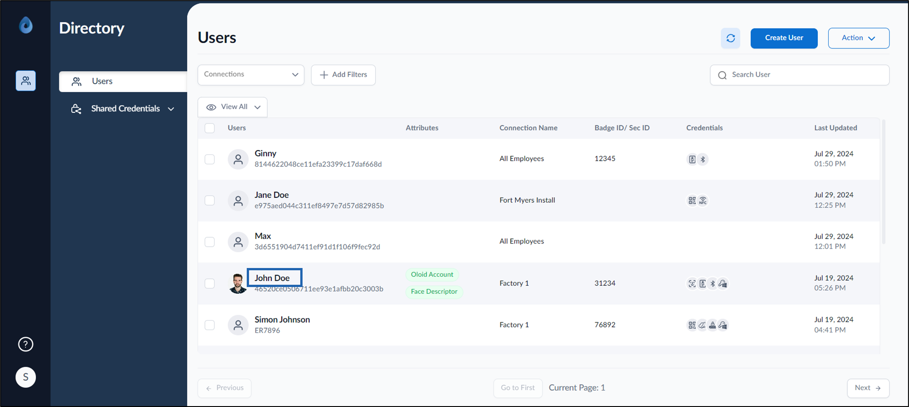
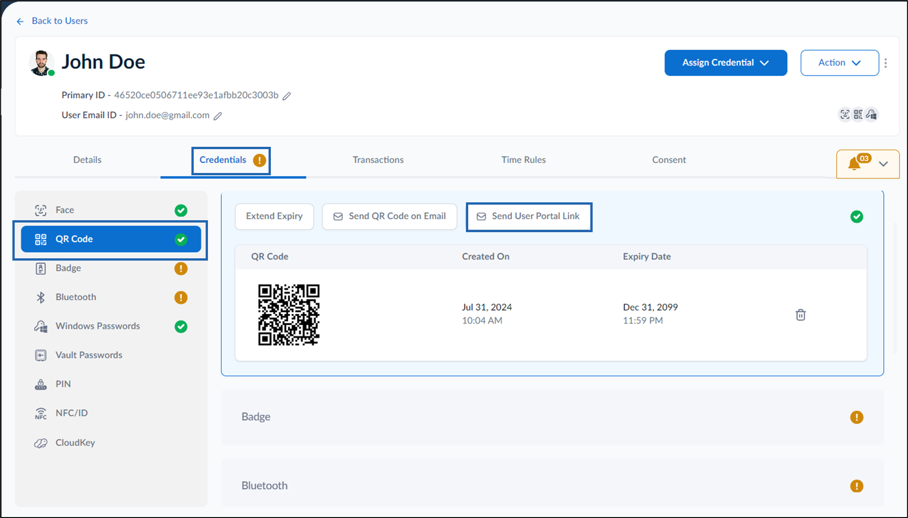
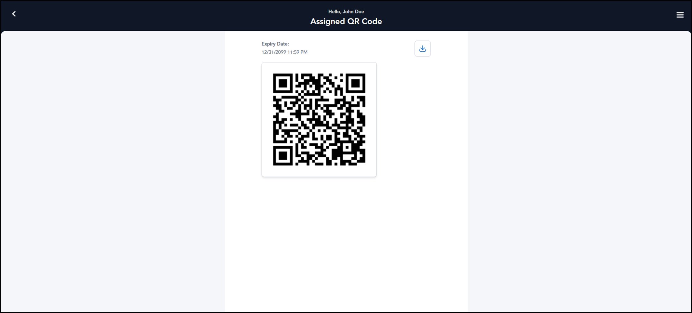

{/* Source: Intercom article 9674178 -  */}
{/* Generated by intercom_to_mintlify.py - re-running overwrites this file. */}

To send QR Code credential to user using the User Portal ink:

1. Log in to the **Supervisor Portal**.
   The **Users** page is displayed.
2. Click username to edit.

   

   The User details page is displayed.
3. Go to **Credentials** tab > **QR Code** > select **Send User Portal Link**.

   

   An email with the user portal link is sent to the user to view and scan the QR Code. The link navigates the user to the Oloid User Portal where the user can download the QR Code for transaction.

   
