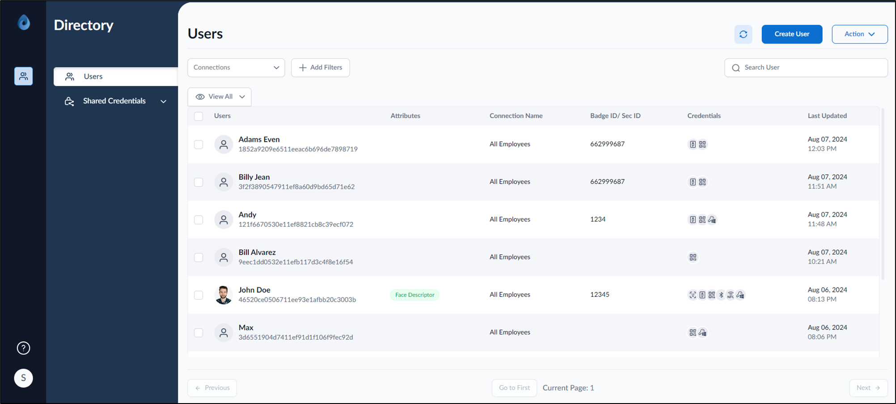
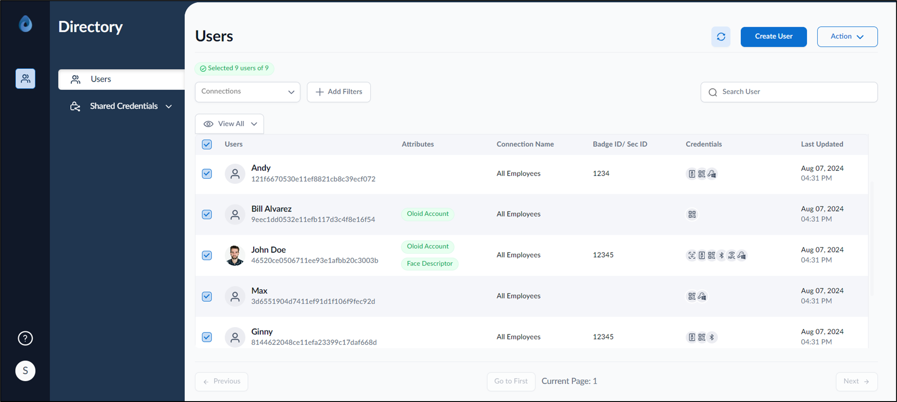
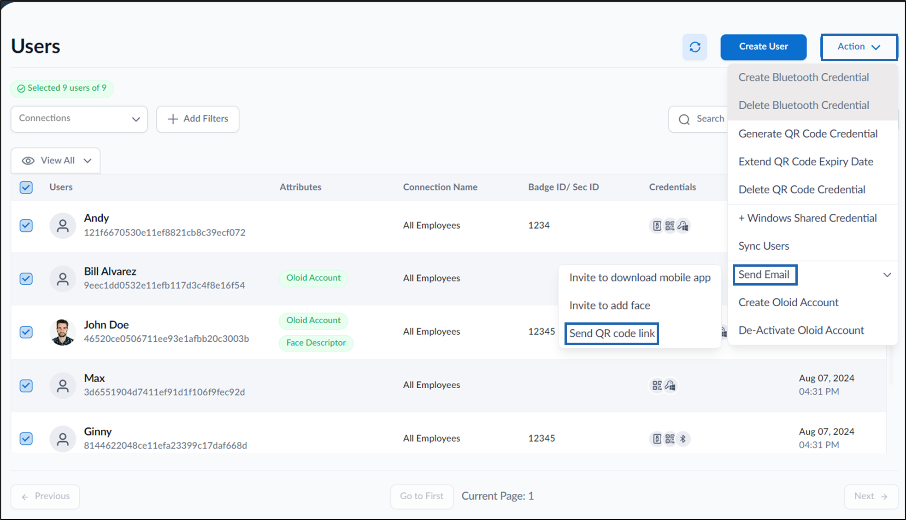

{/* Source: Intercom article 9711988 -  */}
{/* Generated by intercom_to_mintlify.py - re-running overwrites this file. */}

**Pre-requisite:**

QR Code must be created for selected users. For more details, refer here [Supervisor Portal- How to generate QR Code for multiple users](/platform/supervisor-portal/supervisor-portal-how-to-generate-qr-code-for-multiple-users)

Oloid account should be created(add link)

Steps to send QR Code link:

1. Log in to **Supervisor Portal**.
   The Users page is displayed.

   

2. Select user(s) to send QR code link.

   

3. Click **Action** > **Send Email** > **Send QR code link**.

   

   The QR code link is sent to selected users successfully.
