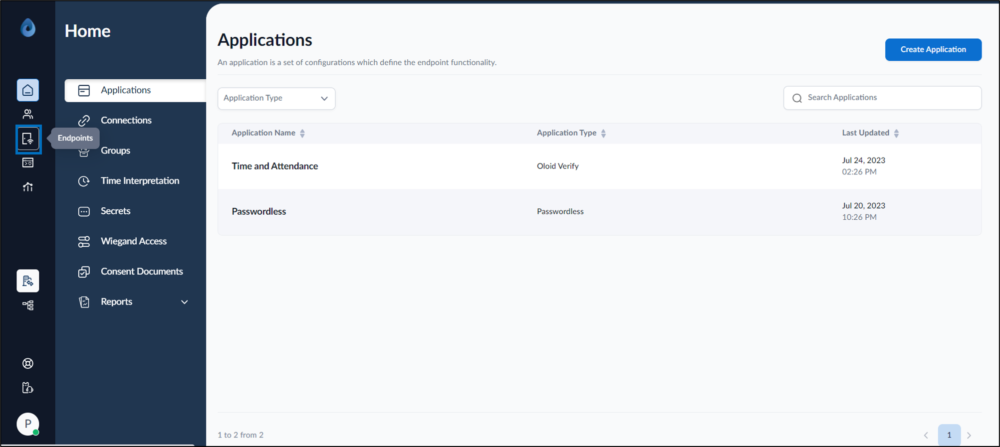
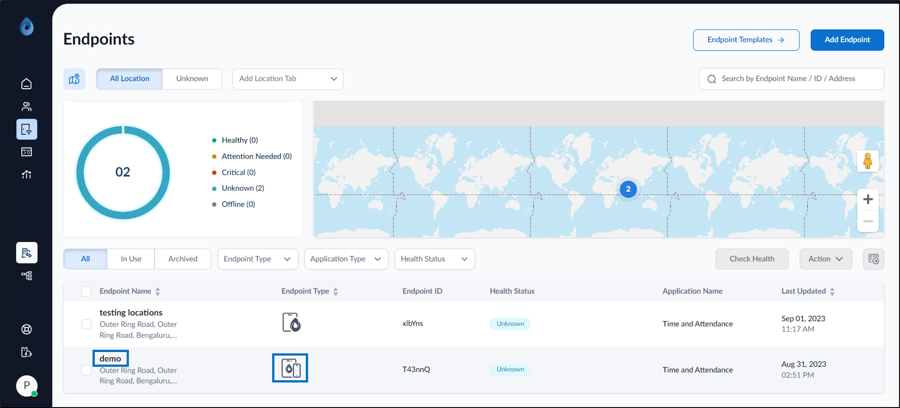

{/* Source: Intercom article 8320322 -  */}
{/* Generated by intercom_to_mintlify.py - re-running overwrites this file. */}

- Doc to be deleted, see https://proxce.atlassian.net/browse/XD-5892

## Introduction

An endpoint is added to the Oloid Platform for Oloid Verify/Connect app using the device.

Once the endpoint is paired, it gets automatically registered in the Oloid Platform.

Please refer to the instructions to learn **[how to pair an endpoint in Oloid Verify/Connect](/drafts/platforms/ios/time-clock/how-to-pair-an-oloid-verify-connect-endpoint-archived)**.

Once the pairing process is completed on your device, you can check the added endpoint in the Oloid platform.

To check the added endpoint:

1. Log in to the **Oloid Portal**.
2. On the homepage of the portal, click **Endpoints** on the left menu panel.

   

   The Endpoints page is displayed.
3. On the Endpoints page, review the **Endpoint Name** and **Endpoint Type**.

   

   The endpoint is successfully added to the portal.
   To edit and configure the Endpoint, see **[How to configure Endpoint](/platform/tenant-admin-portal/how-to-configure-endpoint-for-verify-connect)**[.](/platform/tenant-admin-portal/how-to-configure-endpoint-for-verify-connect)
