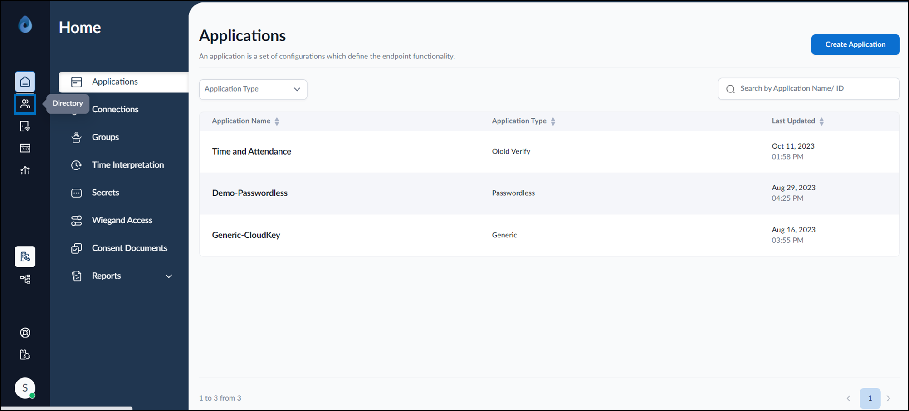
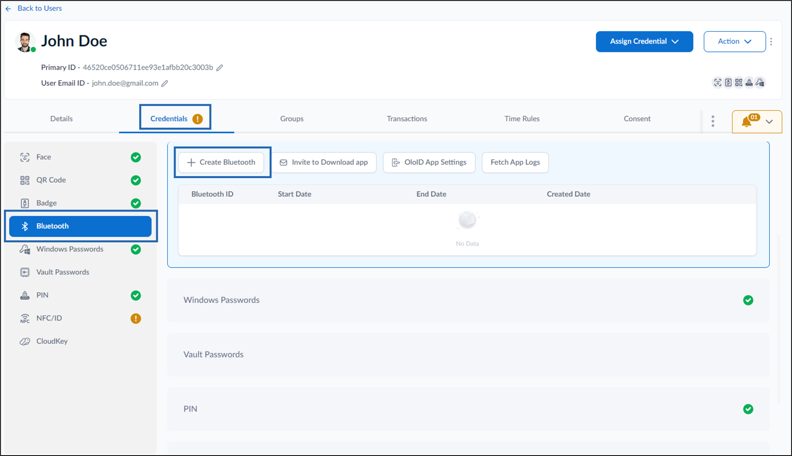
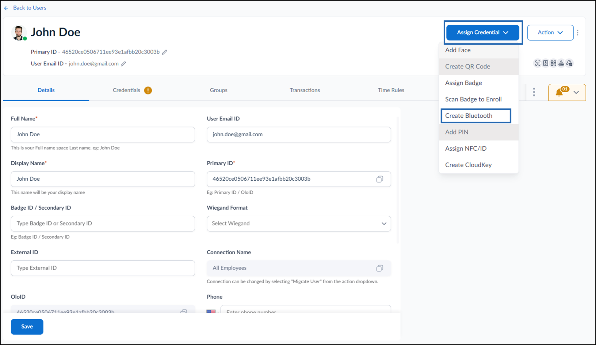
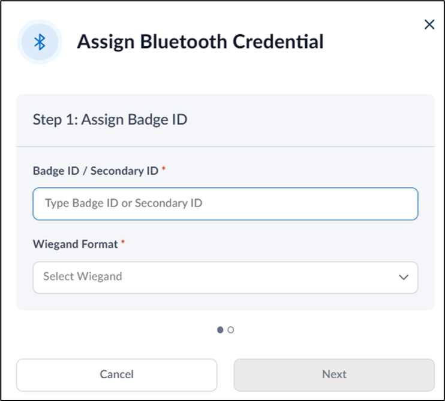
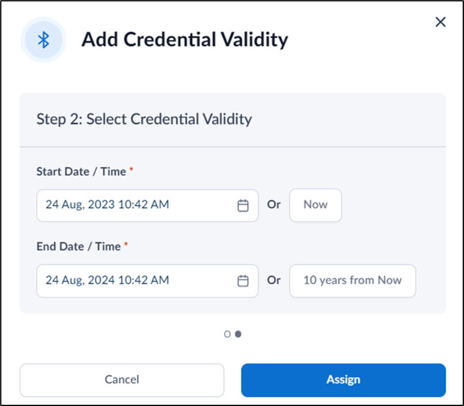
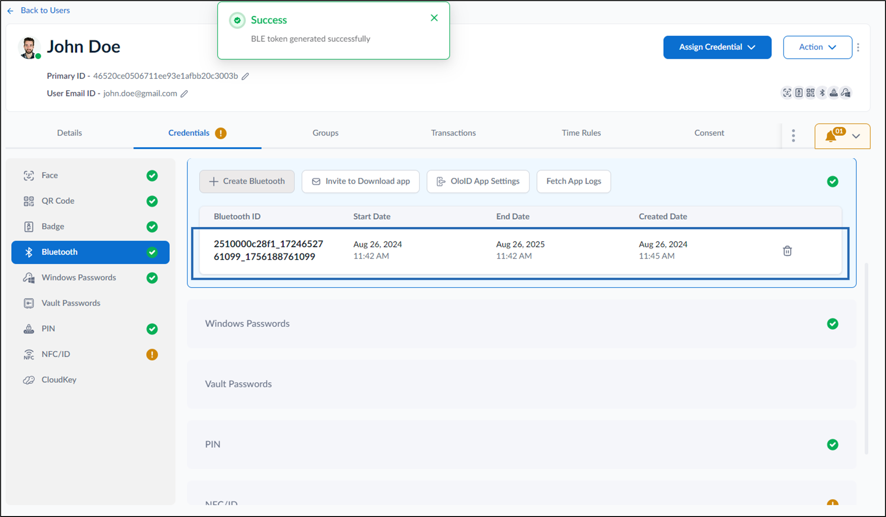
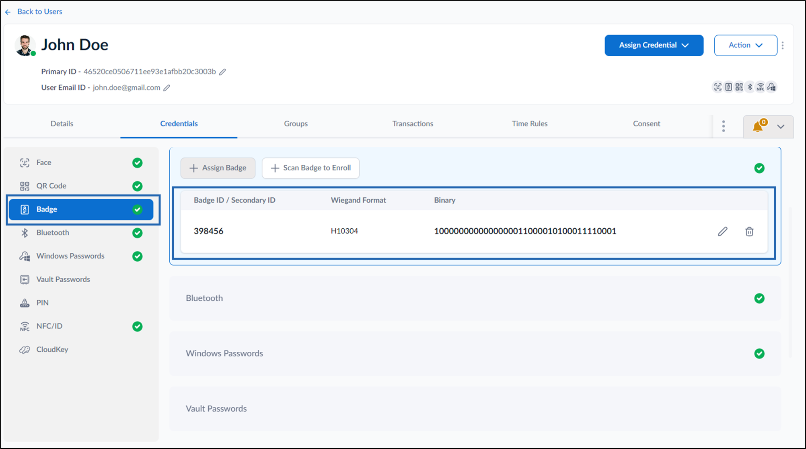

{/* Source: Intercom article 8290168 -  */}
{/* Generated by intercom_to_mintlify.py - re-running overwrites this file. */}

**Introduction**

Bluetooth credential is generated for the M-Tag application to function.

**Pre-requisite**

Badge ID should be assigned to the User.

Steps to assign Badge ID and create Bluetooth credentials:

1. Log in to the **Oloid Portal**.
2. On the home page of the portal, click **Directory** on the left panel menu.

   

   The **Users** page is displayed.
3. Click user name to edit.

   

   The user details page is displayed.
4. Do one of the following:
   1. Go to **Credentials** > **Bluetooth** tab> + **Create Bluetooth**.

      

   2. Go to **Assign Credential** > **Create Bluetooth**.

      

      The **Assign Bluetooth Credential** pop-up box is displayed.

      

5. On the pop-up box do the following:
   1. Enter **Badge ID** / **Secondary ID**.
   2. Select weigand format from **Wiegand Format** drop-down list.
   3. Click **Next**.
      The **Add Credential Validity** screen is displayed.

      

   4. Select **Start Date / Time** and **End Date/Time** from the calendar.

      <Note>
        **Note:** You can click **Now** to set the current date and time. The end date is automatically set to 1 year from the current date.
      </Note>

      You can also click **10 years from Now** to set the **End Date/Time** to 10 years from the current date/time.
   5. Click **Assign**.
      The Bluetooth ID is created and listed on the **Bluetooth** tab.

      

      <Note>
        **Note:** The Badge ID is also assigned and listed on the **Badge** tab.
      </Note>

      

      Watch our video tutorial here **[How to add bluetooth as credential to users.](/drafts/platform/tenant-admin-portal/videos/how-to-add-bluetooth-as-credential-to-users-video-tutorial)**
