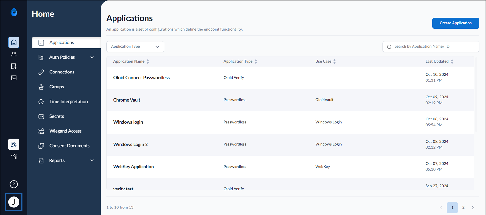
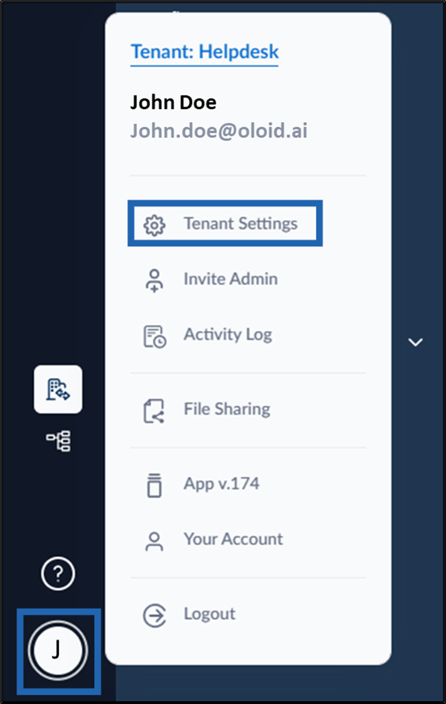
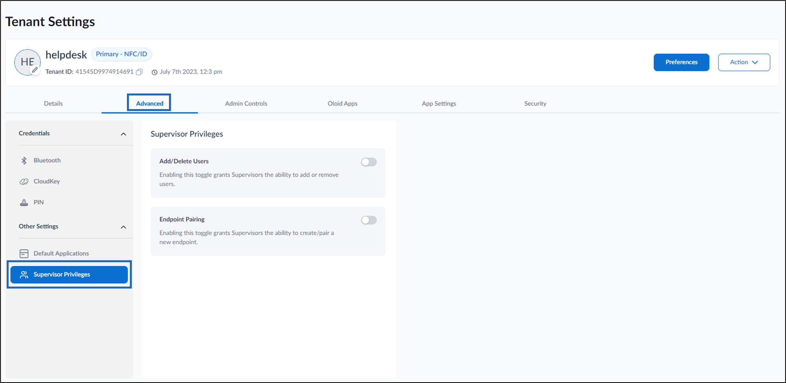
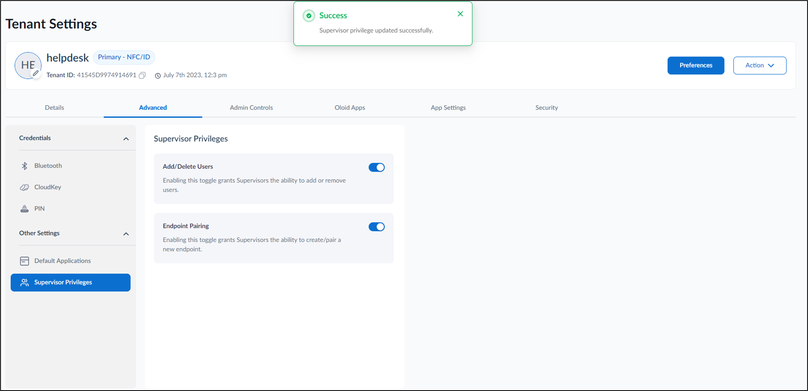

{/* Source: Intercom article 9968942 -  */}
{/* Generated by intercom_to_mintlify.py - re-running overwrites this file. */}

Steps to assign Supervisor Privileges:

1. Log in to the **Oloid Portal**.
2. On the homepage, click the **user profile icon**.

   

   The **user profile menu** is displayed.
3. Click **Tenant Settings**.

   

   The **Tenant Settings** page is displayed.
4. Go to **Advanced** Tab > **Supervisor Privileges**.

   

5. Do the following :
   1. Enable **Add/Delete Users** toggle button to allow the supervisor to add or remove users. ( optional)
   2. Enable **Endpoint Pairing** toggle button to allow the supervisor to create or pair new endpoints. ( optional)
      The Supervisor Privileges are updated successfully.

      
