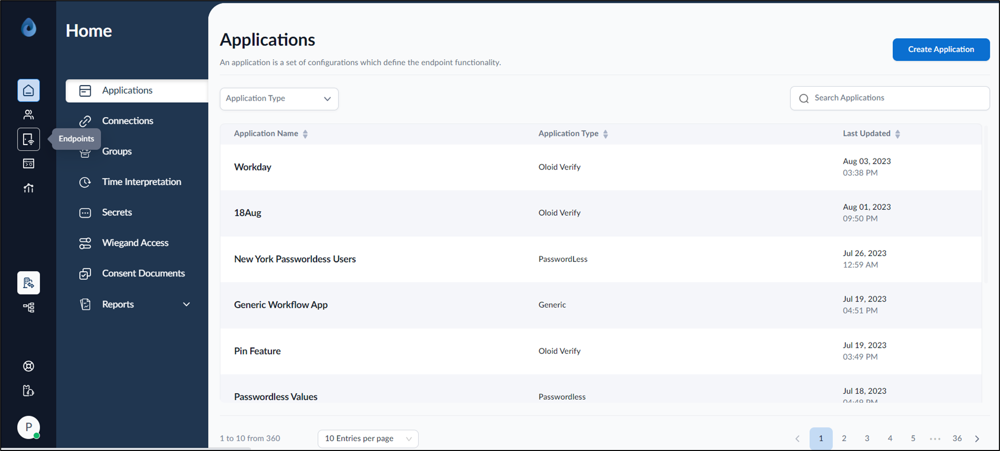
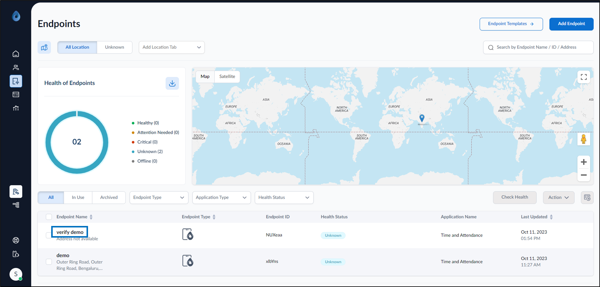
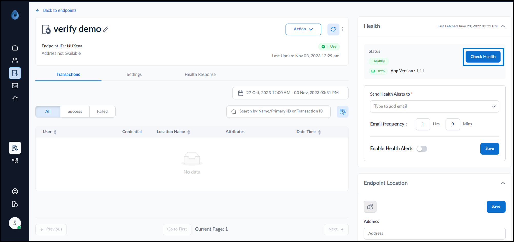
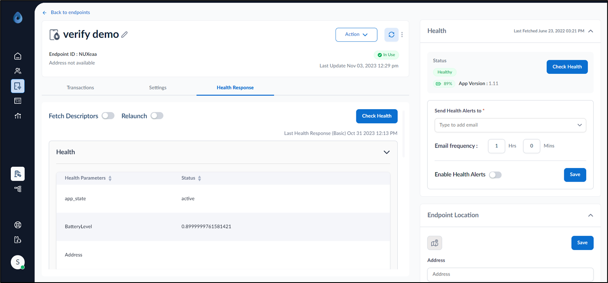

{/* Source: Intercom article 8483945 -  */}
{/* Generated by intercom_to_mintlify.py - re-running overwrites this file. */}

## Introduction

The **Check Health** feature in the Oloid portal provides the endpoint's health status.

Steps to add health alerts:

1. Log in to the **Oloid Portal**.
2. On the homepage of the portal, click **Endpoints** on the left menu panel.

   

   The Endpoints page is displayed.
3. Click Endpoint Name to edit.

   

   The Endpoint detail page is displayed.
4. Do one of the following:
   1. Navigate to **Health Response** tab > **Check Health**.
   2. On the top right corner, locate **Health**.
   3. Select **Check Health**.

      

      The health status of the endpoint is displayed after some time.

      
