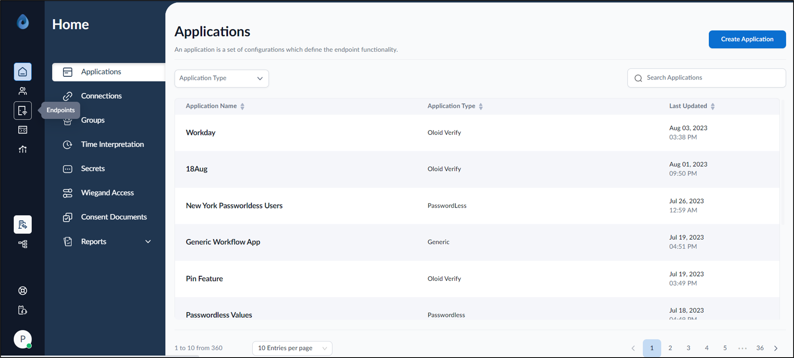
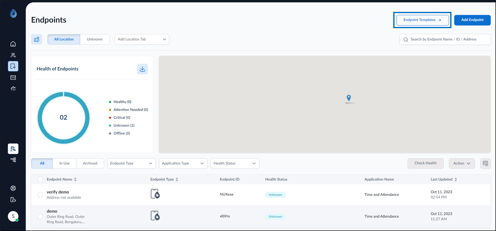
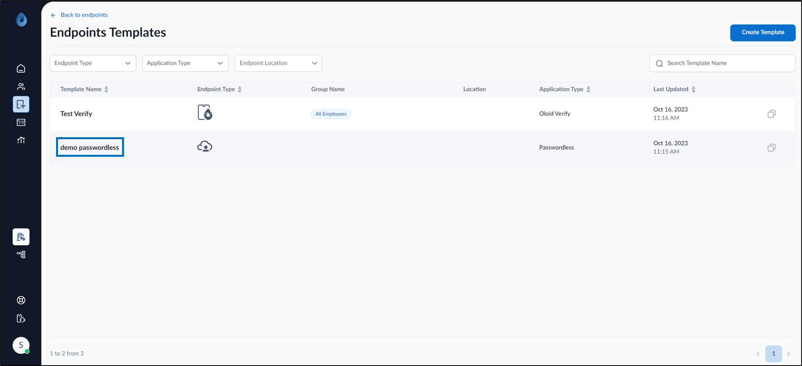
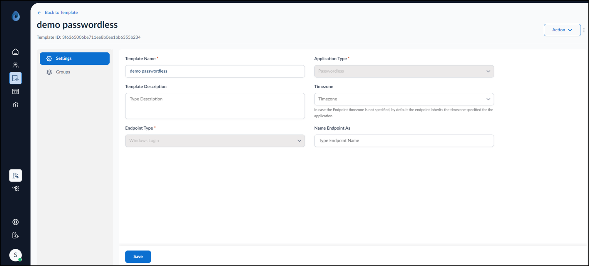

{/* Source: Intercom article 8479490 -  */}
{/* Generated by intercom_to_mintlify.py - re-running overwrites this file. */}

<Note>
  **Note:** This document is not valid as UI has changed completely. Needs to be deleted.
</Note>

Steps to configure Passwordless Template:

1. Log in to the **Oloid Portal**.
2. On the home page of the portal, click **Endpoints** on the left menu panel.

   

   The Endpoints page is displayed.
3. On the top right, click **Endpoint Templates**.

   

   The **Endpoint Templates** page is displayed.
4. Click template name of Passwordless **Endpoint Type** to be configured from the listed template name.

   

   The endpoint template details page is displayed.

   

5. Do the following:
   1. **Settings** tab:
      1. Enter **Template Name**.
      2. Enter **Template Description (**Optional**)**.
      3. Select timezone from **Timezone** dropdown list.
      4. Enter endpoint name in the **Name Endpoint As** field.
      5. Click **Save**.
   2. **Groups** tab: Add group to the template.
      The Passwordless template is configured.
