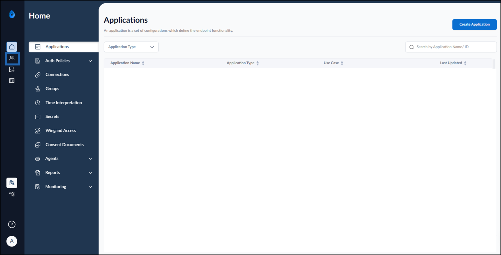
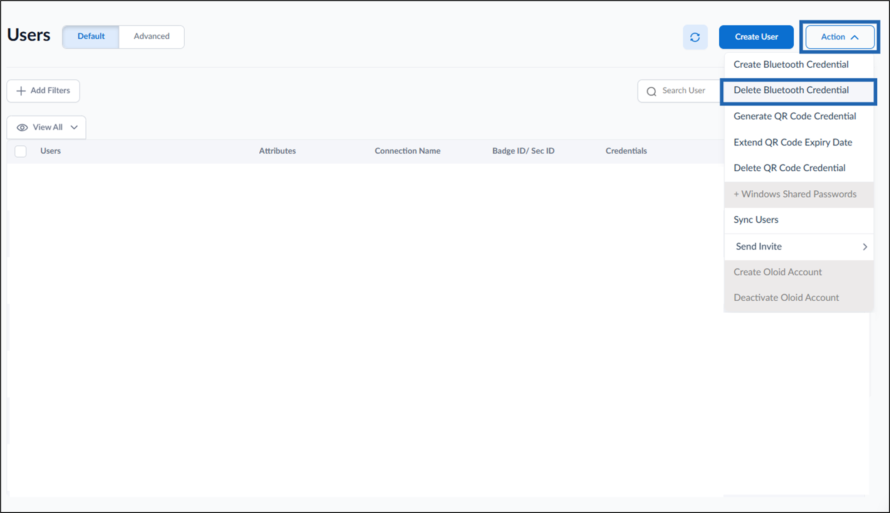
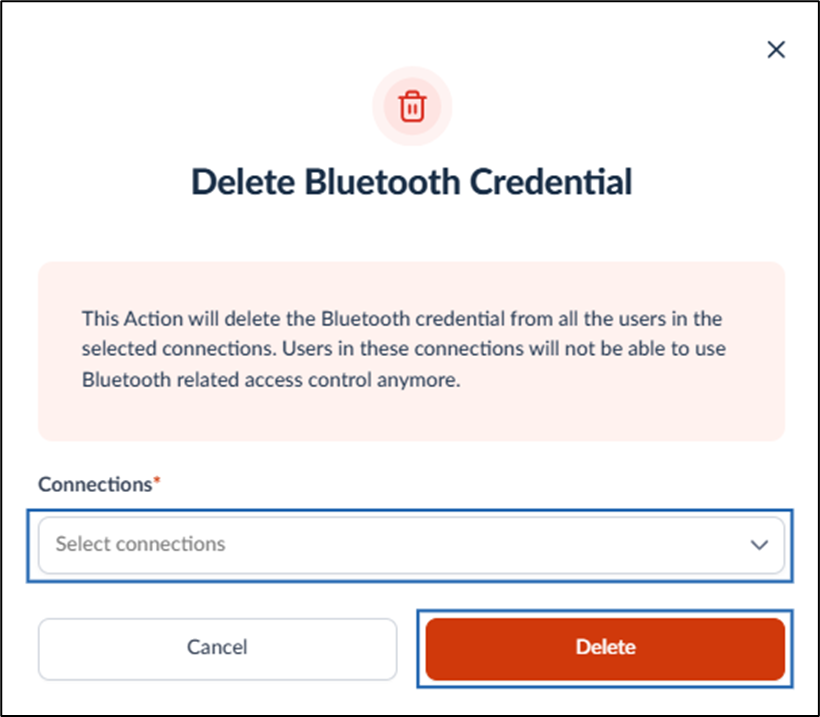
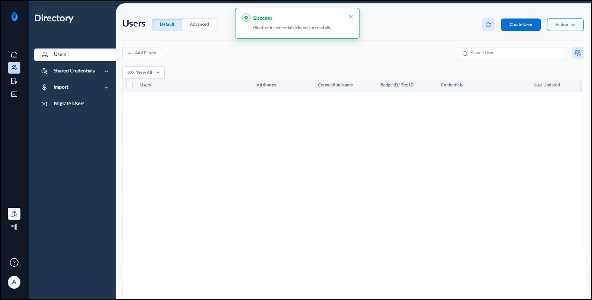

{/* Source: Intercom article 8736223 -  */}
{/* Generated by intercom_to_mintlify.py - re-running overwrites this file. */}

## Introduction

The Tenant Admin Portal allows the admin to delete Bluetooth credentials for users within a specific connection. Removing these credentials immediately disables access through Bluetooth-enabled devices, ensuring secure and up-to-date user authentication. This helps admin maintain proper access control by eliminating unused or expired credentials.

## Prerequisite

You must create Bluetooth credential for connections in the Tenant Admin Portal. To create Bluetooth credential refer [How to create Bluetooth credential for users in a connections in the Tenant Admin Portal](/drafts/platform/tenant-admin-portal/how-to-create-bluetooth-credential-for-users-in-a-connections-in-the).

## Steps to delete Bluetooth credentials for a Connection

1. Log in to the **Tenant Admin Portal**.
2. On the home page of the portal, click **Directory** on the left menu panel.

   

   The **Users** page is displayed.
3. Go to **Action >** select **Delete Bluetooth Credential**.

   

   The **Delete Bluetooth Credential** pop-up box is displayed.
4. On the pop-up box, do the following:
   1. Select the connection(s) from the **Connections** dropdown list.
   2. Click **Delete**.

      

      The Bluetooth credential is deleted successfully for all the users in the selected connection.

      
