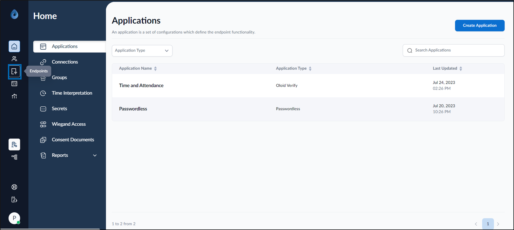
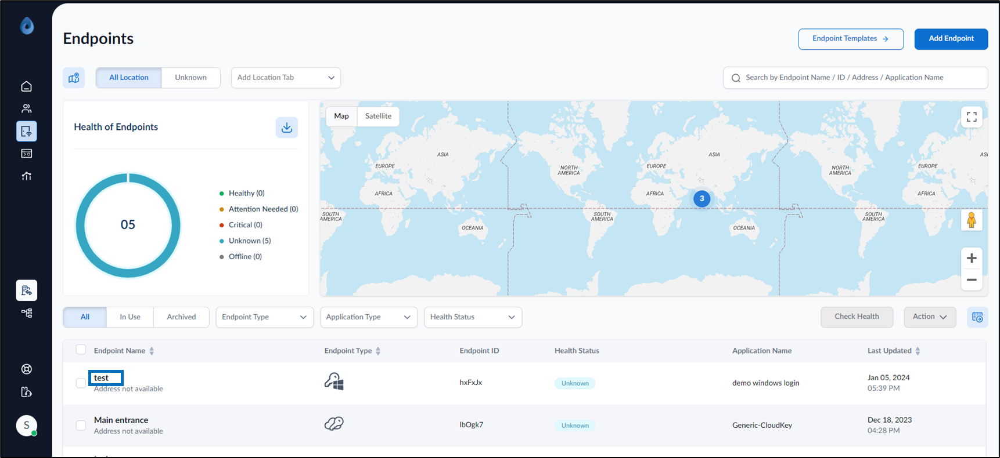
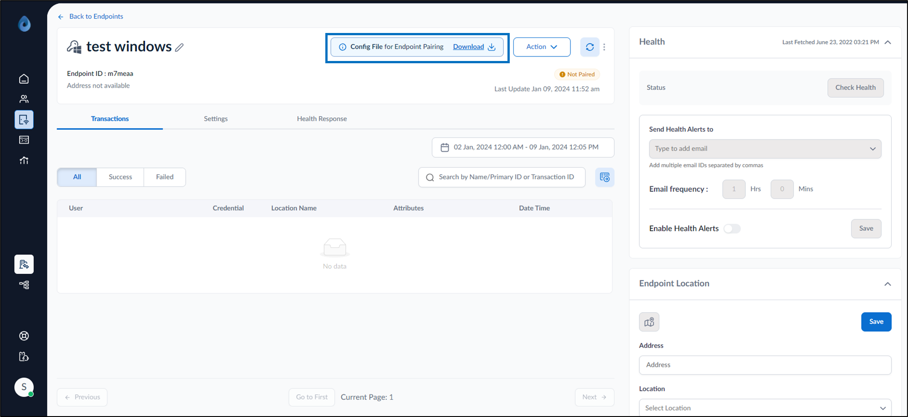

{/* Source: Intercom article 8778331 -  */}
{/* Generated by intercom_to_mintlify.py - re-running overwrites this file. */}

**Pre-requisite**

The Windows Login endpoint must be created from Oloid Portal. For further details, see [How to add Windows Login endpoint](/drafts/platform/tenant-admin-portal/how-to-add-windows-login-endpoint)

To download endpoint config file:

1. Log in to the **Oloid Portal**.
2. On the homepage of the portal, click **Endpoints** on the left menu panel.

   

   The Endpoints page is displayed.
3. Click **Endpoint Name** (endpoint created from portal) to edit.

   

   The Endpoint detail page is displayed.
4. Click **Download** to download the config file for endpoint pairing.

   

   The Config File is saved to the local device.
