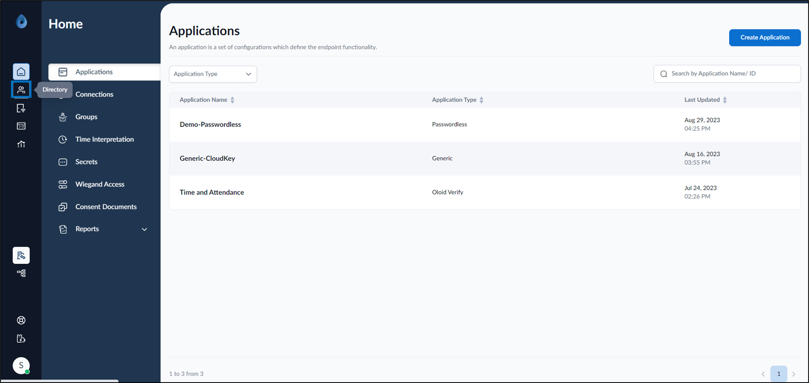
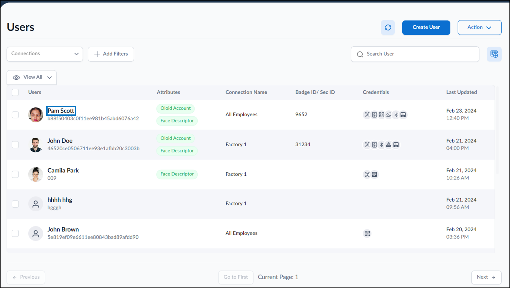
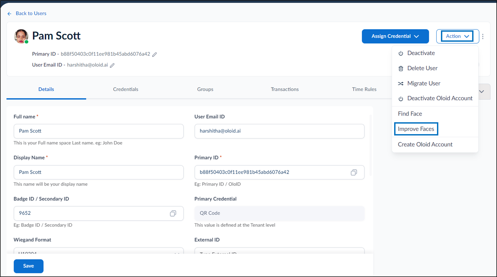
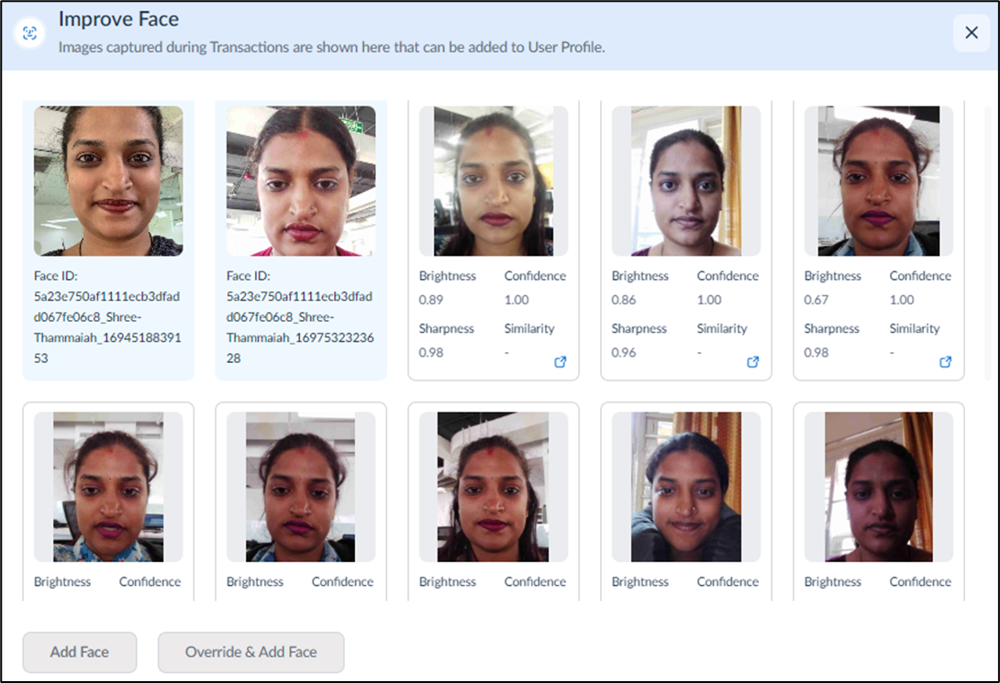

{/* Source: Intercom article 8353777 -  */}
{/* Generated by intercom_to_mintlify.py - re-running overwrites this file. */}

Steps to Improve Faces:

1. Log in to the **Oloid Portal**.
2. On the home page of the portal, click **Directory** on the left menu panel.

   

   The **Users** page is displayed.
3. Click user name to edit.

   

   The User details page is displayed.
4. Go to **Action** > **Improve Faces**.

   

   The **Improve Face** pop-up box is displayed.

   

5. Select a preferred face.
6. Do one of the following:
   1. Click **ADD FACE** to add it as a reference image.

Face is added and listed in **Faces** tab under **Credentials**.

1. Click **ADD FACE (OVERRIDE)** to add a new face with confidence level.
   Face is added and overrides reference image on confidence level match.
