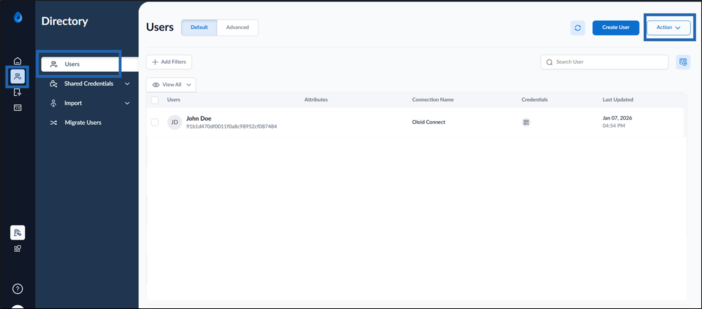
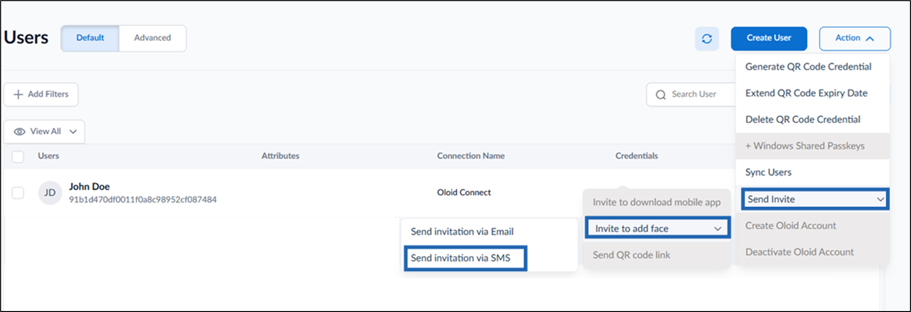
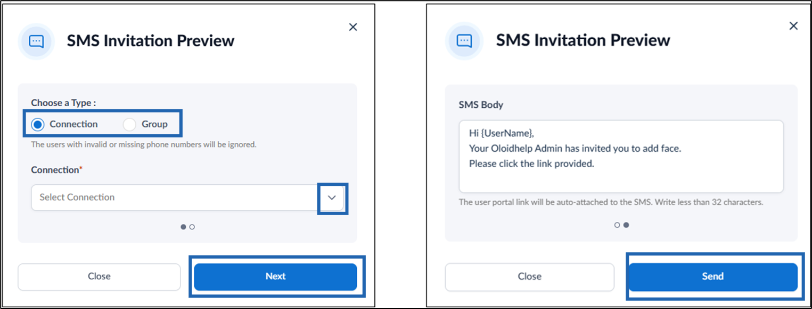

{/* Source: Intercom article 13339654 -  */}
{/* Generated by intercom_to_mintlify.py - re-running overwrites this file. */}

## Steps to Send Face Invite via SMS

1. Log in to the **Tenant Admin Portal**.
2. Go to **Directory > Users >** click **Action.**

   

   The action drop-down list is displayed.
3. Click **Send Invite > Invite to add Face > Send invitation via SMS**.

   

   The SMS Invitation Preview pop-up box is displayed.
4. Do the following:
   1. Select **Connection** or **Group**.
   2. Choose applicable connection/group from the drop-down list.
   3. Click **Next**.
   4. Update the SMS (if needed).
   5. Click **Send**.

      

      The QR code is created successfully.
