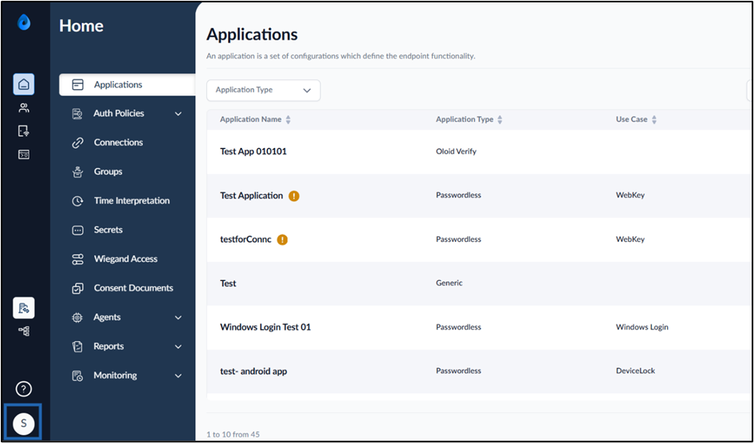
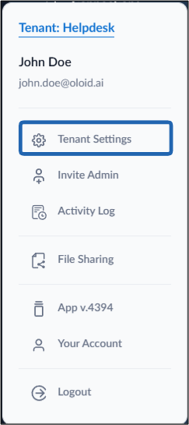
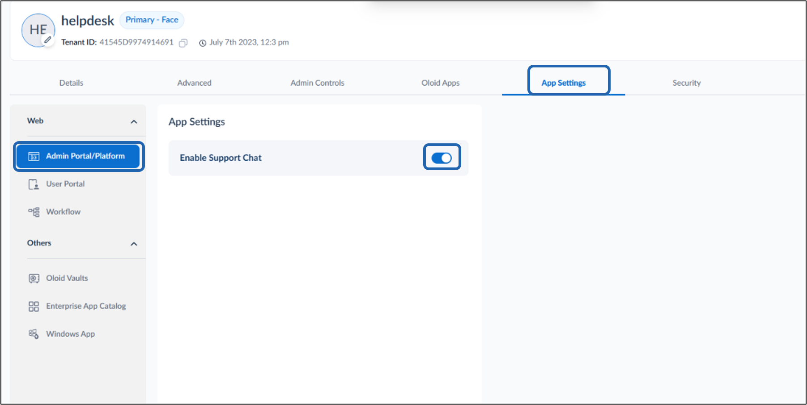
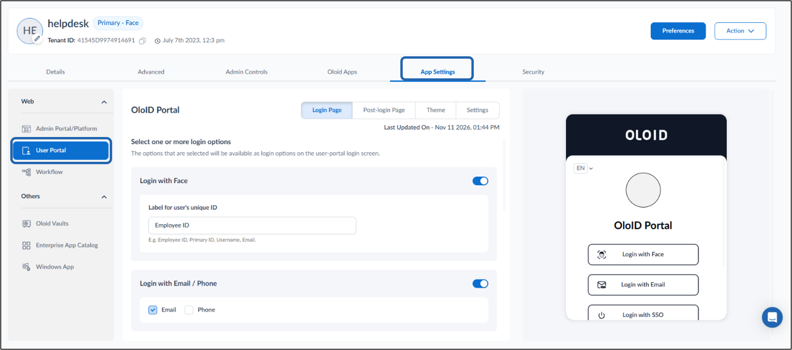
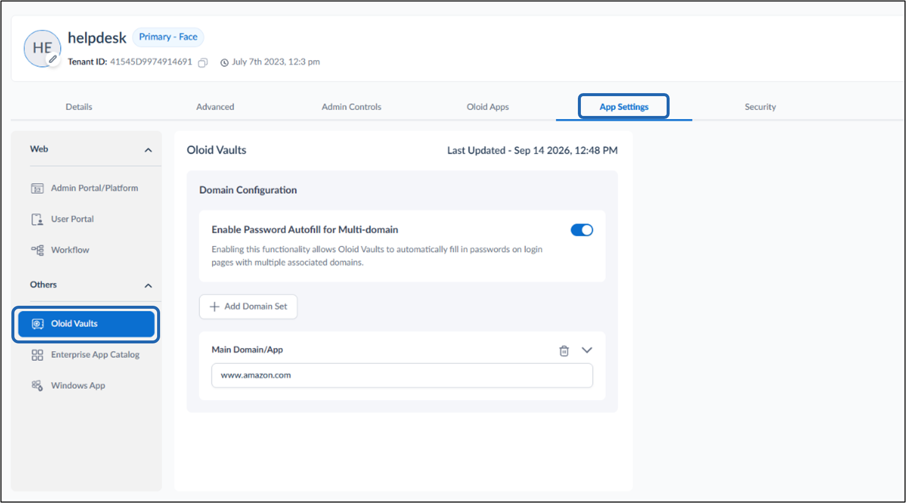
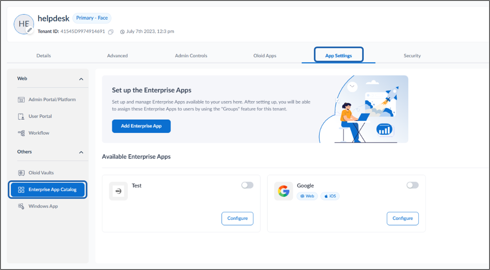
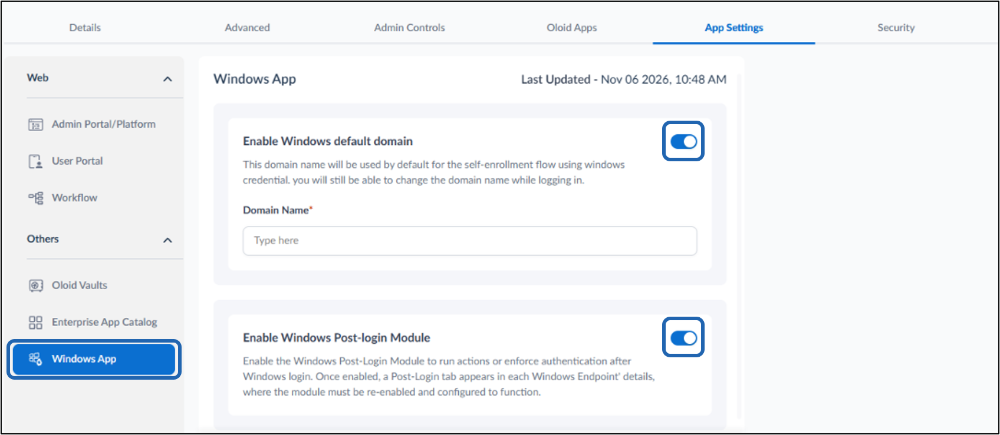

{/* Source: Intercom article 18171974 -  */}
{/* Generated by intercom_to_mintlify.py - re-running overwrites this file. */}

## Introduction

The App Settings page in the Tenant Admin Portal lets Tenant Admins configure tenant-wide settings for Oloid applications and portals from a single location. App Settings is available on the Tenant Settings page.

## Prerequisite

- You must have a Tenant Admin account.

## Steps to Configure App Settings

1. Login to the **Tenant Admin Portal**.
2. On the homepage of the portal, click **Profile icon** on the bottom left corner of the menu panel.

   

   The user profile menu is displayed.
3. Click **Tenant Settings**.

   

   The **Tenant Settings** page is displayed.
4. On Tenant Settings page > click **App Settings**.
5. Do the following:
   [Admin Portal/Platform](#admin-portal-platform)
   [User Portal](#user-portal)
   [Workflow](#workflow)
   [Oloid Vaults](#oloid-vaults)
   [Enterprise App Catalog](#enterprise-app-catalog)
   [Windows App](#windows-app)
6. Click **Save.**

### Admin Portal/Platform

Turn on the **Enable Support Chat** toggle to enable chat support across the Tenant Admin Portal.

### User Portal

The Admin can configure the Oloid User Portal from the Tenant Admin Portal by selecting preferred login options, enabling Single Sign-On (SSO) providers, customizing the visual theme to enhance the end-user experience, and accessing the Oloid User Portal directly by clicking the User Portal link within the Tenant Admin Portal. For more information, refer: [Oloid User Portal - How to Configure Oloid User Portal in Tenant Admin Portal](/platform/tenant-admin-portal/oloid-user-portal-how-to-configure-oloid-user-portal-in-tenant-admin)

### Workflow

### Oloid Vaults

When the Password Autofill feature is enabled, Oloid Vault can automatically populate saved credentials on login pages for multiple domains or related applications. For more information, refer: [Oloid Vault (Chrome / Chromium) - How to Enable Password Autofill for Multi-Domain in the Tenant Admin Portal](/platforms/web/vault/chrome/oloid-vault-chrome-chromium-how-to-enable-password-autofill-for-multi)

### Enterprise App Catalog

The Enterprise App Catalog in the Tenant Admin Portal lets Tenant Admins add the enterprise applications used in their organization and make them available in the Oloid platform. For more information, refer: [Tenant Admin Portal - How to Add and Enable Enterprise Apps](/platform/tenant-admin-portal/tenant-admin-portal-how-to-add-and-enable-enterprise-apps)

### Windows App

This section allows the Admin to enable Windows Default Domain and Enable the Windows Post Login Module.

Do the following:

1. Enable Windows Default Domain.The Oloid Windows Login application enables secure, passwordless sign-in. Tenant Admins can configure a default Windows domain in the Tenant Admin Portal to streamline logins in domain-connected environments. For more information, refer: [Windows Login - How to enable Windows Default Domain for Windows Login in the Tenant Admin Portal](/platforms/windows/windows-login/windows-login-how-to-enable-windows-default-domain-for-windows-login)
2. Enable Windows Post-Login module. The Windows Post-login Module allows the admin to control post-login behavior on Windows devices after user authentication. For more, refer: [Windows Login v2.0 - How to Enable Windows Post-login Module](/platforms/windows/windows-login/v2/windows-login-v2-0-how-to-enable-windows-post-login-module)
