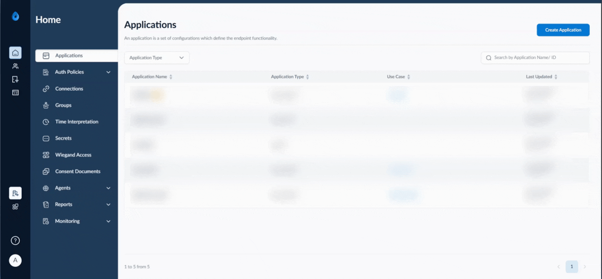
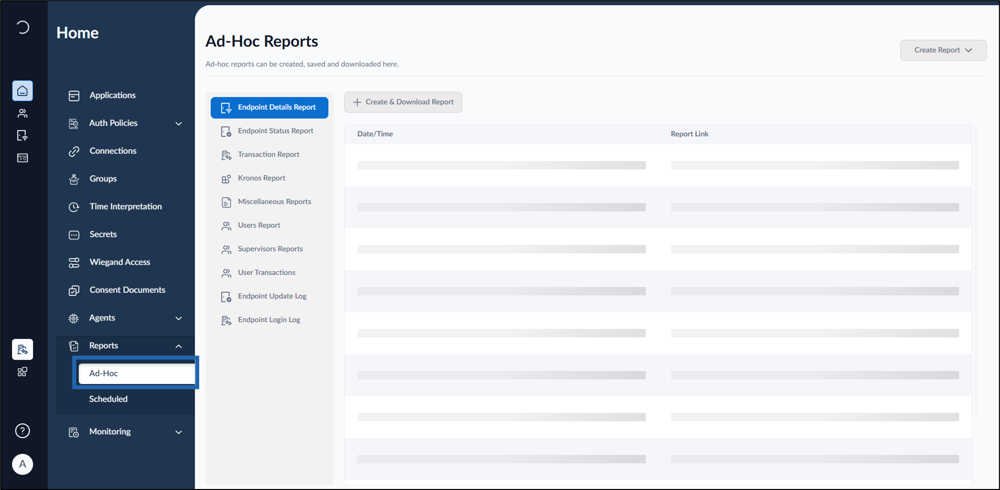
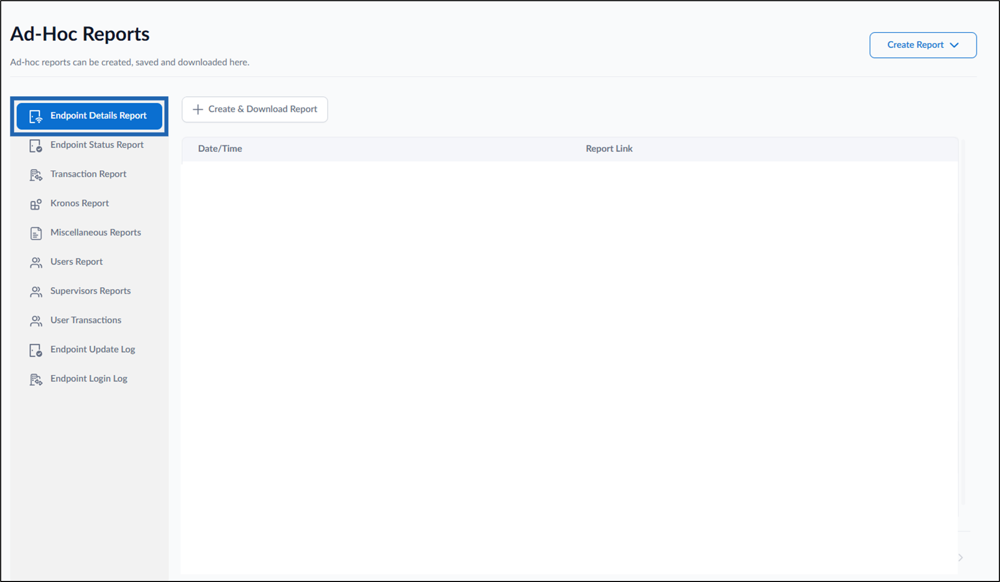
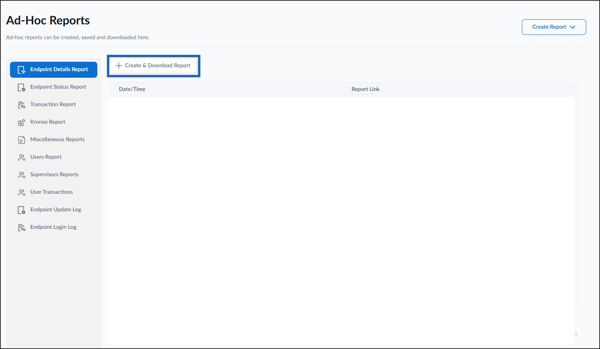

{/* Source: Intercom article 13333200 -  */}
{/* Generated by intercom_to_mintlify.py - re-running overwrites this file. */}

## Steps to create and download Endpoint Details Ad-Hoc Report

1. Log in to the Tenant Admin Portal.
2. Click **Report** from the left menu panel > click **Ad-Hoc** report.

   

   The Ad-Hoc report page is displayed.
3. Click **Endpoint Details Report**.

   

4. Click **create and download report**.

   

   The endpoint details Ad-Hoc report is created and downloaded successfully.
