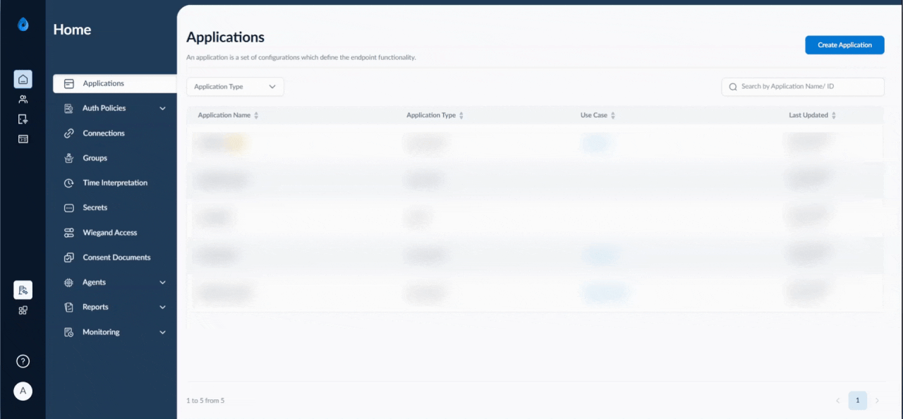

{/* Source: Intercom article 13346792 -  */}
{/* Generated by intercom_to_mintlify.py - re-running overwrites this file. */}

## Steps to create and download endpoint login Ad-Hoc report

1. Log in to the Tenant Admin Portal.
2. Click **Report** from the left menu panel > click **Ad-Hoc** report.
3. Click **endpoint login log** >click **create report**.
4. Set **from date and time** and **to date and time**.
5. Select **transactions status** from drop down list.
6. Enter **primary ID**.
7. Select application name from drop down list.
8. Select endpoint name from drop down list.
