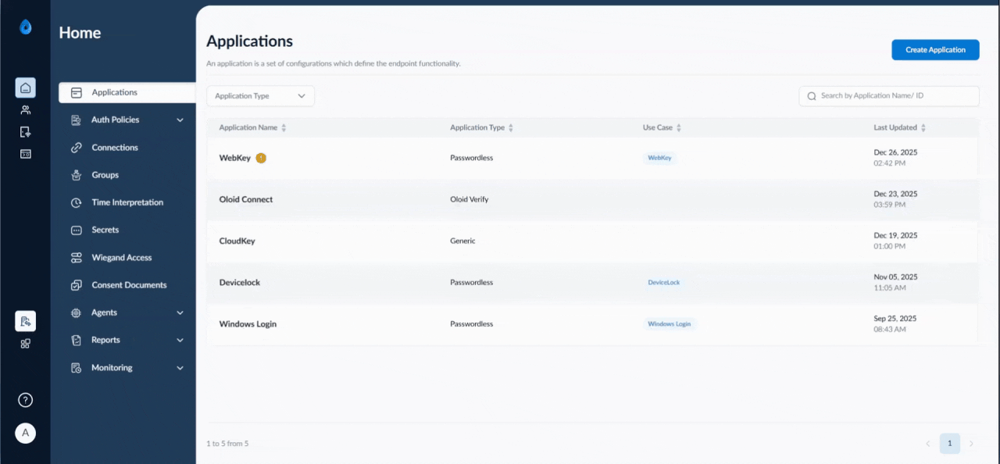

{/* Source: Intercom article 13341005 -  */}
{/* Generated by intercom_to_mintlify.py - re-running overwrites this file. */}

## Steps to create and download endpoint update Ad-Hoc report

1. Log in to the Tenant Admin Portal.
2. Click **Report** from the left menu panel > click **Ad-Hoc** report.
3. Click **endpoint update log** > click **create and download report**.
