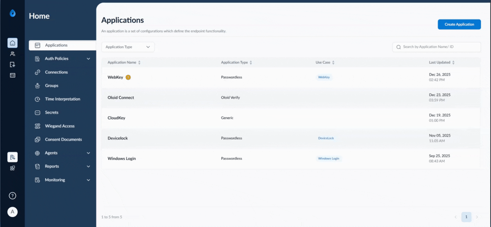

{/* Source: Intercom article 13340270 -  */}
{/* Generated by intercom_to_mintlify.py - re-running overwrites this file. */}

## Steps to create and download supervisor Ad-Hoc report

1. Log in to the Tenant Admin Portal.
2. Click **Report** from the left menu panel > click **Ad-Hoc** report.
3. Click **Supervisor report** > Click **create and download report**.

The Supervisor Ad-Hoc report is created and downloaded successfully.
