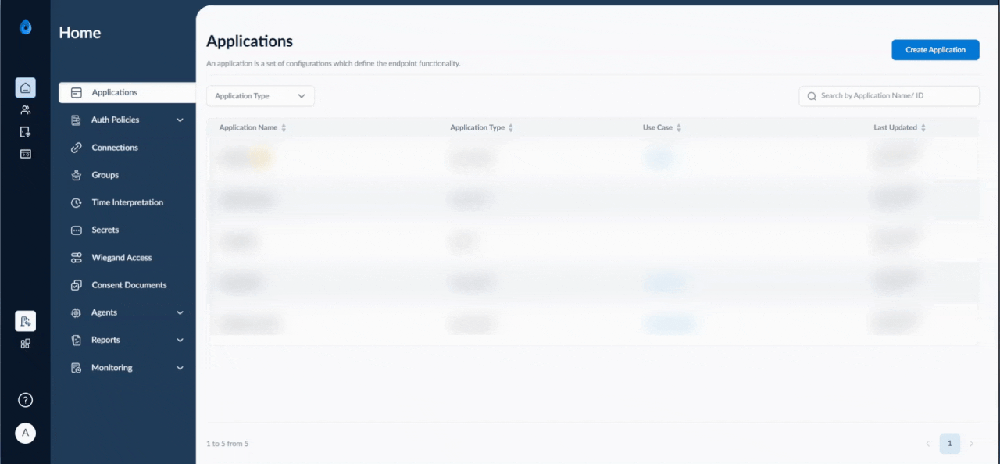

{/* Source: Intercom article 13340188 -  */}
{/* Generated by intercom_to_mintlify.py - re-running overwrites this file. */}

## Steps to create user Ad-Hoc report

1. Log in to the Tenant Admin Portal.
2. Click **Report** from the left menu panel > click **Ad-Hoc** report.
3. Click **User report** > click **Create report**.
4. Do one of the following:
   1. **Connection**
      1. Select **Connection**.
      2. Select the preferred connection from the drop down list.
      3. Click **download**.
   2. **Group**
      1. Select **Group**.
      2. Select the preferred group from the drop down list.
      3. Click **download**.

The User Ad-Hoc report is created and downloaded successfully.
