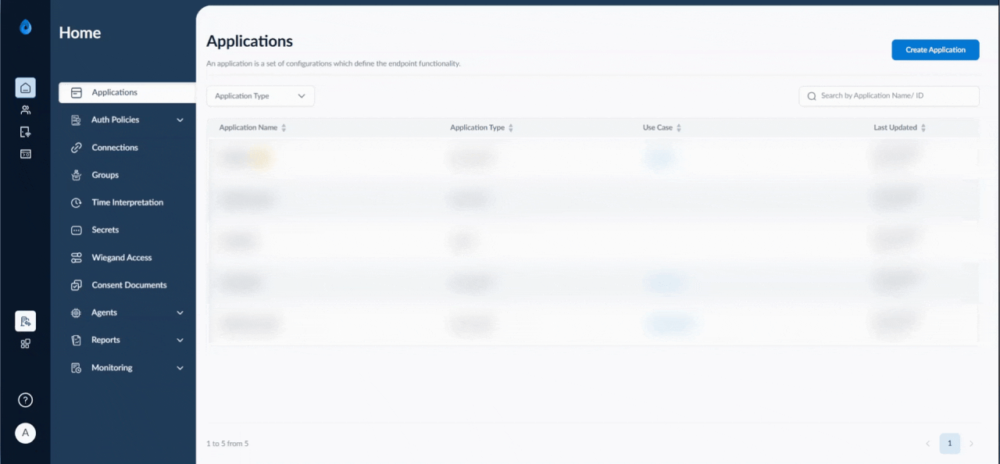
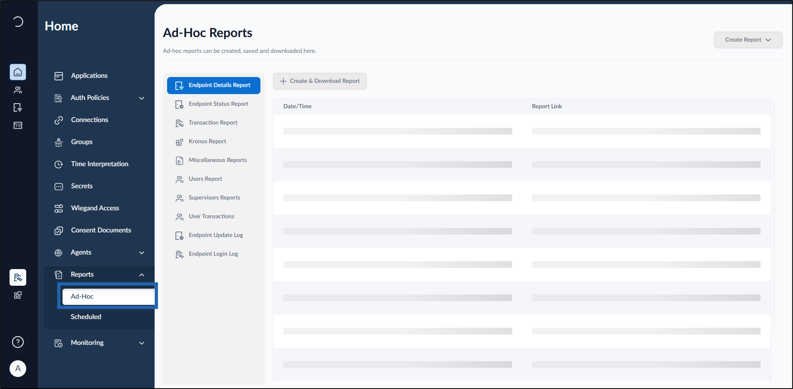
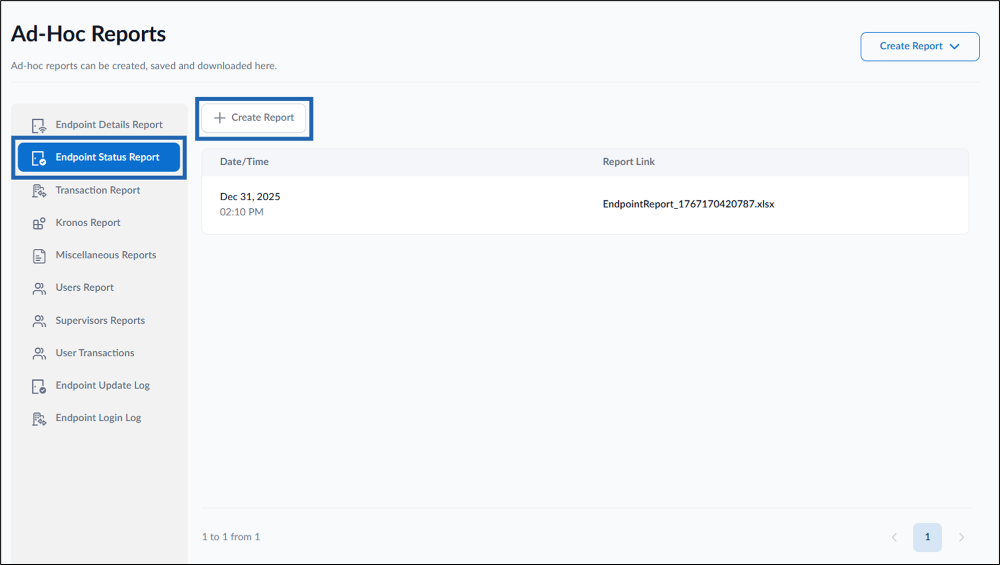
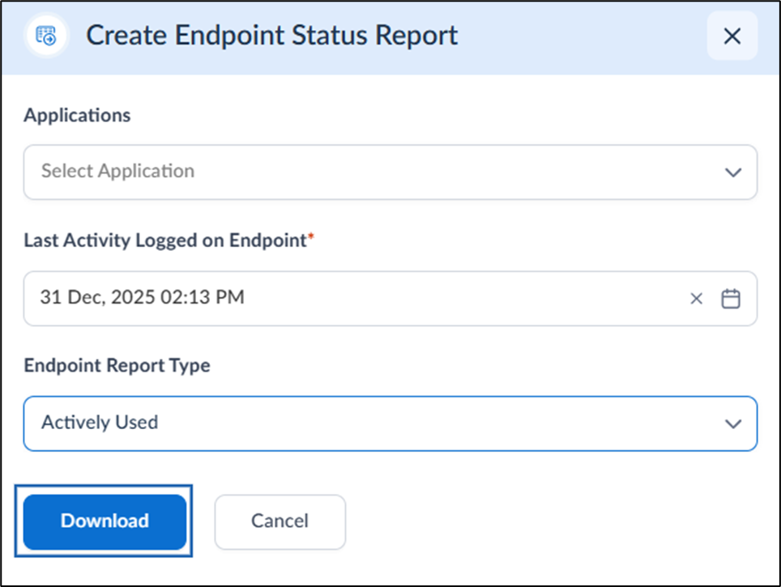

{/* Source: Intercom article 13333557 -  */}
{/* Generated by intercom_to_mintlify.py - re-running overwrites this file. */}

## Steps to create endpoint status Ad-Hoc Report

1. Log in to the Tenant Admin Portal.
2. Click **Report** from the left menu panel > click **Ad-Hoc** report.

   

   The Ad-Hoc report page is displayed.
3. Click **Endpoint Status Report** >click **Create Report**.

   

   The **create endpoint status report** pop-up box is displayed.
4. Do the following on the pop-up box:
   1. Select the preferred application from application dropdown list.
   2. Set **last activity logged on endpoint** date and time.
   3. Select **endpoint report type** from dropdown list.
   4. Click **download**.

      

      The endpoint status report is created successfully.
