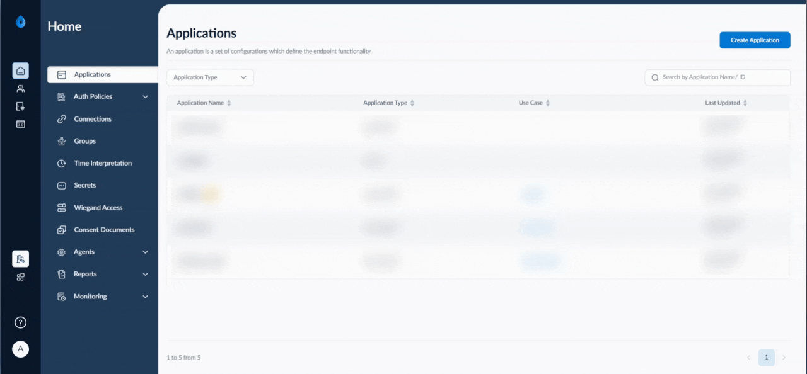
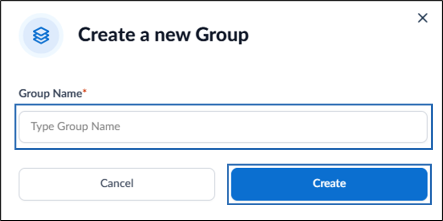

{/* Source: Intercom article 13303684 -  */}
{/* Generated by intercom_to_mintlify.py - re-running overwrites this file. */}

## Steps to Create Group

1. Log in to the **Tenant Admin Portal**.
2. Click **Groups** from the left panel menu > Click **Create Group**.
   **Create a new Group** Pop box is displayed.

   

3. Enter a group name in the **Type Group Name** field.

Click **Create** to save the group.

The group is created successfully.
