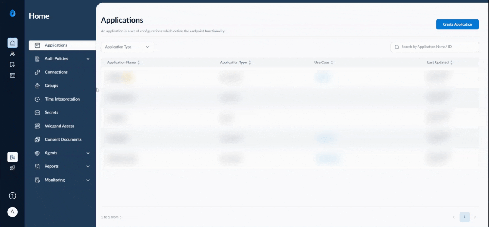

{/* Source: Intercom article 13347649 -  */}
{/* Generated by intercom_to_mintlify.py - re-running overwrites this file. */}

## Steps to create schedule transaction report

1. Log in to the Tenant Admin Portal.
2. Click **Report** from the left menu panel > click **Schedule** report.
3. Click **create**.
4. Enter report name > select **transaction**.
5. Click **create**.
