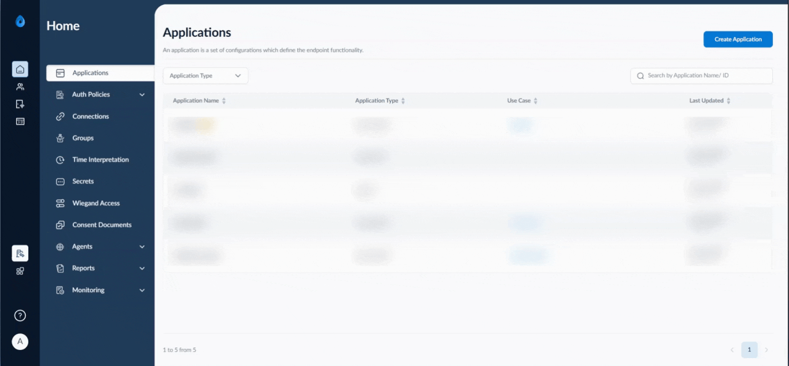

{/* Source: Intercom article 13340732 -  */}
{/* Generated by intercom_to_mintlify.py - re-running overwrites this file. */}

## Steps to user transaction Ad-Hoc report

1. Log in to the Tenant Admin Portal.
2. Click **Report** from the left menu panel > click **Ad-Hoc** report.
3. Click **User transaction** > click **create report**.
4. Set **from date and time** and **to date and time**.
5. Click **download**.
