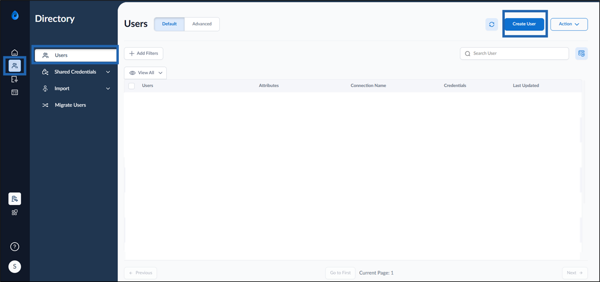
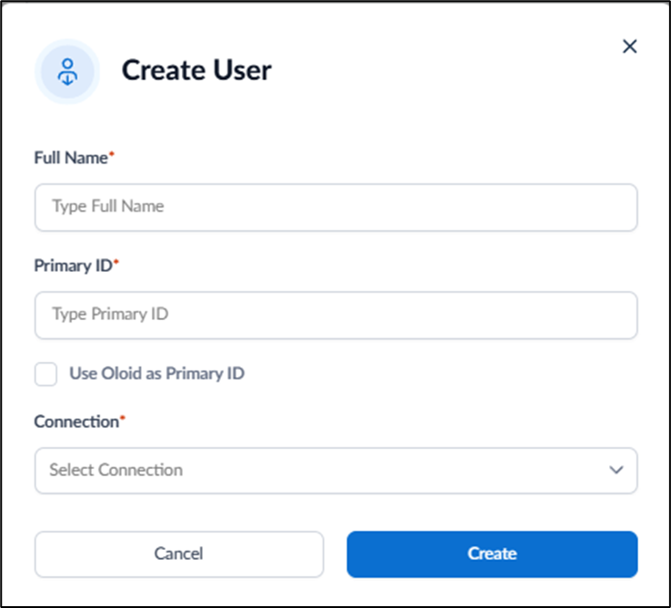

{/* Source: Intercom article 13333139 -  */}
{/* Generated by intercom_to_mintlify.py - re-running overwrites this file. */}

## Steps to Create Users

1. Log in to the **Tenant Admin Portal**.
2. Go to **Directory > Users >** click **Create User**.

   

   **Create User** Pop box is displayed.
3. Do the following:
   1. Enter **Full Name**.
   2. Enter **Primary ID**.

      <Note>
        **Note:** Select the checkbox, to use Oloid as Primary ID.
      </Note>

   3. Select **Connection** from the drop-down list.
   4. Click **Create**.

      

      The User is created successfully.
