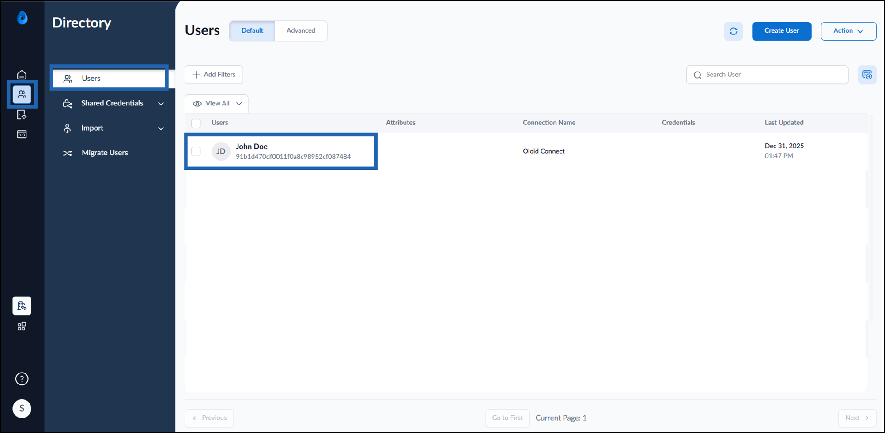
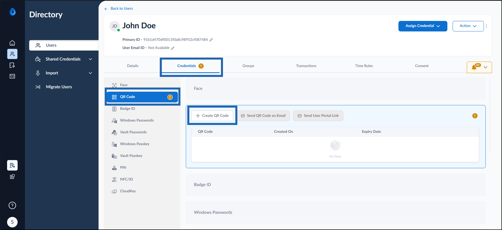
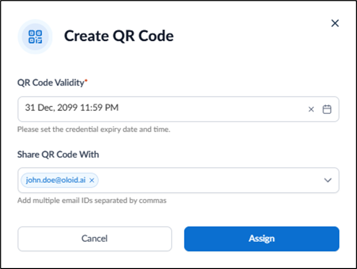

{/* Source: Intercom article 13333168 -  */}
{/* Generated by intercom_to_mintlify.py - re-running overwrites this file. */}

## Steps to Generate/Create QR Code

1. Log in to the **Tenant Admin Portal**.
2. Go to **Directory > Users >** click **applicable user.**

   

   The user detail page is displayed.
3. Click **Credentials > QR Code >** click **Create QR Code.**

   

   The QR code page is displayed.
4. Do the following:
   1. Select **QR Code Validity**.
   2. Enter **Mail ID** in the **Share QR Code with** field.
   3. Click **Assign**.

      

      The QR code is created successfully.
