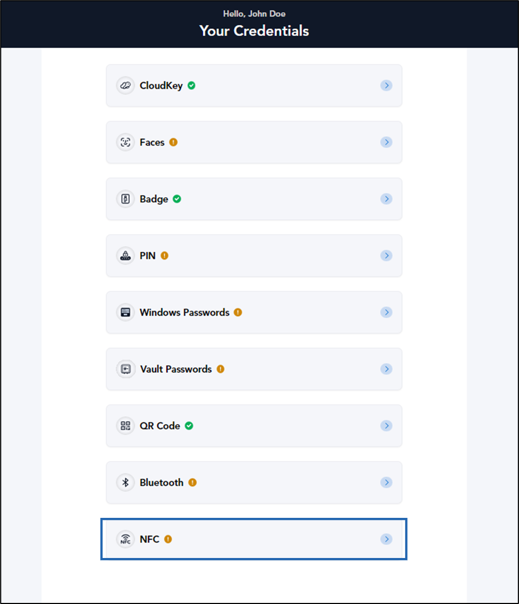
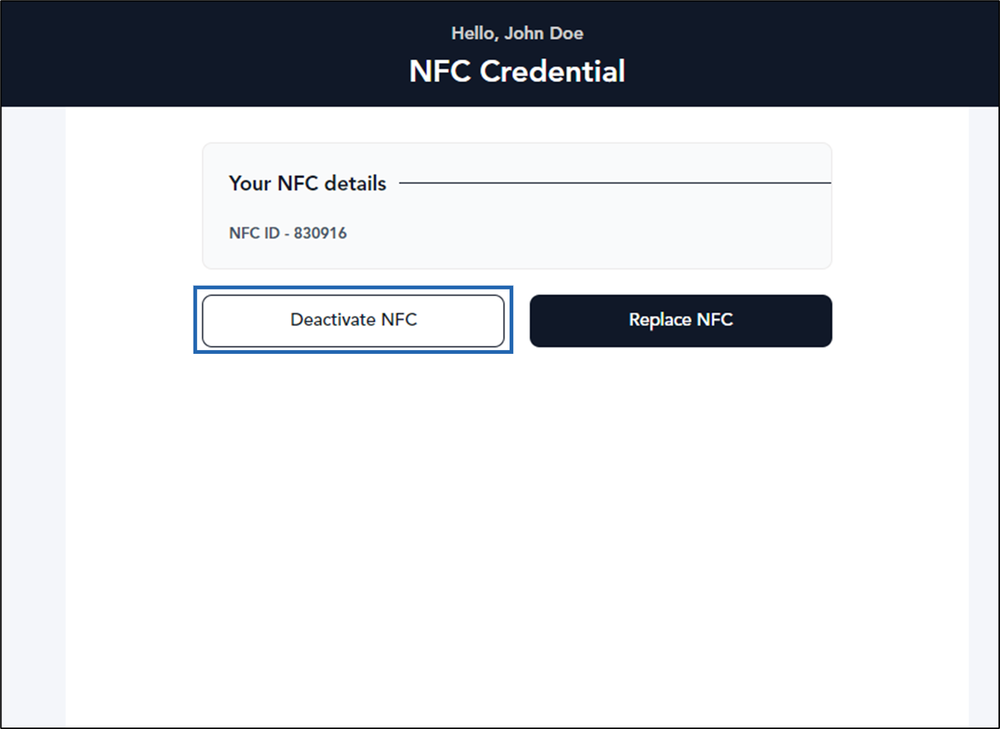
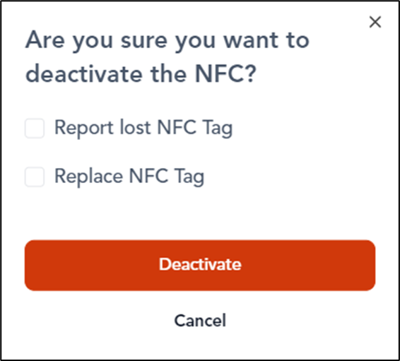
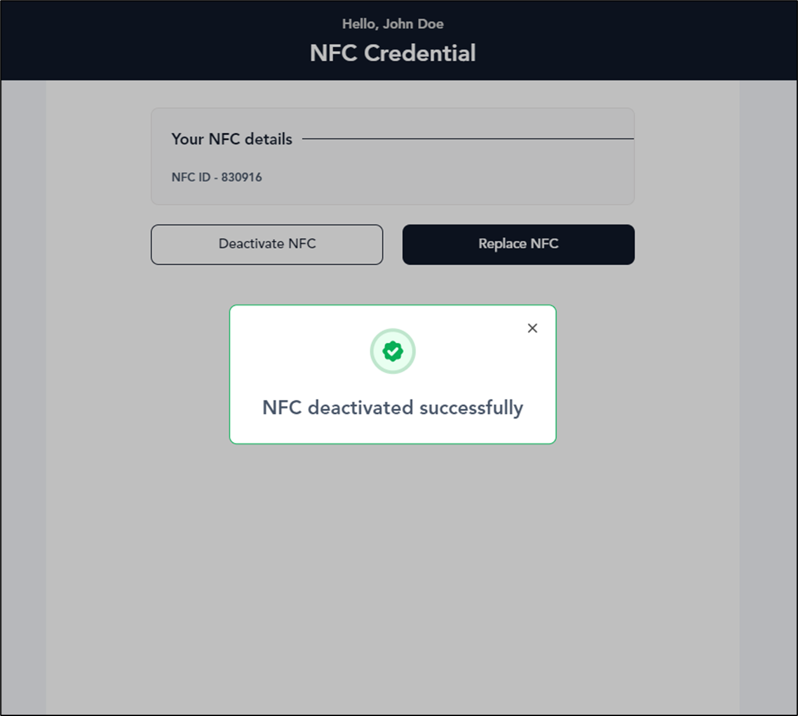

{/* Source: Intercom article 9895839 -  */}
{/* Generated by intercom_to_mintlify.py - re-running overwrites this file. */}

Steps to deactivate NFC:

1. Login to the **Oloid User Portal**.
2. On the homepage, click **NFC**.

   

   The **NFC Credential** page is displayed.
3. Click **Deactivate NFC**.

   

   The confirmation pop-up screen is displayed.

   

4. On the screen, do the following.
   1. Select reason. (optional)
   2. Click **Deactivate**.
      The NFC is deactivated successfully.

      
