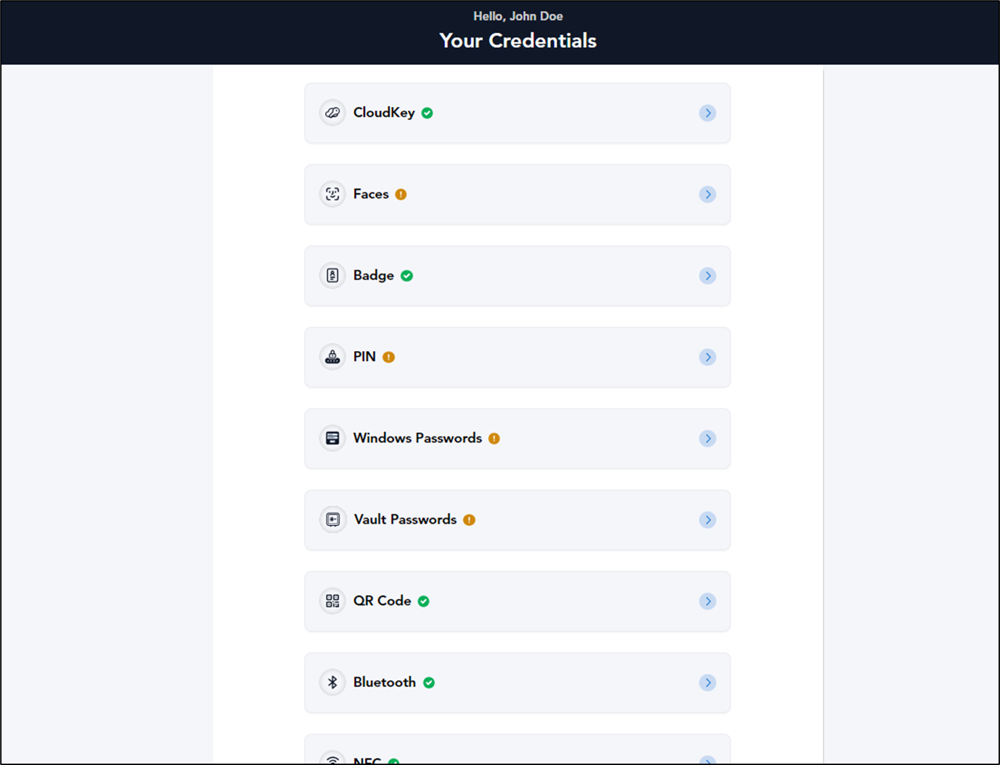
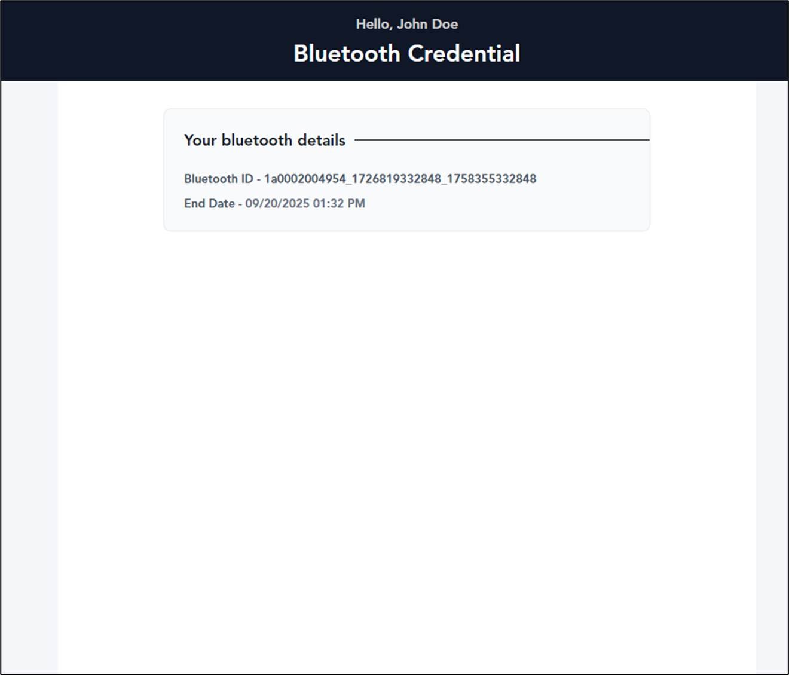

{/* Source: Intercom article 9901614 -  */}
{/* Generated by intercom_to_mintlify.py - re-running overwrites this file. */}

Steps to view Bluetooth credentials.

1. login to the **Oloid User Portal**.
2. On the homepage, click **Bluetooth**.

   

   The **Bluetooth Credential** page is displayed and you can view the Bluetooth credential on the page.

   
