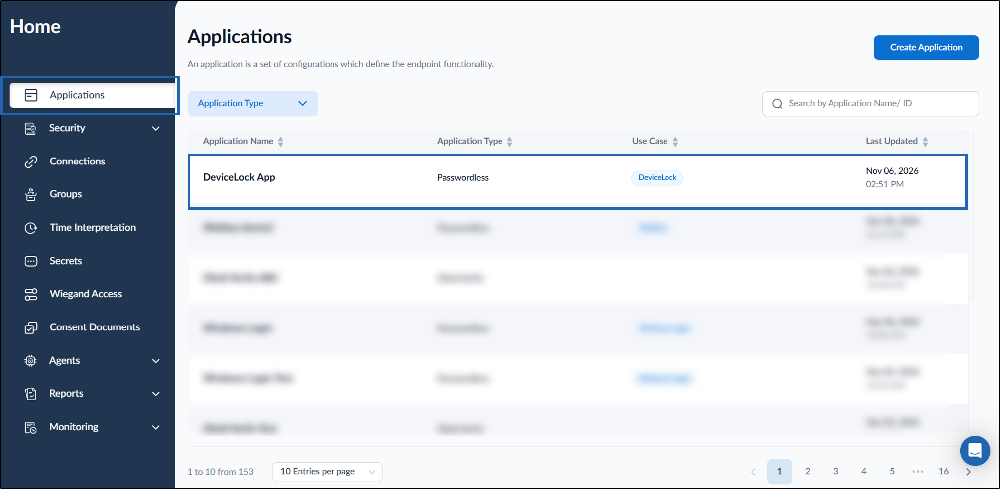
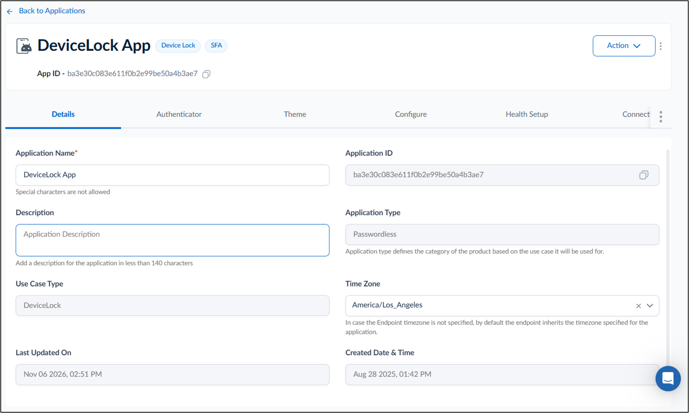
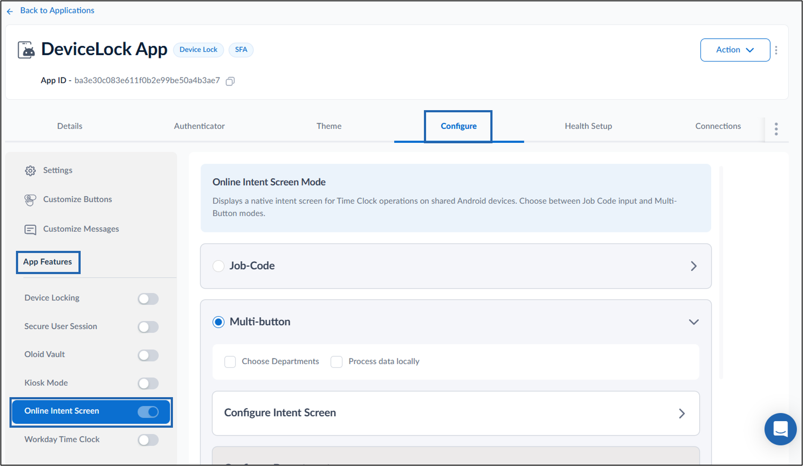
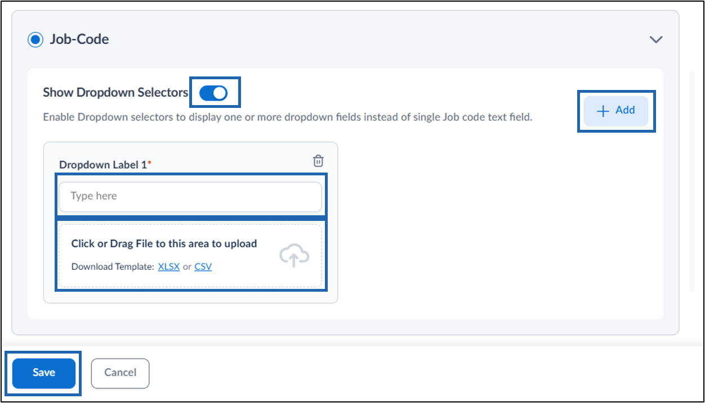

{/* Source: Intercom article 18360110 -  */}
{/* Generated by intercom_to_mintlify.py - re-running overwrites this file. */}

## Introduction

The Online Intent Screen feature in the Tenant Admin Portal allows admins to display a native intent screen for Time Clock operations on shared Android devices. Admins can choose between the Job-Code mode, where users enter or select a job code, and the Multi-button mode, where users choose an action from configured buttons.

## Prerequisite

- You must have admin access to the Tenant Admin Portal.
- A Device Lock application must be created. For more, refer to [DeviceLock App - How to Create and Configure DeviceLock Application in the Tenant Admin Portal](/platforms/windows/windows-login/devicelock-app-how-to-create-and-configure-devicelock-application-in)

## Steps to configure Online Intent Screen

1. Log in to the **Tenant Admin Portal**.
2. On the home page of the portal, click **Applications** on the left menu panel.
   The **Applications** page is displayed.

   

3. Click the preferred **DeviceLock** application.
   The application details page is displayed.

   

4. Go to **Configure** > **App Features** > Enable the **Online Intent Screen** toggle.
   The **Online Intent Screen Mode** section is displayed.

   

5. Configure any one of the following modes:
   1. [Configure Job-Code mode](#)
   2. [Configure Multi-button mode](#)

### Configure Job-Code mode

The **Job-Code** mode allows users to enter a job code, or select one or more values from drop-down fields, on the intent screen.

1. Select **Job-Code**.
2. Enable the **Show Dropdown Selectors** toggle to display one or more drop-down fields instead of a single job code text field.
   1. Enter the label in the **Dropdown Label 1** field.
   2. Click or drag the file containing the drop-down values to the upload area.

      <Note>
        **Note:** To download the template, click **XLSX** or **CSV**.
      </Note>

   3. To add more drop-down fields, click **+ Add**, and then repeat steps 2.a and 2.b. (Optional)

      <Note>
        **Note:** To remove a drop-down field, click the **Delete** icon.
      </Note>

3. Click **Save**.

   

   The **Job-Code** mode is configured successfully.

### Configure Multi-button mode

The **Multi-button** mode allows users to choose an action from configured buttons on the intent screen.

1. Select **Multi-button**.
2. Select one or both of the following checkboxes:
   - **Choose Departments:** Displays a department selection screen after the intent screen.
   - **Process data locally:** Processes the intent data on the device.
3. Configure the following sections:
   1. [Configure Intent Screen](#)
   2. [Configure Departments](#)
