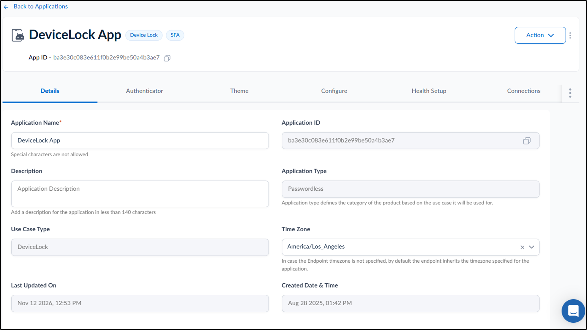
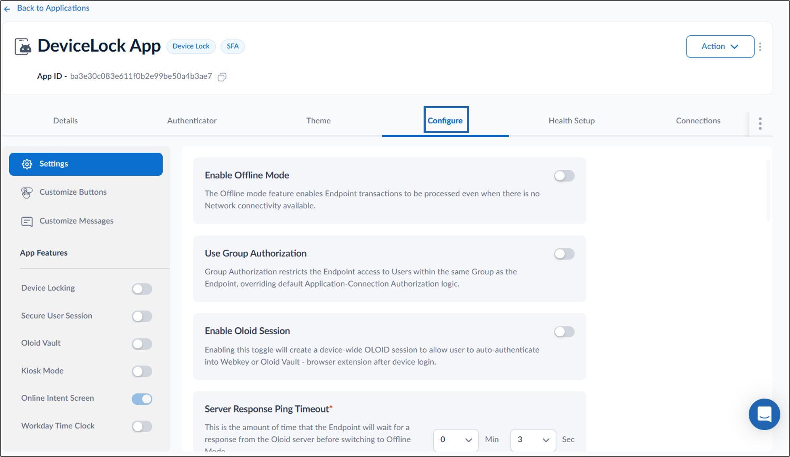
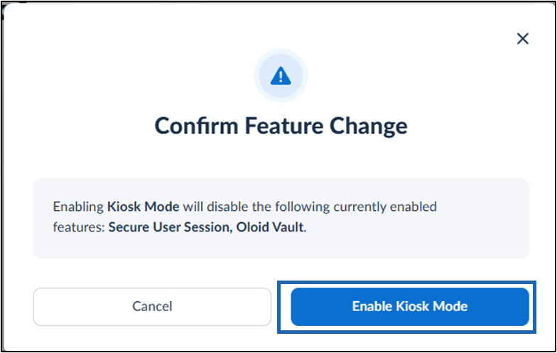
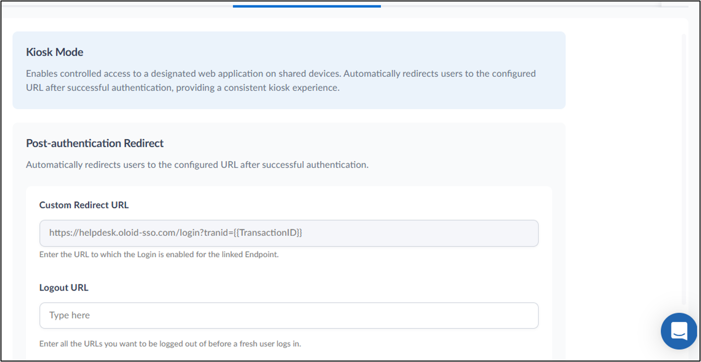
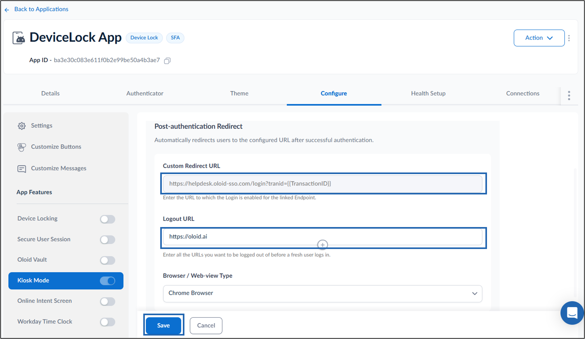

{/* Source: Intercom article 18359970 -  */}
{/* Generated by intercom_to_mintlify.py - re-running overwrites this file. */}

## Introduction

The Kiosk Mode enables controlled access to a designated web application on shared devices. After a user authenticates successfully, the Oloid DeviceLock app automatically redirects the user to the URL configured by the administrator, providing a consistent kiosk experience.

## Prerequisites

- You must have admin access to the **Tenant Admin Portal**.
- You must create a **DeviceLock** application. To create, refer [How to create and configure Device Lock application](/platforms/windows/windows-login/devicelock-app-how-to-create-and-configure-devicelock-application-in).

## Steps to Configure Kiosk Mode

1. Log in to the Tenant Admin Portal.
2. On the homepage, click the **DeviceLock** applicationto be configured.
   The DeviceLock application **Details** page is displayed.

   

3. Click the **Configure** tab.

   

   The Configure page is displayed.
4. Go to **App Features >** turn on **Kiosk Mode** toggle.

   <Note>
     **Note:** If you enable Kiosk Mode, automatically disable all other enabled app feature options.
   </Note>

   

5. Click **Enable Kiosk Mode.**
   The **Kiosk Mode** page is displayed.

   

Do the following:

a. In the **Post-authentication Redirect** > go to **Custom Redirect URL** field, enter the URL of the web application to which users must be redirected after successful authentication.

<Note>
  **Note:** The URL is the one to which the login is enabled for the linked endpoint.
</Note>

b. In the **Logout URL** field, enter all the log out URLs, to add multiple URL's click plus icon.

c. Click **Save**.

The Kiosk mode is configured successfully.
