{/* Source: Intercom article 16781960 -  */}
{/* Generated by intercom_to_mintlify.py - re-running overwrites this file. */}

## Introduction

This document provides step-by-step instructions to configure **PingOne Single Sign-On (SSO)** in the Tenant Admin Portal for DeviceLock app.

## Prerequisites

- You must have admin access to the Tenant Admin Portal.
- You must configure PingOne and generate the required SSO configuration details in the **PingOne Administrator Console**. For instructions, see [PingOne Settings for Oloid SSO](/more/sso-and-mfa/how-to-configure-pingone-single-sign-on-sso-for-the-oloid-portal-in).

## Steps to Configure PingOne SSO

1. Log in to the **Tenant Admin Portal**.
2. On the homepage, click **user profile icon** on the bottom-left of the menu panel.

   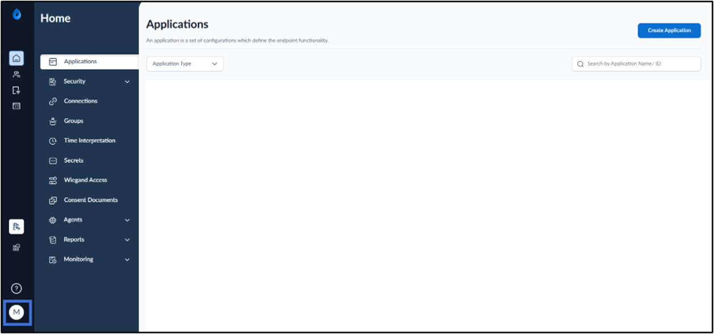

   The user profile menu is displayed.
3. Click **Tenant Settings**.

   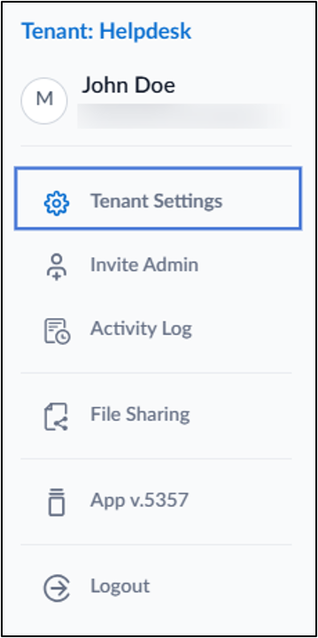

   The **Tenant Settings** page is displayed.
4. Go to **Security** > **PingOne**.
   The PingOne configuration section is displayed.

   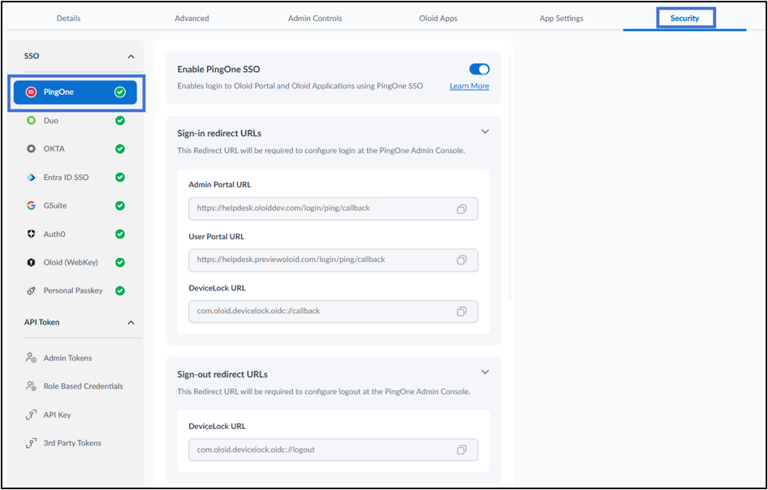

5. Turn on **Enable PingOne SSO** toggle.

   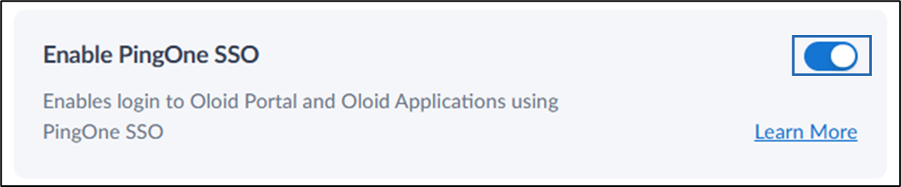

6. Do the following:
   1. Copy the **Sign-in redirect URL for DeviceLock**.

      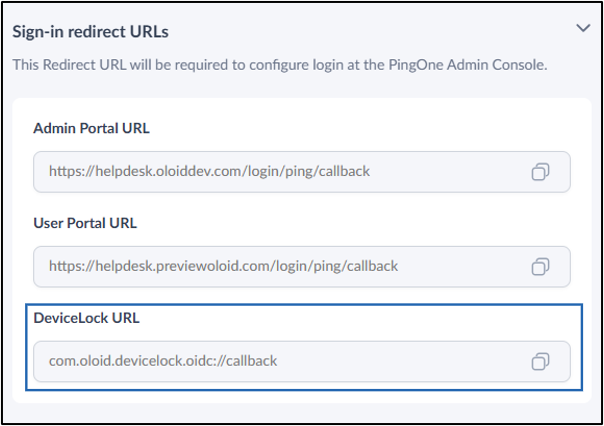

   2. Enter the **Environment ID**.

      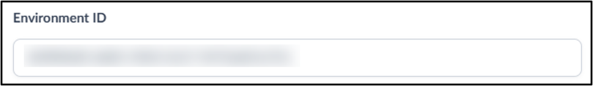

   3. Enter the **Client ID**.

      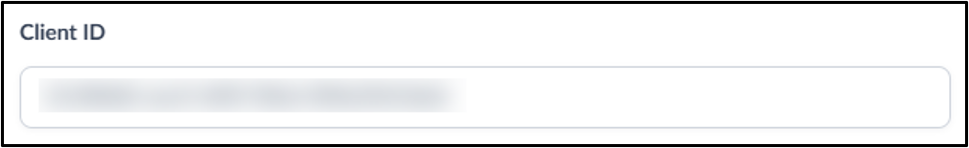

   4. Enter the **Client Secret**.

      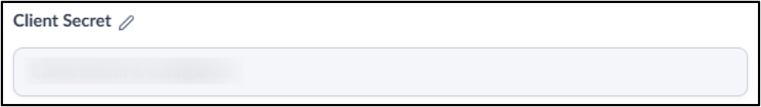

      <Note>
        **Note:** You can find the **Environment ID**, **Client ID**, and **Client Secret** in the **PingOne Administrator Console**. To get these details, go to **Applications > Overview > General**, and copy the required information.
      </Note>

      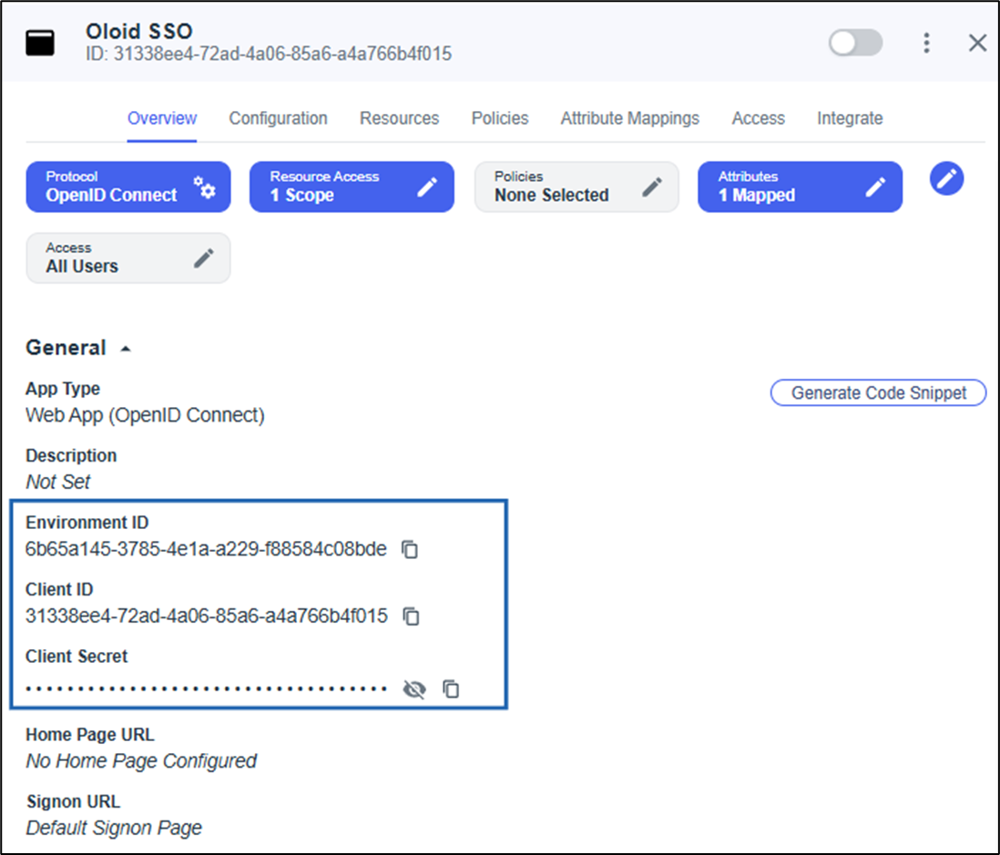

   5. Enter the **Auth URL**.

      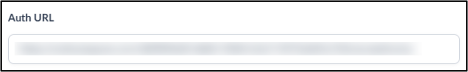

   6. Enter the **Token URL**.

      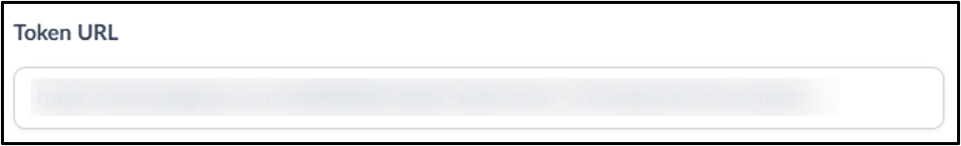

   7. Enter the **User Info URL**.

      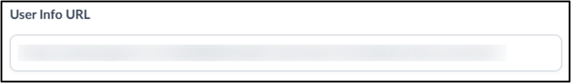

      <Note>
        **Note:** You can find the **Auth URL**, **Token URL**, and **User Info URL** in the **PingOne Administrator Console**. To get these URLs, go to **Applications > Overview > Connection Details**, and copy the required URLs.
      </Note>

      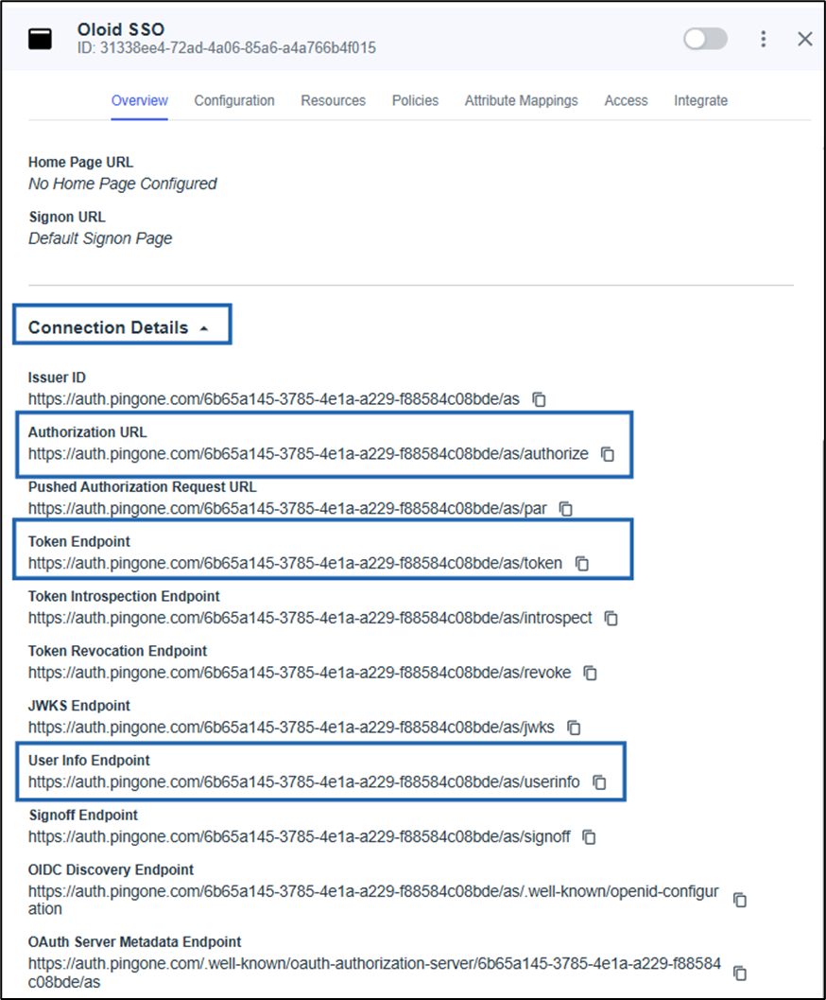

7. Click **Save**.

   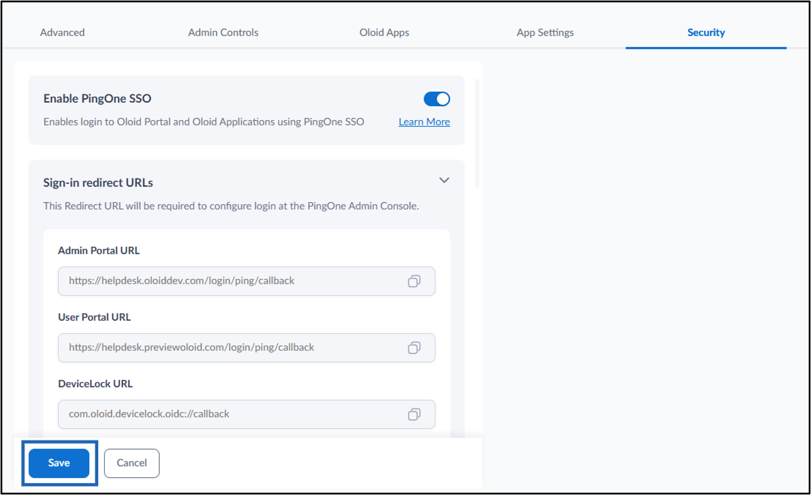

   The PingOne SSO is configured successfully.

   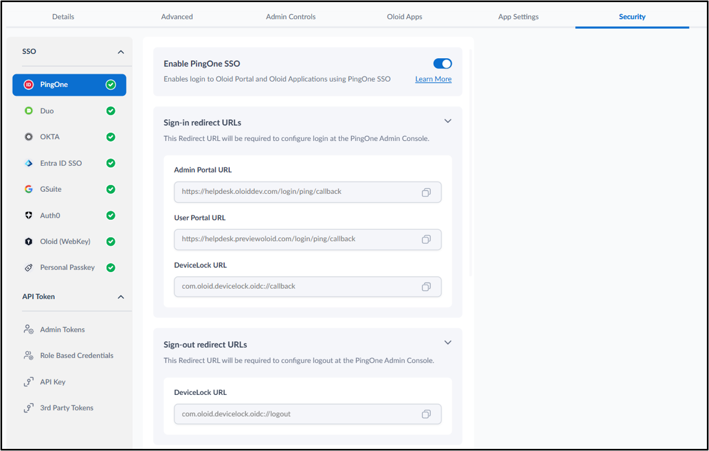
