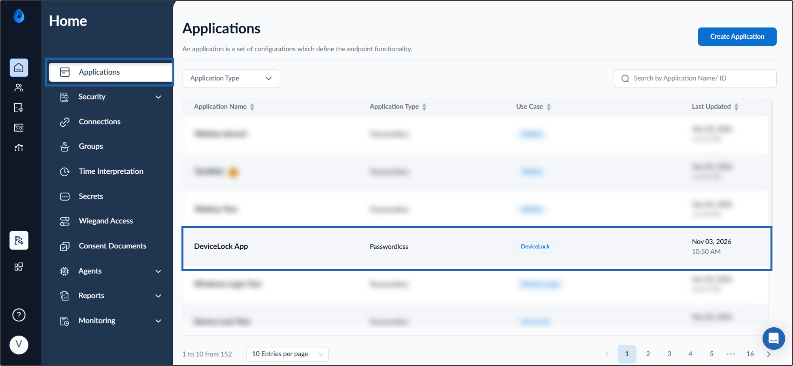
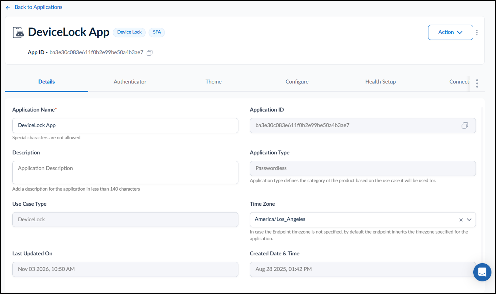
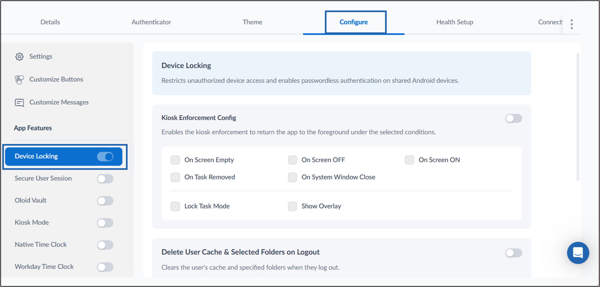
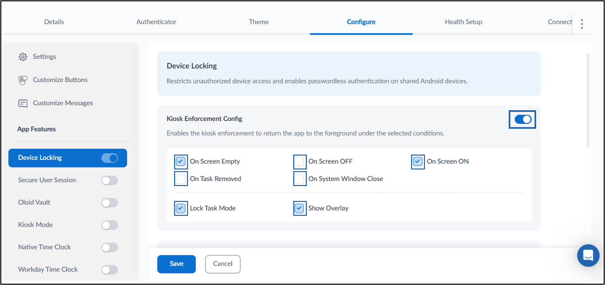
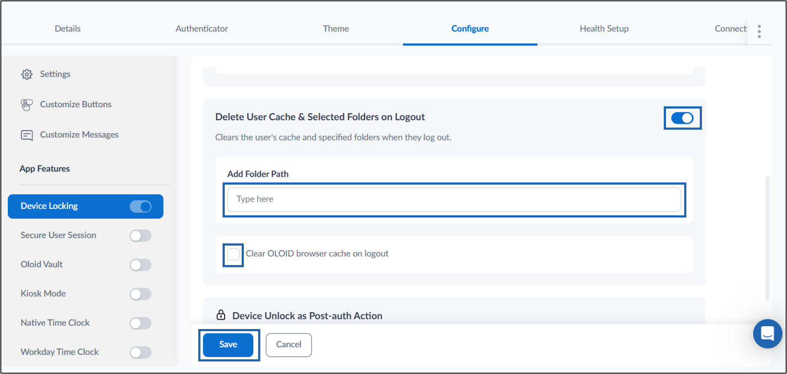
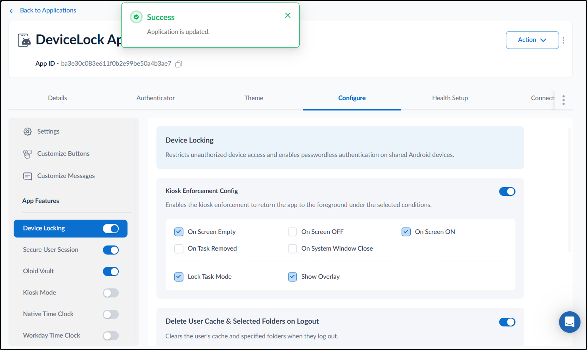

{/* Source: Intercom article 18171988 -  */}
{/* Generated by intercom_to_mintlify.py - re-running overwrites this file. */}

## Introduction

The Device Locking feature in the Tenant Admin Portal allows admins to restrict unauthorized access to shared Android devices and enable passwordless authentication.

## Prerequisites

- You must have admin access to the Tenant Admin Portal.
- A DeviceLock application must be created. For more, refer to [DeviceLock App - How to Create and Configure DeviceLock Application in the Tenant Admin Portal](/platforms/windows/windows-login/devicelock-app-how-to-create-and-configure-devicelock-application-in).

## Steps to configure Device Locking

1. Log in to the **Tenant Admin Portal**.
2. On the home page of the portal, click **Applications** on the left menu panel.

   

   The **Applications** page is displayed.
3. Click the preferred **DeviceLock** application.
   The application details page is displayed.

   

4. Go to **Configure** > **App Features** > Enable **Device Locking** toggle.

   

   The Device Locking toggle is enabled successfully.
5. On the **Kiosk Enforcement Config** section do the following:
   1. Enable the **Kiosk Enforcement Config** toggle.
   2. Select one or more of the following options:
      - **On Screen Empty:** Returns the app to the foreground when no app is displayed on the screen.
      - **On Screen OFF:** Returns the app to the foreground when the screen turns off.
      - **On Screen ON:** Returns the app to the foreground when the screen turns on.
      - **On Task Removed:** Returns the app to the foreground when it is removed from the recent apps list.
      - **On System Window Close:** Returns the app to the foreground when a system window is closed.
      - **Lock Task Mode:** Pins the DeviceLock app on the screen, so users cannot switch to other apps.
      - **Show Overlay:** Displays an overlay on top of other apps.

        

6. On the **Delete** section, do the following:
   1. Enable the **Delete User Cache & Selected Folders on Logout** toggle.
   2. In the **Folder Path** field, enter the folder path to be deleted.
   3. Select the **Clear OLOID browser cache on logout** checkbox to clear the Oloid browser cache when the user logs out. (Optional)
7. Click **Save**.

   

   Device Locking is configured successfully.

   
