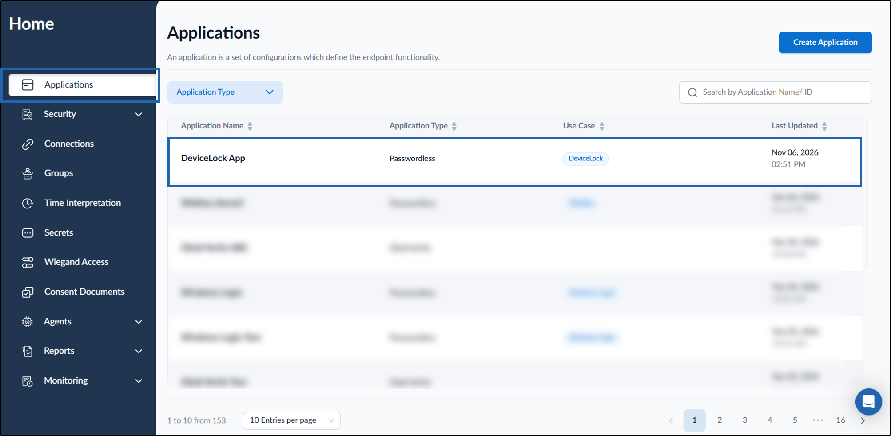
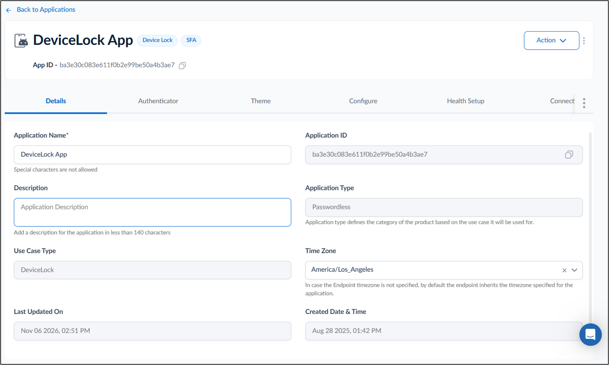
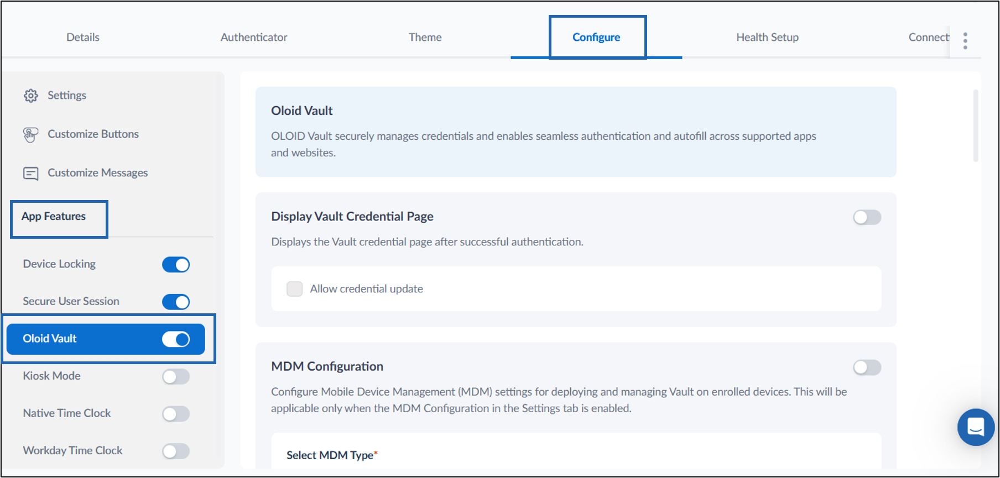
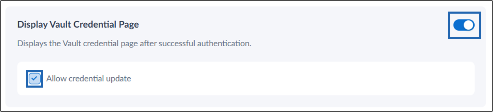
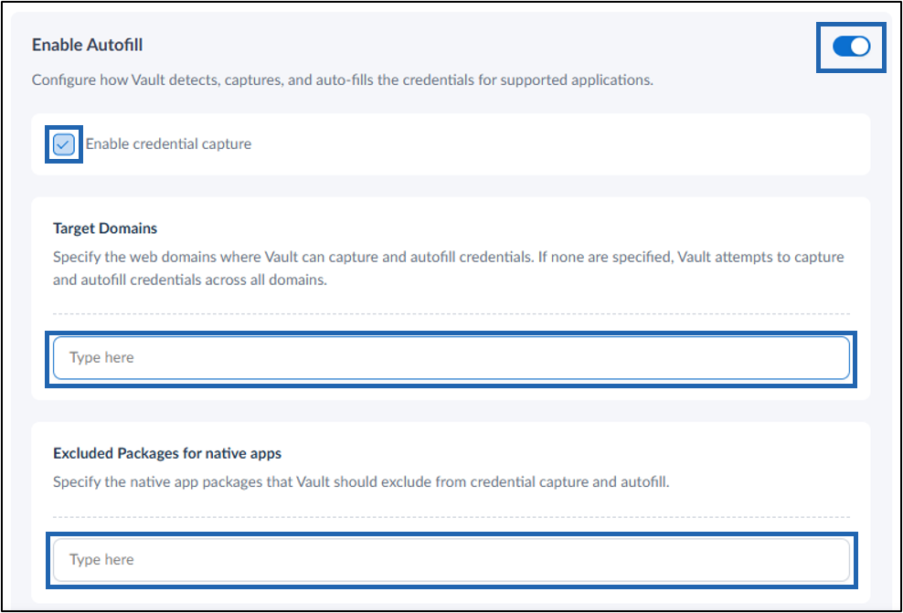
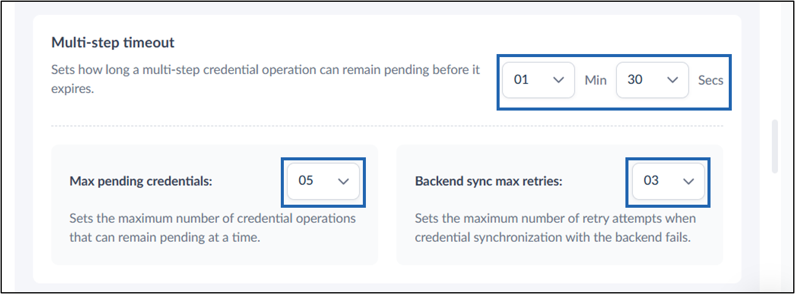
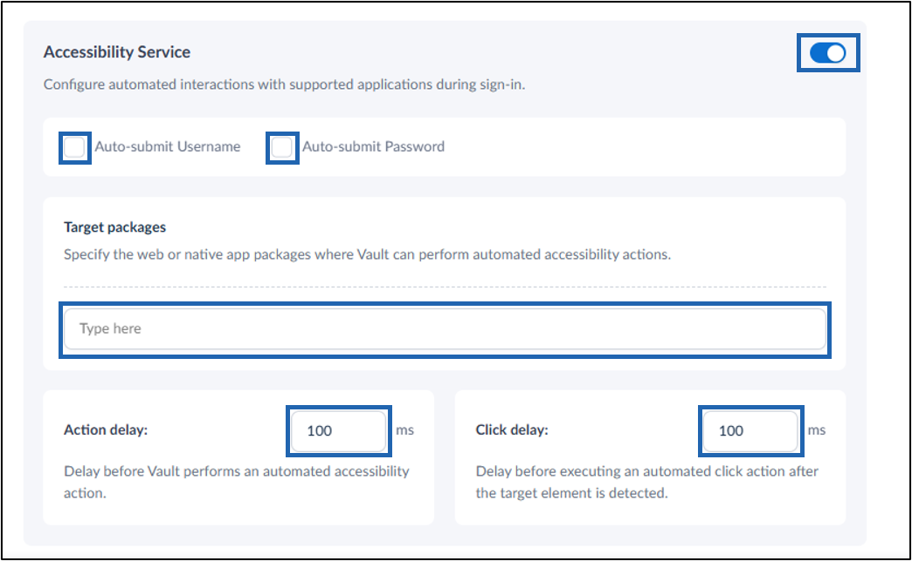
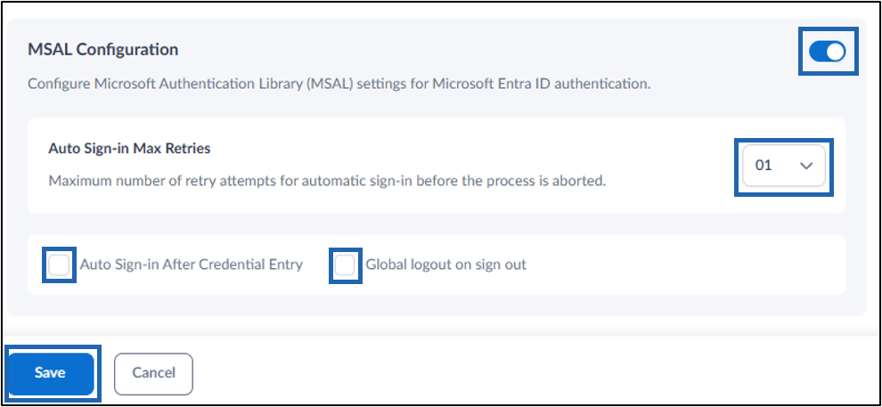

{/* Source: Intercom article 18238061 -  */}
{/* Generated by intercom_to_mintlify.py - re-running overwrites this file. */}

## Introduction

The Oloid Vault feature in the Tenant Admin Portal allows admins to securely manage user credentials on DeviceLock devices. Once configured, Oloid Vault enables seamless authentication and autofills credentials across supported apps and websites.

## Prerequisites

- You must have admin access to the Tenant Admin Portal.
- A DeviceLock application must be created. For more, refer to [DeviceLock App - How to Create and Configure DeviceLock Application in the Tenant Admin Portal](/platforms/windows/windows-login/devicelock-app-how-to-create-and-configure-devicelock-application-in)

## Steps to configure Oloid Vault

1. Log in to the **Tenant Admin Portal**.
2. On the home page of the portal, click **Applications** on the left menu panel.
   The **Applications** page is displayed.

   

3. Click the preferred **DeviceLock** application.
   The application details page is displayed.

   

4. Go to **Configure** > **App Features** > Enable **Oloid Vault** toggle.
   The **Oloid Vault** section is displayed.

   

5. Configure the following:
   1. [Configure Display Vault Credential Page](#configure-display-vault-credential-page)
   2. [Configure Enable Autofill](#configure-enable-autofill)
   3. [Configure Accessibility Service](#configure-accessibility-service)
   4. [Configure MSAL Configuration](#configure-msal-configuration)

### Configure Display Vault Credential Page

The **Display Vault Credential Page** section allows you to show the Vault credential page to the user after successful authentication.

1. Enable the **Display Vault Credential Page** toggle.
2. Select the **Allow credential update** checkbox to allow users to update their credentials on the Vault credential page. (Optional)

   

   The **Display Vault Credential Page** section is configured successfully.

### Configure Enable Autofill

The **Enable Autofill** section allows you to configure how Oloid Vault detects, captures, and autofill credentials for supported applications.

1. Enable the **Enable Autofill** toggle.
2. Select the **Enable credential capture** checkbox to allow Oloid Vault to capture credentials that users enter. (Optional)
3. Enter the web domains where Oloid Vault can capture and autofill credentials in the **Target Domains** field. (Optional)

   <Note>
     **Note:** If no domains are added, Oloid Vault captures and autofills credentials across all domains.
   </Note>

4. Enter the native app packages to exclude from credential capture and autofill in the **Excluded Packages for native apps** field. (Optional)

   

5. Set the **Multi-step timeout** in minutes and seconds.

   <Note>
     **Note:** This is how long a multi-step credential operation can stay pending before it expires. The default is 1 minute 30 seconds.
   </Note>

6. Select the **Max pending credentials** from the drop-down list.

   <Note>
     **Note:** This is the maximum number of credential operations that can be pending at a time. The default is 5.
   </Note>

7. Select the **Backend sync max retries** from the drop-down list.

   <Note>
     **Note:** This is the maximum number of retry attempts when credential sync with the backend fails. The default is 3.
   </Note>

   

   The **Enable Autofill** section is configured successfully.

### Configure Accessibility Service

The **Accessibility Service** section allows you to configure automated interactions with supported applications during sign-in.

1. Enable the **Accessibility Service** toggle.
2. Enter the web or native app packages where Oloid Vault can perform automated accessibility actions in the **Target packages** field.
3. Enter the **Action delay** in milliseconds.

   <Note>
     **Note:** This is the delay before Oloid Vault performs an automated accessibility action. The default is 100 ms.
   </Note>

4. Enter the **Click delay** in milliseconds.

   <Note>
     **Note:** This is the delay before an automated click is performed after the target element is detected. The default is 100 ms.
   </Note>

   

   The **Accessibility Service** section is configured successfully.

### Configure MSAL Configuration

The **MSAL Configuration** section allows you to configure Microsoft Authentication Library (MSAL) settings for Microsoft Entra ID authentication.

1. Enable the **MSAL Configuration** toggle.
2. Select the **Auto Sign-in Max Retries** from the drop-down list.

   <Note>
     **Note:** This is the maximum number of automatic sign-in attempts before the process stops. The default is 1.
   </Note>

3. Select one or both of the following checkboxes (Optional):
   - **Auto Sign-in After Credential Entry:** Signs the user in automatically after credentials are entered.
   - **Global logout on sign out:** Signs the user out of all sessions when they sign out.
4. Click **Save**.

   

   The **MSAL Configuration** section is configured successfully.

The **Oloid Vault** is configured successfully.
