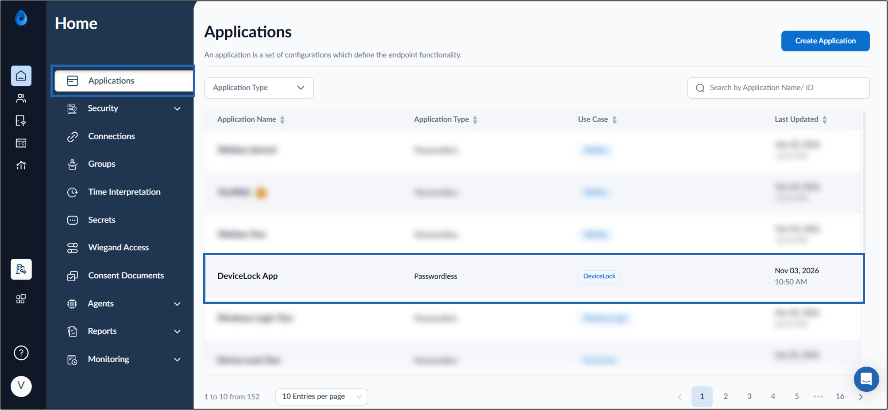
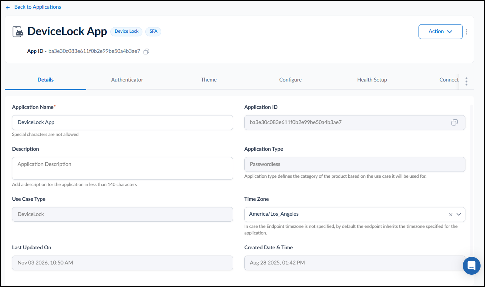
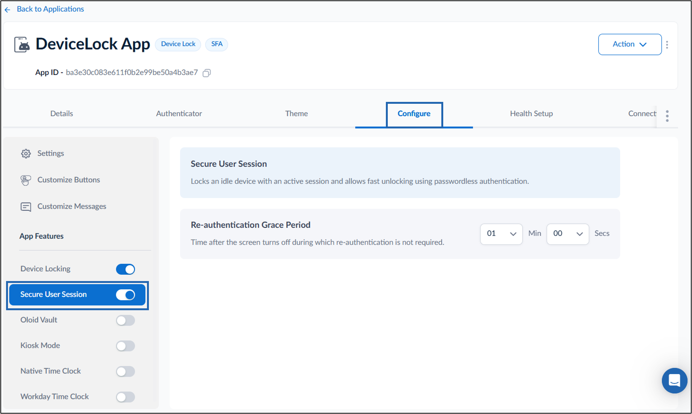
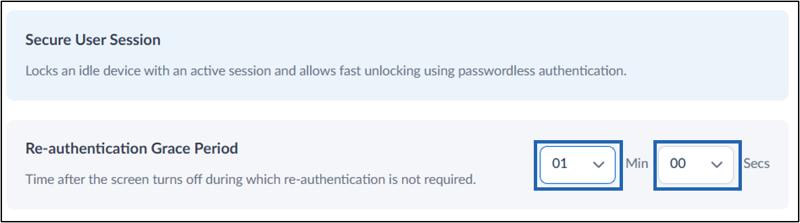
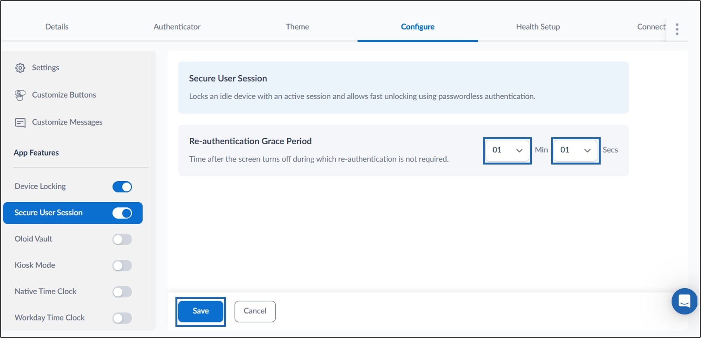

{/* Source: Intercom article 18236503 -  */}
{/* Generated by intercom_to_mintlify.py - re-running overwrites this file. */}

## Introduction

The Secure User Session feature in the Tenant Admin Portal allows admins to lock an idle device that has an active user session. Once locked, the user can unlock the device quickly using passwordless authentication, without starting a new session.

## Prerequisites

- You must have admin access to the Tenant Admin Portal.
- A DeviceLock application must be created. For more, refer to [DeviceLock App - How to Create and Configure DeviceLock Application in the Tenant Admin Portal](/platforms/windows/windows-login/devicelock-app-how-to-create-and-configure-devicelock-application-in)

## Steps to configure Secure User Session

1. Log in to the **Tenant Admin Portal**.
2. On the home page of the portal, click **Applications** on the left menu panel.

   

   The **Applications** page is displayed.
3. Click the preferred **DeviceLock** application.

   

   The application details page is displayed.

Go to **Configure** > **App Features** > Enable **Secure User Session** toggle.

### Configure Re-authentication Grace Period

4. The **Re-authentication Grace Period** section allows you to set a time limit after the screen turns off. If the user returns to the device within this time, they do not need to authenticate again.

   

   1. Select the minutes and seconds from the **Re-authentication Grace Period** drop-down lists.

      <Note>
        **Note:** The default grace period is 1 minute.
      </Note>

   2. Click **Save**.

      

      The **Re-authentication Grace Period** is configured successfully, and Secure User Session is configured.
