{/* Source: Intercom article 16782092 -  */}
{/* Generated by intercom_to_mintlify.py - re-running overwrites this file. */}

## Introduction

This document provides instructions to configure PingOne Single Sign-On (SSO) for the DeviceLock App in the PingOne Admin Console.

## Prerequisite

You must have **administrator access** to the PingOne Admin Console.

## Steps to Configure PingOne SSO

Create Environment

Create and Configure Applications

### Steps to Create an Environment

<Note>
  **Note:** If an environment already exists, skip this section.
</Note>

1. Sign in to the Ping Identity Administrator Console with your PingOne account credentials.
2. Click **Create Environment**

   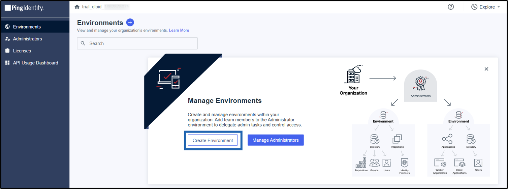

   The Create Environment screen is displayed.
3. Select **Customer Solution** and then click **Next**.

   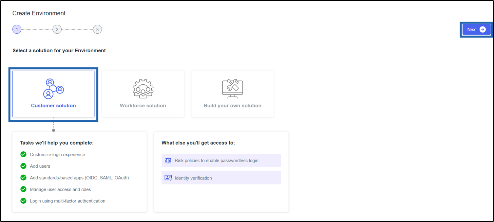

4. Click **Next**.

   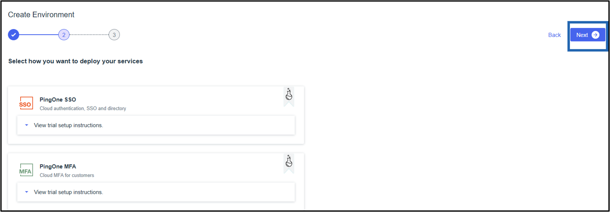

5. Do the following:
   1. Enter **Trial Environment Name**.
   2. Enter **Description (Optional)**
   3. Select **Environment ID**.
   4. Select a **Region**.
   5. Select a **Licence**.
   6. Click **Finish**.

      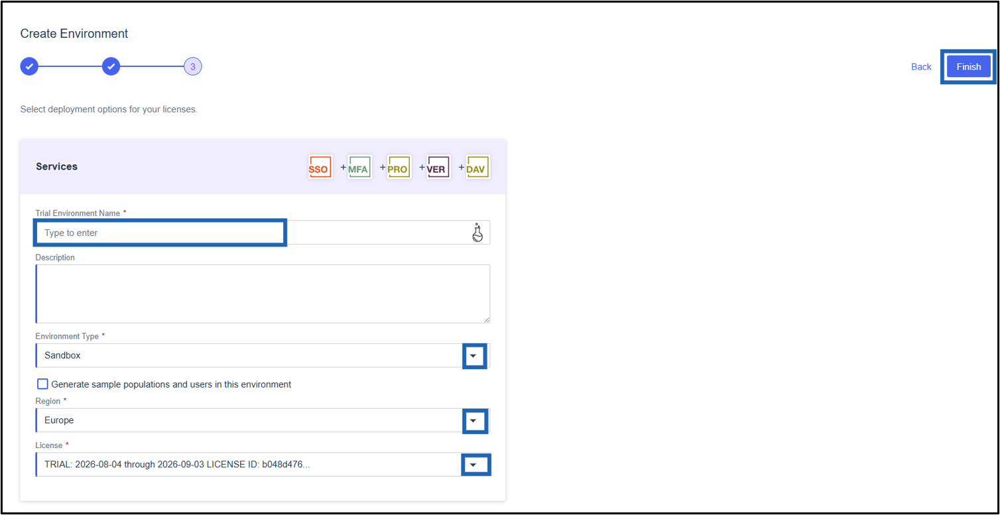

      The environment is created successfully.

### Steps to Create and Configure Application

1. Go to the newly created environment, select **Applications > Applications**.

   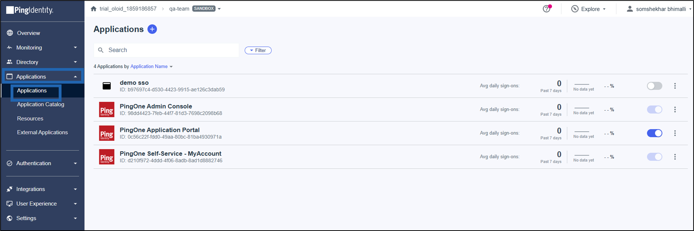

   The application page is displayed.
2. Click Add icon ().

   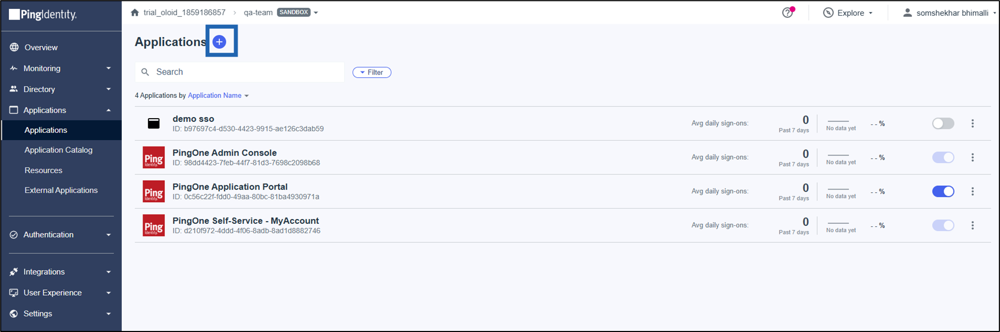

   The **Add Application** page is displayed.
3. Do the following:
   1. Enter **Application Name**.
   2. Enter **Description** (Optional).
   3. Select **OIDC Web App** as the **Application Type**.
   4. Click **Save**.

      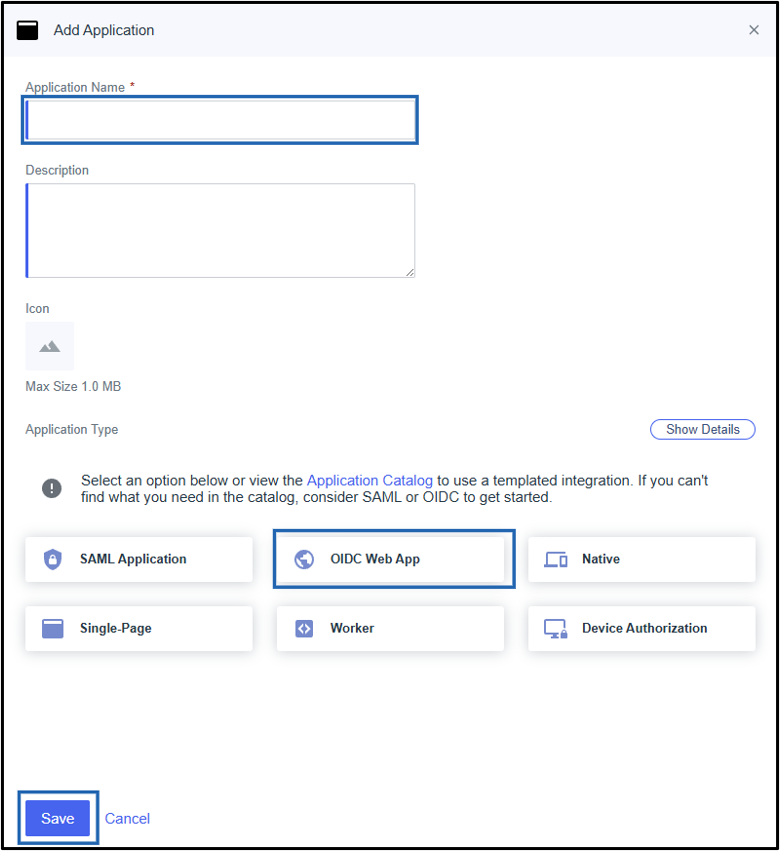

      The application is created successfully.
4. Select the newly created application.

   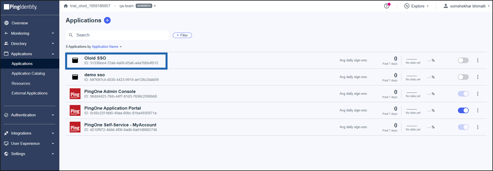

   The Application detail page is displayed.
5. On the application **profile** page, enable the app using the toggle button next to the application name.

   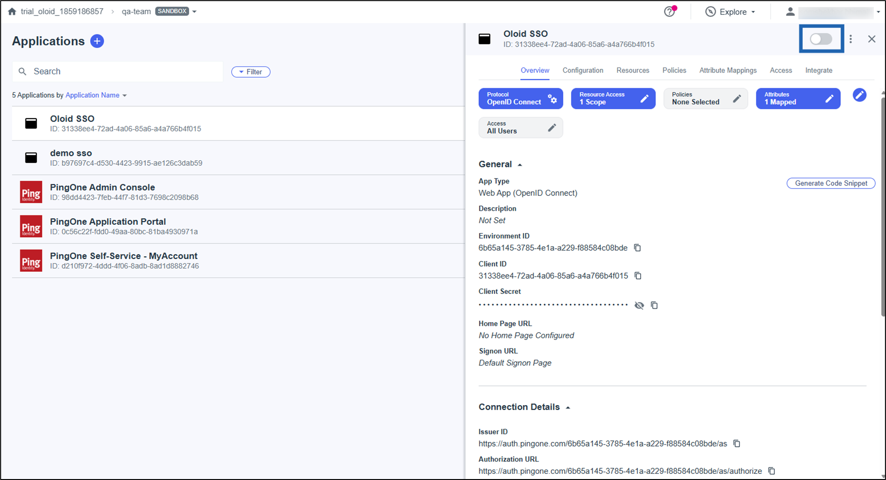

   The app is enabled successfully.
6. Select **Overview** > **OpenID Connect.**

   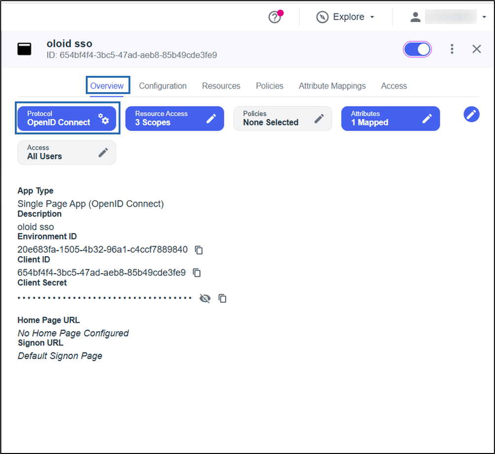

   The **Edit Configuration** screen is displayed.
7. Do the following:
   1. Enter the **Redirect URIs**.

      <Note>
        **Note:** Click **+ Add** to add additional redirect URIs, if required (Optional).
      </Note>

   2. Ensure that **Client Secret Basic** is selected as the **Token Endpoint Authentication Method**.
   3. Enter the **Signoff URL**.

      <Note>
        **Note:** To get the Redirect URI and Signoff URL, go to your **Oloid Portal**, select **Tenant Settings > Security > SSO > PingOne**, and copy the DeviceLock URLs and enter the URLs in the respective field.
      </Note>

      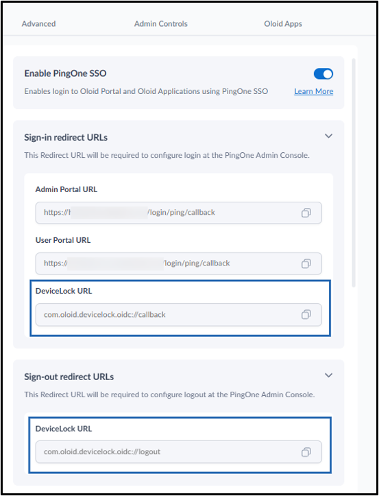

   4. Click **Save**.

      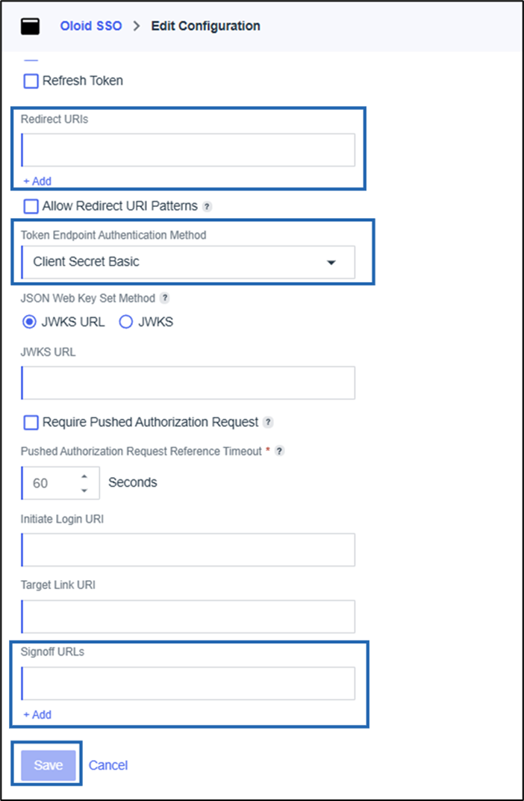

8. In the application overview, click **Resources >** Allowed Scopes **Edit icon.**

   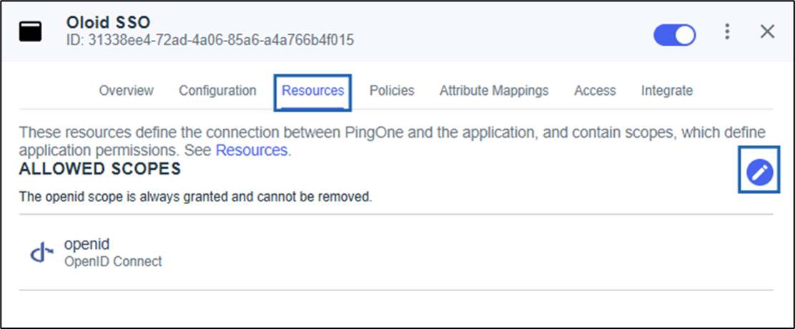

   The **Edit Resources** page is displayed.
9. Select **email >** click **Save**.

   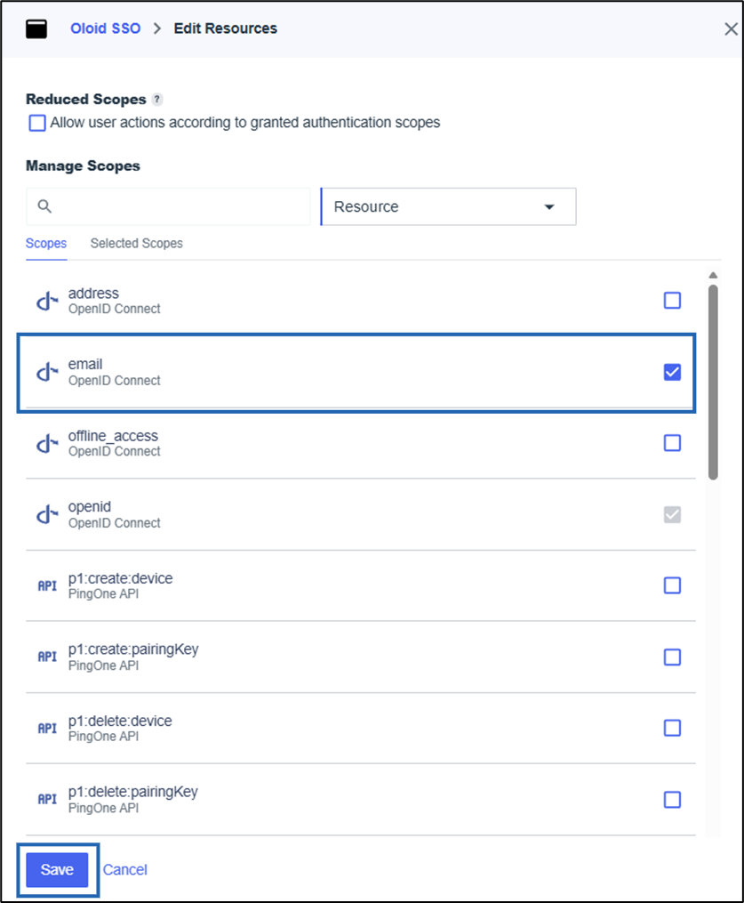

   The **email** is added in the allowed scopes list.

   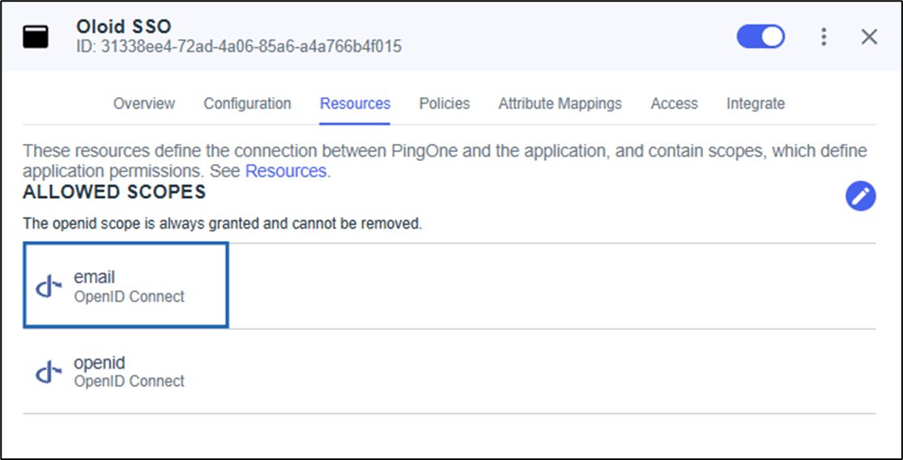

   The PingOne SSO for DeviceLock is configured successfully.

---

### Related Article

[How to configure PingOne SSO in Oloid Portal](/more/sso-and-mfa/tenant-admin-portal-how-to-configure-pingone-single-sign-on-sso-for)
