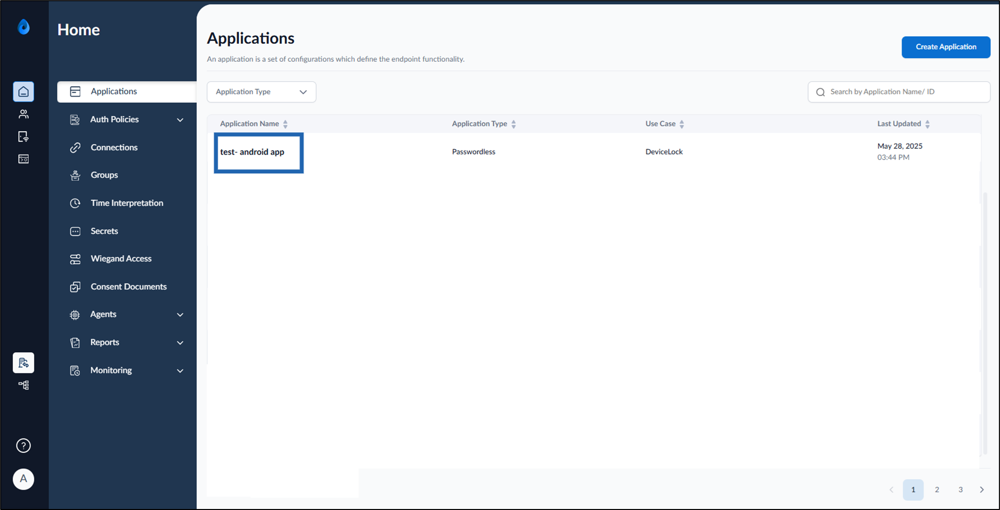
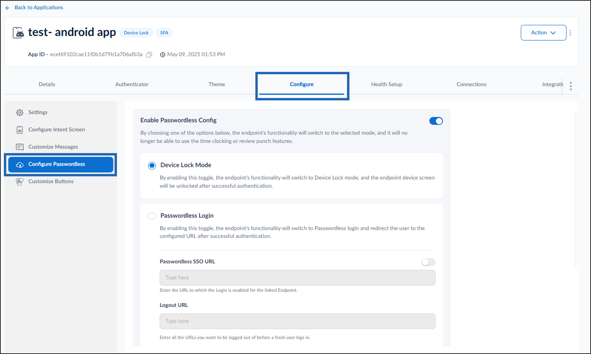
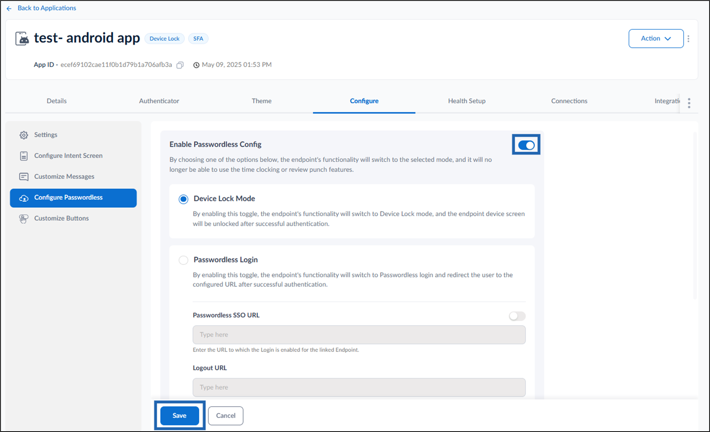
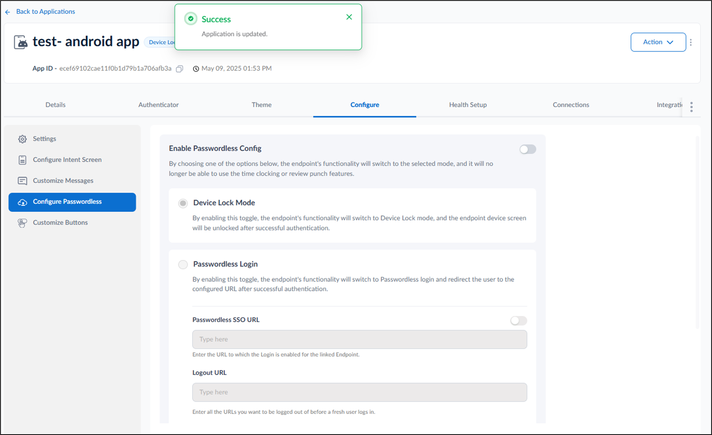

{/* Source: Intercom article 11513752 -  */}
{/* Generated by intercom_to_mintlify.py - re-running overwrites this file. */}

**Steps to enable Time clocking mode:**

1. Log in to the **Tenant Admin Portal**.
2. On the homepage of the portal, click the preferred application from the application list.

   

3. Go to **Configure** tab > click **Configure Passwordless** from the left menu panel.

   

4. Turn off **Enable Passwordless Config** toggle > click **Save**.

   <Note>
     **Note:** Turning off this toggle will automatically enable **Time Clocking** mode and disable **DeviceLock** and **Passwordless Login** mode.
   </Note>

   

   The Time clocking mode is successfully enabled.

   
