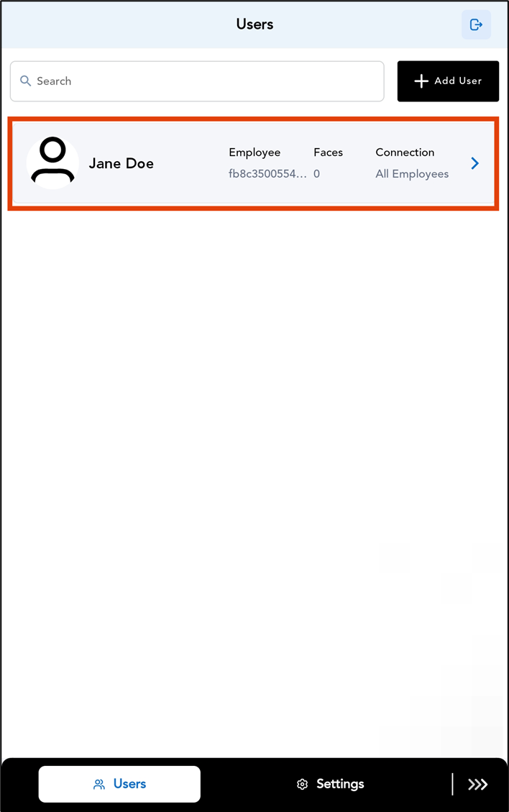

{/* Source: Intercom article 12672438 -  */}
{/* Generated by intercom_to_mintlify.py - re-running overwrites this file. */}

## Introduction

## Steps to enroll Badge

1. Login to the Admin mode in **DeviceLock App.** To login refer[How to log in to admin mode in DeviceLock App](/platforms/android/devicelock/devicelock-app-how-to-log-in-to-admin-mode).
2. Go to **Users** tab > select the preferred user.

   

3. Go to **PIN** tab > tap **Add** PIN.
