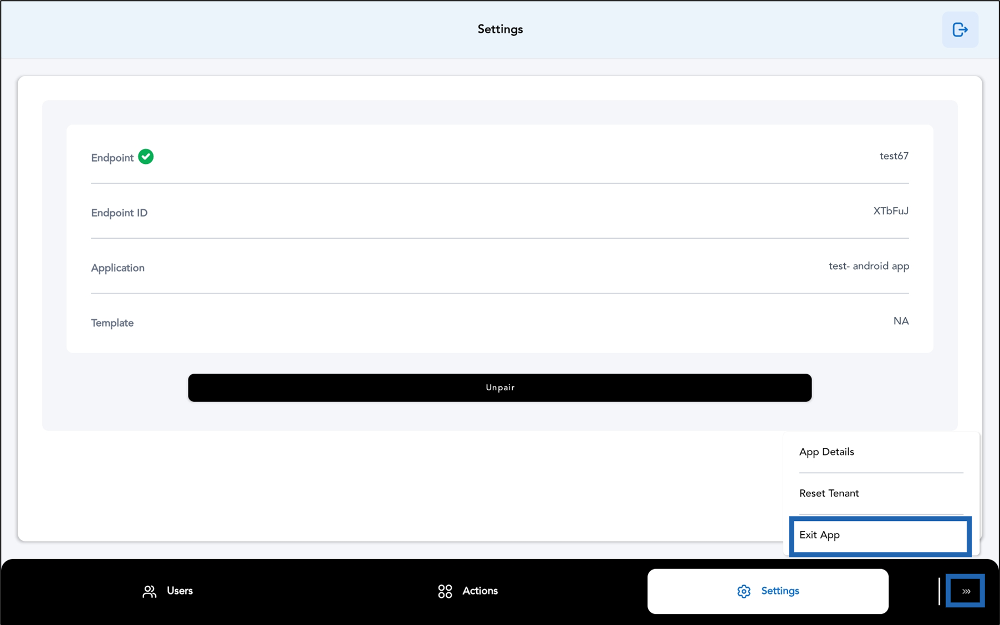
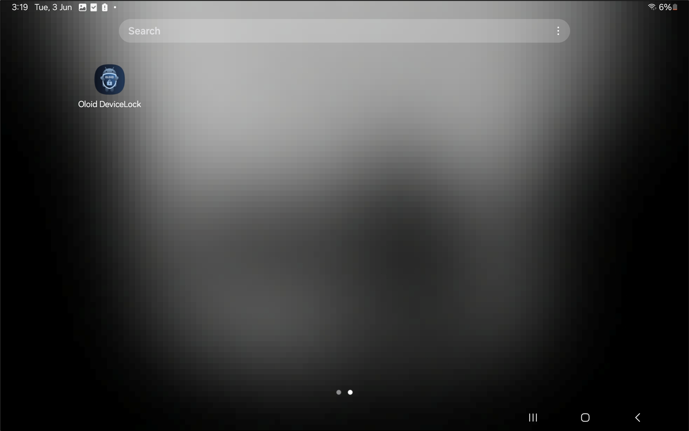

{/* Source: Intercom article 11501488 -  */}
{/* Generated by intercom_to_mintlify.py - re-running overwrites this file. */}

**Steps to exit:**

1. Log in to the **DeviceLock** App.
2. Go to the **Home page** of DeviceLock App.
3. Click **More Option** icon () on bottom-right side of the screen> click **Exit App**.

   

   <Note>
     **Note:** By clicking **Exit App**, you will be logged out and the app will close.
   </Note>

   

   You have successfully exited the DeviceLock App.
