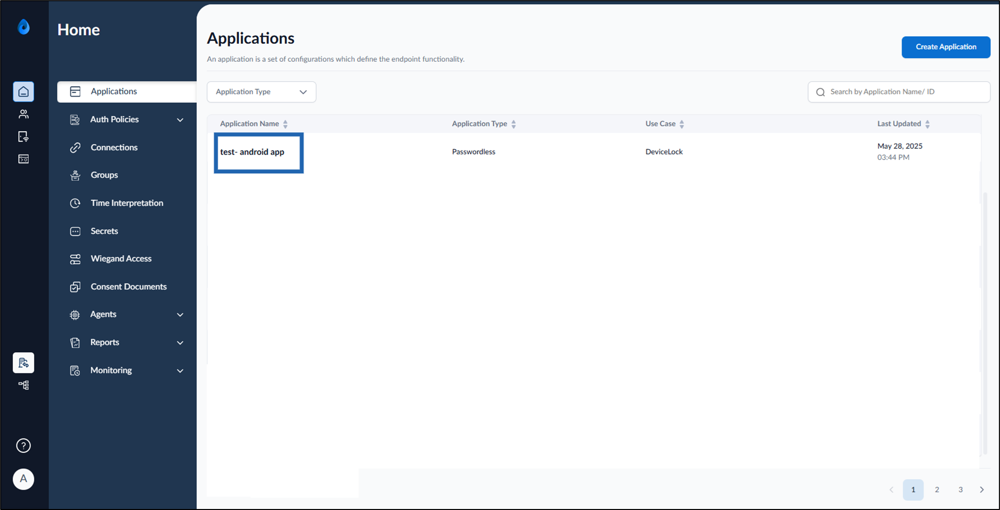
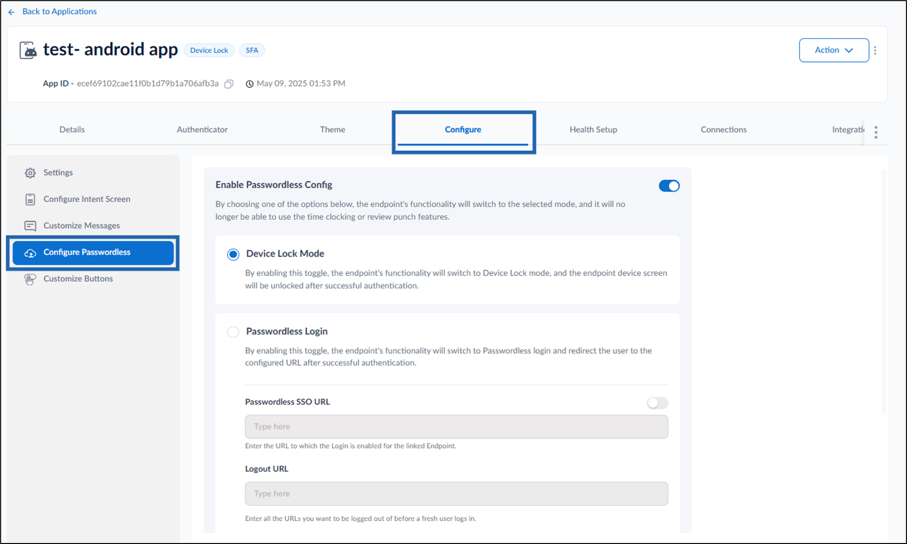
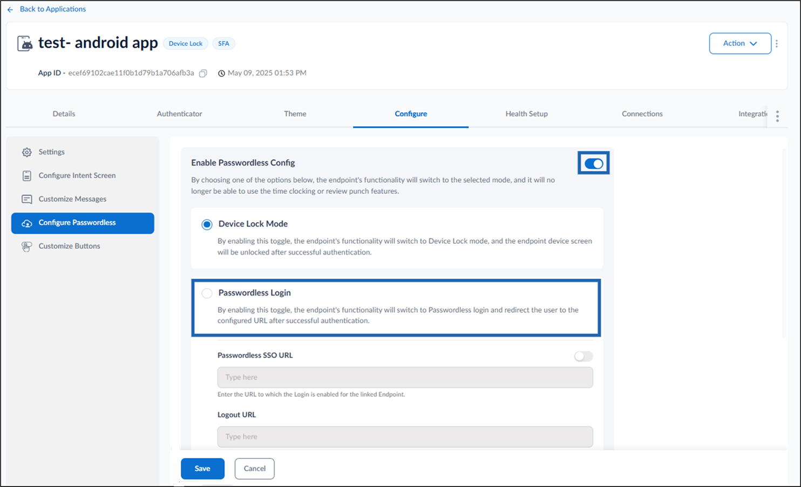
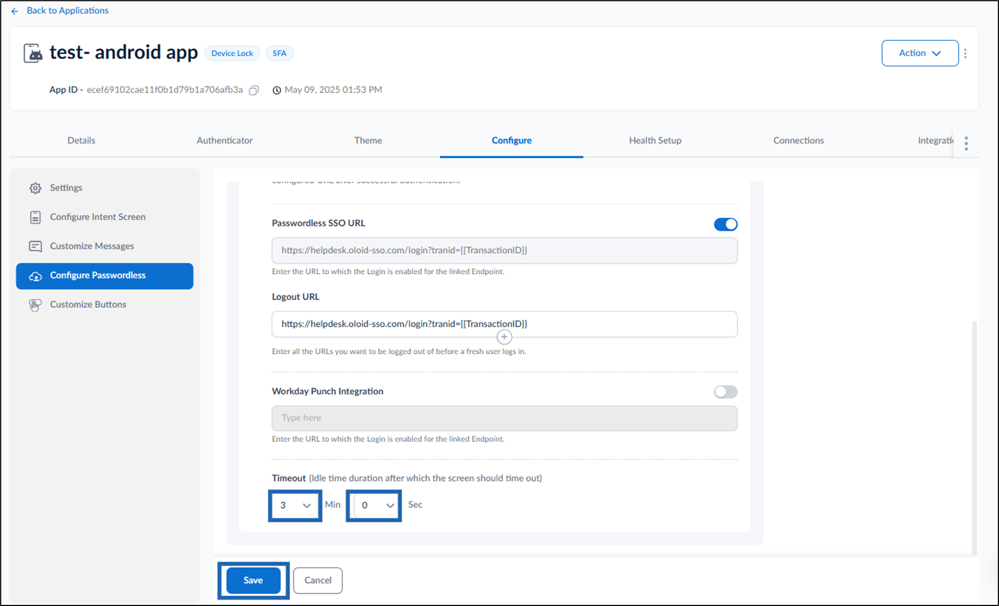
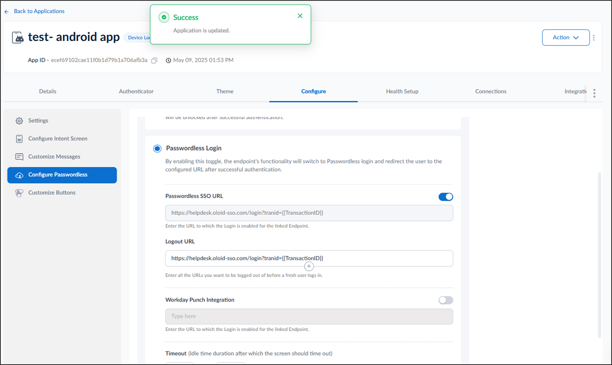

{/* Source: Intercom article 11560127 -  */}
{/* Generated by intercom_to_mintlify.py - re-running overwrites this file. */}

## Introduction

Screen timeout duration refers to the idle time after which the device screen automatically times out. Configuring this setting help ensures efficient device usage in DeviceLock mode.

## Prerequisite

You must have an active tenant and access to the Tenant Admin Portal. For more details refer [How to log in to the Tenant Admin Portal](/platform/tenant-admin-portal/tenant-admin-portal-how-to-log-in-to-the-tenant-admin-portal).

## Steps to set screen timeout duration

1. Log in to the **Tenant Admin Portal**. For more details refer [How to log in to the Tenant Admin Portal](/platform/tenant-admin-portal/tenant-admin-portal-how-to-log-in-to-the-tenant-admin-portal).
2. On the homepage of the portal, click the preferred application from the application list.

   

   The application detail page is displayed.
   (Add Screenshot here)
3. Go to **Configure** tab > click **Configure Passwordless** from the left menu panel.

   

   The configure passwordless screen is displayed.,
   (Add screenshot here)
4. Do the following:
   1. Turn on **Enable Passwordless Config** toggle.
   2. Select **Passwordless Login**.

      

5. Scroll down and select the duration in **minutes** and **seconds** from the drop-down list or manually enter the value in the field to define the duration the screen should remain active before it times out.
6. Click **Save**.

   

   The screen timeout duration is set successfully.

   
