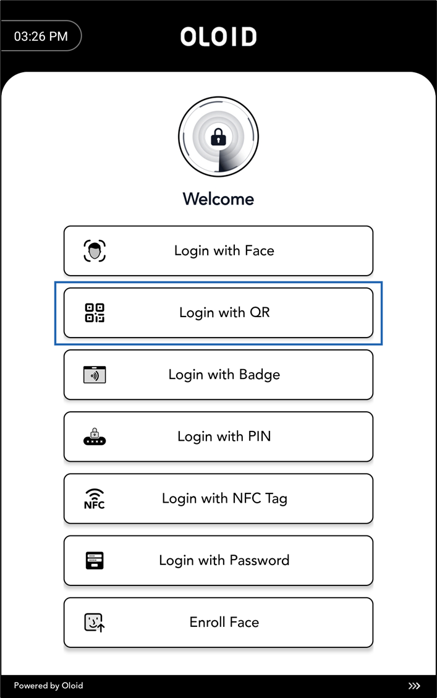

{/* Source: Intercom article 12116099 -  */}
{/* Generated by intercom_to_mintlify.py - re-running overwrites this file. */}

## Introduction

The **Oloid DeviceLock app** secures your Android device by requiring QR code authentication to unlock it. The app displays a QR code scanner, prompts you to scan the assigned code, and verifies your identity. Once authentication succeeds, the app unlocks the device and grants access instantly.

## Prerequisite

You must have your assigned QR code available for scanning.

## Steps to unlock

1. Press the power button or tap the screen.
   The Welcome screen is displayed.
2. Tap **Login with QR**.

   
