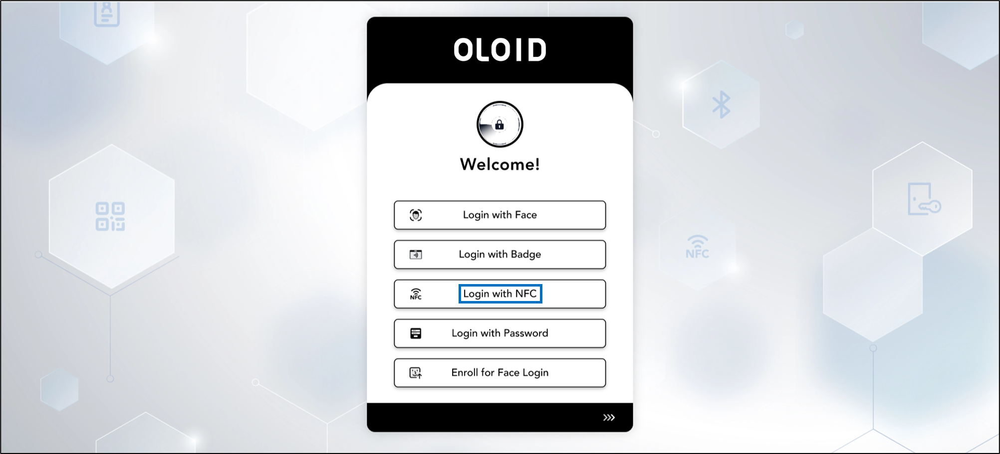
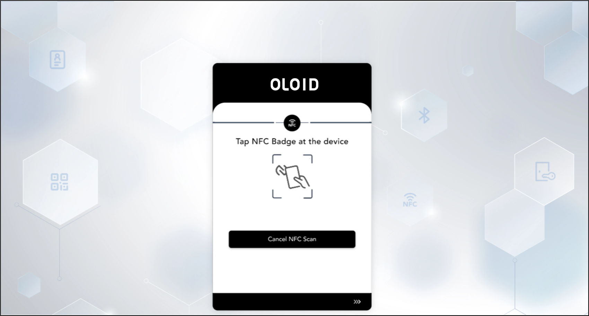
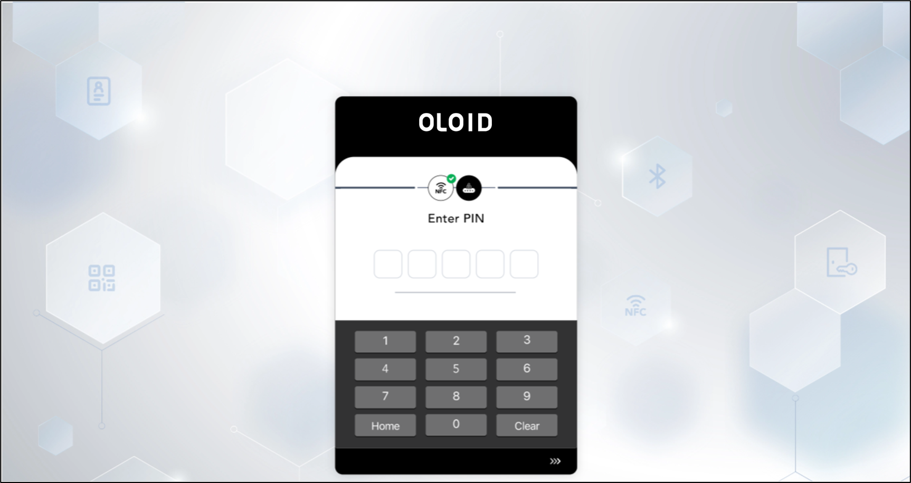
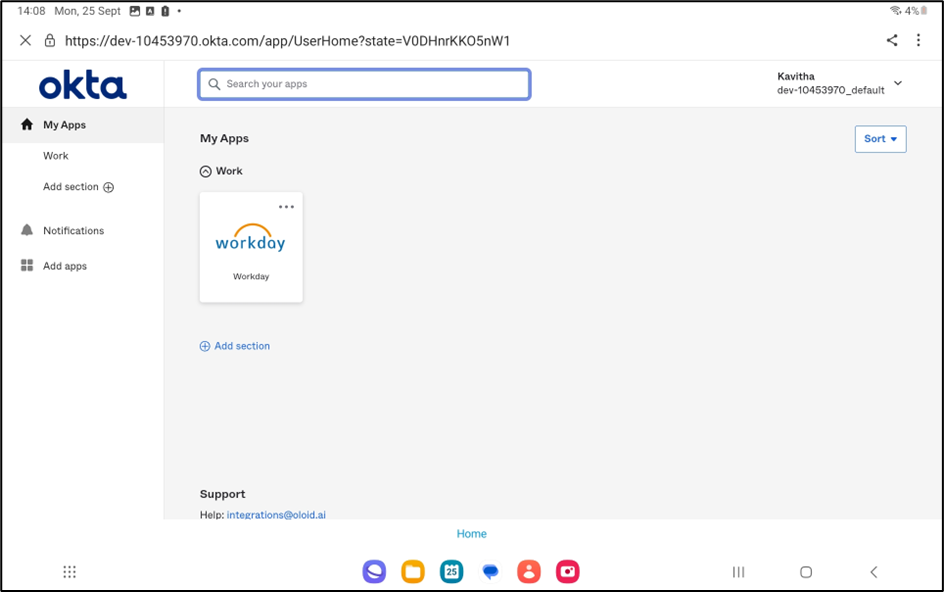

{/* Source: Intercom article 8611576 -  */}
{/* Generated by intercom_to_mintlify.py - re-running overwrites this file. */}

This document provides instruction to log into your Okta account using MFA.

Devicelock supports MFA using NFC badge and pin.

To set up your Oloid portal for the Multi-factor authentication, refer **[Credential Sequencing for Multi-factor authentication in Oloid DeviceLock](/drafts/more/passwordless-authenticator/factor-sequencing-for-multi-factor-authentication-in-oloid-device)**.

## Pre-requisite

- You must have an Okta account.
- You must have an NFC-enabled Android tab.

## Steps to log in using multi-factor authentication

1. Launch the **DeviceLock** app.
2. On the home page of the app, tap **Login with NFC**.

   

   The **Tap NFC Badge at the device** page is displayed.

   

3. Tap the NFC Badge behind the device to scan it.
   On the NFC Badge authentication, the **Enter PIN** pop-up box is displayed.

   

4. Enter the Pin.
   On Pin authentication, you are signed in to the Okta system.

   
